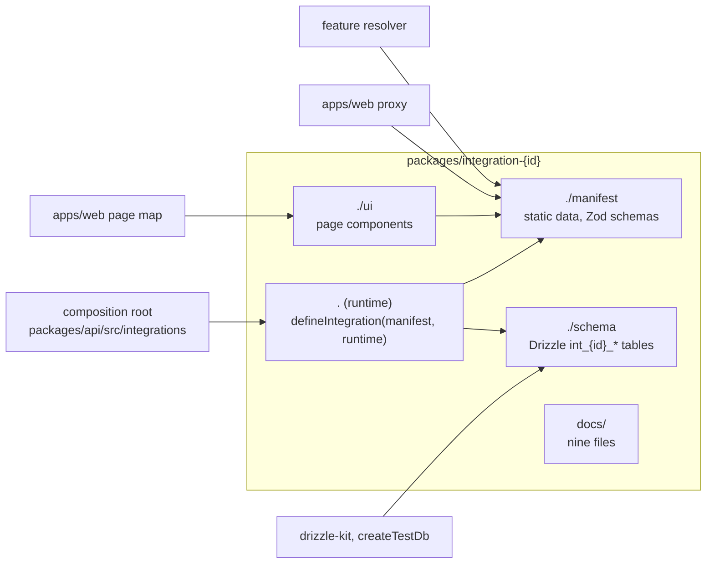
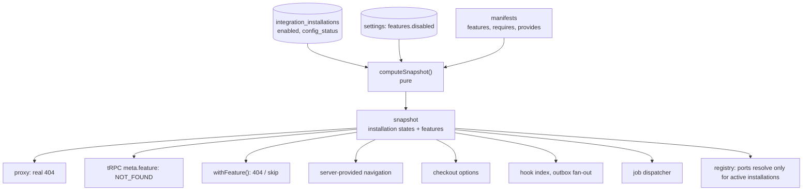
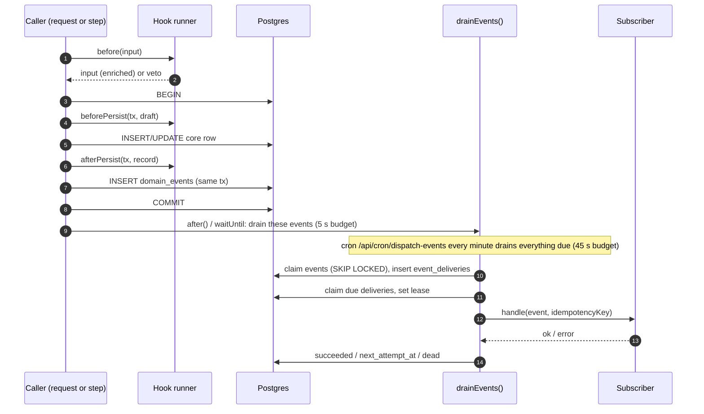
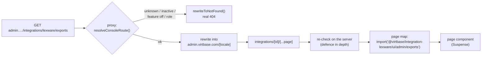
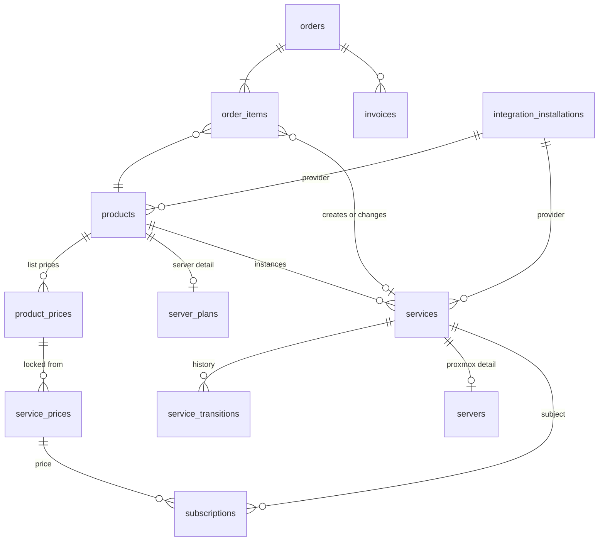
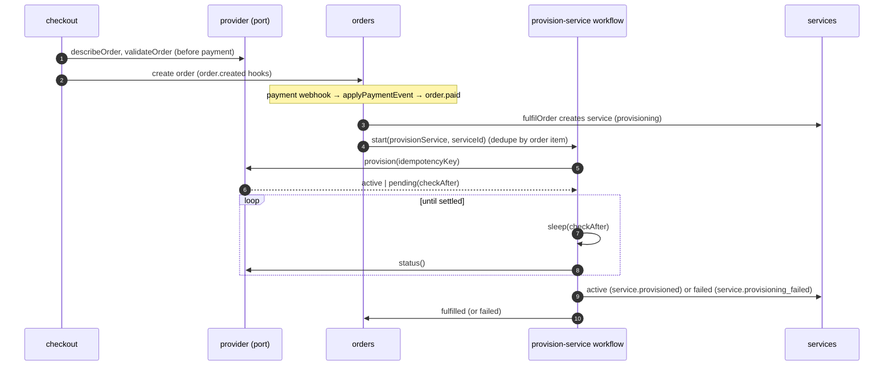

# Integration-first Virtbase

Status: **accepted** on 2026-10-11 (Phase 0 deliverable). Verified against
`a69165e7` on 2026-10-11; `a69165e7` changes only MCP configuration on top of the `5c728c17`
the brief was written against.

This document describes the target architecture for R1 to R10.

- **Why each choice was made:** the options and reasons are in the
  [ADRs](adr/).
- **Decisions:** what was decided before Phase 1, all as recommended, is in
  [decisions.md](decisions.md).
- **How code is written:** the rules every phase follows are in the
  [style guides](../style/README.md).
- **Getting there:** existing data moves as described in
  [migration-plan.md](migration-plan.md).
- **What can go wrong:** risks, pre-existing defects and rollback are in
  [risks.md](risks.md).
- **Environment:** every environment variable and configuration constant is
  classified in [env-inventory.md](env-inventory.md).

## Contents

1. [Summary](#1-summary)
2. [Where we start](#2-where-we-start)
3. [Principles](#3-principles)
4. [The integration manifest (R6)](#4-the-integration-manifest-r6)
5. [Installations and features (R1)](#5-installations-and-features-r1)
6. [Events and hooks (R2)](#6-events-and-hooks)
7. [Pages, procedures and routes (R3)](#7-pages-procedures-and-routes-r3)
8. [Integration data (R4)](#8-integration-data-r4)
9. [Settings and configuration (R5)](#9-settings-and-configuration-r5)
10. [Security (R7)](#10-security)
11. [Products, services and provisioning (R8)](#11-products-services-and-provisioning)
12. [Documentation (R9)](#12-documentation-r9)
13. [Quality gates (R10)](#13-quality-gates)
14. [Testing strategy](#14-testing-strategy)
15. [Phases](#15-phases)

## 1. Summary

Integrations today are adapters behind twelve ports. After this programme they
are the unit the product is assembled from.

| | Today | After |
| --- | --- | --- |
| Definition | `defineIntegration()` is a cast; no version, features or dependencies | a versioned manifest (`apiVersion: 2`) split across four entry points: manifest, runtime, UI, schema |
| Features | each caller copes with a `null` port in its own way; payments are gated by environment variables | one resolver; a disabled feature disappears from navigation, routing (a real 404), procedures, crons, jobs and checkout |
| Events | `DomainEvent` declared, never emitted; 18 abuse notifications and 19 direct email sends are called imperatively | a typed catalogue, four hook phases, and a transactional outbox drained after commit and every minute |
| Pages | none | admin and customer pages through one catch-all per surface, typed procedures under `integrations.<id>`, authenticated route handlers |
| Data | integrations read core tables directly (Discord, Prometheus, Stripe) | owned `int_<id>_*` tables in the one migration history, declared requirements on core entities, a privacy contract |
| Configuration | integration config in Postgres, but Stripe, Anonpay, email, AI and noVNC in the environment; `defineSettings` unused | global settings in namespaces, secret settings, an audit log, an import script, a CI gate on `process.env` |
| Products | virtual servers only | a product catalogue, services with a lifecycle, a `provisioning` port; Proxmox behind it, Pelican as a reference |
| Installations | one per integration | several, where an integration opts in |

What does not change:

- Integrations remain first-party workspace packages compiled into the app.
- The order and subscription state machines, `order_transitions`, the payment
  ledger, the reconcilers, claim-by-insert renewals and the dunning ladder stay
  as they are.
- Envelope encryption stays as it is, and so does the webhook rule: the
  dispatcher never reads a body.

| Requirement | Section | ADRs |
| --- | --- | --- |
| R1 features | [§5](#5-installations-and-features-r1) | [0002](adr/0002-several-installations-per-integration.md), [0007](adr/0007-features-and-effective-state.md) |
| R2 events | [§6](#6-events-and-hooks) | [0001](adr/0001-event-names-use-dots.md), [0004](adr/0004-event-catalogue-package.md), [0005](adr/0005-hook-phases.md), [0006](adr/0006-outbox-delivery.md) |
| R3 pages | [§7](#7-pages-procedures-and-routes-r3) | [0008](adr/0008-integration-pages-and-routes.md), [0009](adr/0009-integration-procedures.md) |
| R4 data | [§8](#8-integration-data-r4) | [0010](adr/0010-integration-data.md) |
| R5 settings | [§9](#9-settings-and-configuration-r5) | [0011](adr/0011-global-settings.md), [0014](adr/0014-social-login-stays-in-env-for-now.md) |
| R6 manifest | [§4](#4-the-integration-manifest-r6) | [0003](adr/0003-manifest-v2.md), [0018](adr/0018-translation-standard.md), [0019](adr/0019-integration-jobs-dispatcher.md) |
| R7 security | [§10](#10-security) | all of the above |
| R8 products | [§11](#11-products-services-and-provisioning) | [0012](adr/0012-products-and-services.md), [0013](adr/0013-proxmox-stays-core-for-now.md), [0015](adr/0015-reference-provider-skeletons.md) |
| R9 docs | [§12](#12-documentation-r9) | [0016](adr/0016-integration-docs-in-the-admin-console.md) |
| R10 gates | [§13](#13-quality-gates) | [0017](adr/0017-proxmox-e2e-on-proxbase.md), [0020](adr/0020-coverage-gate.md) |

## 2. Where we start

The facts below shaped the design. Each one was read from the code at the
commit above.

### Integration platform

- **The definition.** `IntegrationDefinition`
  (`packages/integration-sdk/src/types.ts`) has identity, settings, secrets,
  `provides`, `webhooks`, `onEnable`, `onDisable`, `localize` and `health`.
  `defineIntegration()` is a cast, and the registry erases types.
- **The registry.** It caches resolved configuration for 30 s per process
  (`registry.ts`). `DbConfigSource` has no `onChange`, so other instances see a
  change only when the cache expires.
  - `health()` runs every probe in one `Promise.all`, with no timeout.
  - "Check now" probes every integration, including Discord's sync, which writes
    to Discord.
  - `onDisable` never runs: the admin action stores `enabled = false` first, and
    no context is built for a disabled integration.
- **The composition root** registers ten integrations
  (`packages/api/src/integrations/index.ts`), including the internal `core`,
  which provides `serverManagement`, `notifications` (email) and `signals`.
- **Ports in use.** Of the twelve ports, nothing consumes `metrics` or
  `ipReputation`, and nothing provides `events` or `objectStore`. The `payment`
  port's `createPayment`, `verifyWebhook` and `refund` have no callers; checkout
  and both payment webhooks use environment variables and the Stripe and
  Anonpay packages directly, at 15 import sites.
- **Database access.** Three integrations read core tables: Discord (`accounts`,
  `users`, `servers`), Prometheus (nine tables) and Stripe
  (`users.stripe_customer_id`).
- **Outbound HTTP.** No integration sets a timeout. Two leak a secret into an
  error message: Anonpay's webhook secret through a query string, and Discord's
  interaction token through `DiscordApiError`.
- **Admin management** is next-safe-action server actions
  (`apps/web/src/features/admin/api/integrations/update-integration.ts`), checked
  by the admin session and never by step-up.

### Configuration

- **Storage.** `integration_installations.integration_id` is unique. Secrets
  are AES-256-GCM, with a data key per installation wrapped by
  `CONFIG_ENCRYPTION_KEY` (`packages/config`).
- **Settings.** `SettingsStore` and `defineSettings` exist and are not called
  anywhere.
- **Where the encryption key is read.** `CONFIG_ENCRYPTION_KEY` is read in four
  places: the composition root, the notification target store, order secrets,
  and the abuse mailbox address, where it is a fallback.
- **Proxmox credentials.** Node API tokens are stored in plain text
  (`proxmox_nodes.token_secret`). They pass through workflow inputs, which puts
  them in the workflow event log.

### Events and side effects

- **The event plumbing is unused.** The `events` port has no provider and no
  consumer, and `@virtbase/events` does not exist.
- **The dispatcher is called only from abuse code.** All 18 domain calls of
  `dispatchNotification()` are abuse. It uses the global `db`, so it can never
  join a caller's transaction, and it delivers inline with a 10 s timeout per
  channel.
- **Everything else sends mail directly.** Orders, servers, backups, billing,
  privacy and auth make 19 direct email sends. Six of them carry a secret (OTP,
  magic link, reset or verification link, deletion token, or a root password)
  and must stay synchronous.
- **Abuse writes run without transactions,** apart from the two mailbox paths.
- **One backup call runs inside a transaction:** `vzdump` is started inside one.
- **Customer webhooks do not exist.** The `webhook` integration is an
  operator-only notification channel, signed with
  `X-Virtbase-Signature: sha256=HMAC(secret, "<ts>.<body>")`.
- **Observability is thin.** Sentry has no manual spans,
  `packages/api` makes 55 bare `console.*` calls, and integrations use a
  `consoleLogger` stand-in.

### Web

- **What the proxy sees.** Its matcher skips `/api`, `/_next` and any path with
  a dot, so tRPC, route handlers, webhooks and crons are never gated there.
- **How the proxy reads sessions.** It imports `@virtbase/auth` directly so that
  it never loads the registry, and it may run in its own process.
- **The two dashboards.** The admin dashboard layout blocks on
  `verifyRenderSession()`. The customer dashboard layout is entirely static
  shell, so only the proxy can return a real 404 there.
- **Navigation.** All four menus are hard-coded client arrays.
- **tRPC.** It has no `adminProcedure`; step-up exists only for the customer
  privacy procedures.
- **Translations.** `experimental.srcPath` lists seven integration packages
  (not Stripe or Anonpay), and no test checks that the list is complete.
- **A definition leaks into the browser.** A client component imports the
  Anonpay barrel, which ships the integration definition and its Zod schemas.

### Commerce

- **Orders.** `orders.type` is never branched on; the code switches on
  `configuration.type`, a jsonb field carrying plan IDs without foreign keys.
  Each order has one item.
- **Prices.** `server_plan_prices` is a per-purchase price lock, not a price
  list.
- **Subscriptions** are polymorphic in their columns but restricted to
  `'server'` by a check constraint, and they reference `server_plan_prices`.
- **Fulfilment.** A paid order turns `fulfilled` as soon as its workflow
  starts. A failed provision leaves a paid order and no row.
- **Invoices** are not linked to orders, and `generateInvoiceStep` is not
  idempotent.
- **Workflows.** All nine workflow starts commit first and then enqueue, with no
  dedupe key.
- **Migrations** run during the Vercel build while the previous deployment
  serves (`vercel.json`). Expand/contract is mandatory.

### Proxmox

- **Size.** About 80 files and 10,000 lines.
- **Context.** It is wired into the tRPC context (`ctx.instance`), and serves 36
  procedures and 35 public REST paths.
- **The layer plan** puts it in Layer 3, not Layer 4.
- **Workflow step IDs embed the module path,** so moving a workflow file breaks
  runs that are in flight.

### Tests and CI

- **The Build job is red.** It has timed out at 30 minutes on every push to
  `main` since `736beedc`, in "Compile the web app". The last green run took
  130 s. Any gate placed after that step does not run, including the
  translation-catalogue check.
- **Bun cannot enforce package coverage totals**
  ([ADR 0020](adr/0020-coverage-gate.md)). Current totals range from 57 % (SDK)
  to 100 %. Stripe, Anonpay and `ports` have no tests.
- **Test databases skip the migrations.** `createTestDb()` pushes the
  TypeScript schema. Eight of the 35 migrations contain hand-written data SQL
  that has never run against data.
- **E2E cannot configure an integration:** CI sets no `CONFIG_ENCRYPTION_KEY`.
  Its specs run in parallel on one shared database.
- **Scripts.** `bun script` always exits 0, drops shell variables, and has no
  stdin.

The defects found along the way are listed with a proposed phase in
[risks.md](risks.md#pre-existing-defects).

## 3. Principles

1. **One mechanism per concern.** Core features use the feature resolver too,
   core events use the outbox too, and the `core` integration declares its
   capabilities like any other.
2. **Layering is enforced, not described.** Every new boundary is a
   dependency-cruiser rule or a test in the PR that introduces it.
3. **Integrations are first-party code.** The manifest describes them, and does
   not sandbox them. Loading third-party code at runtime is out of scope, and
   the SDK documentation says so.
4. **The environment holds bootstrap values only.** Everything an operator can
   change lives in the database and is edited in the admin console.
5. **Every schema change is expand/contract.** Each release must work against
   the schema of the next one.
6. **Use what is already here:** Zod, Drizzle, Workflow DevKit, next-intl,
   better-auth, Biome and dependency-cruiser. The event bus is a catalogue, two
   tables and a function.
7. **Disabled means gone:** no menu entry, a real 404, `NOT_FOUND` from tRPC,
   and no cron, job, hook or checkout option.
8. **Every guarantee has a test.** Each claim in this document names the test
   or gate that keeps it true ([§13](#13-quality-gates)).

## 4. The integration manifest (R6)

### 4.1 Package anatomy



Each entry point's allowed imports are enforced
([ADR 0003](adr/0003-manifest-v2.md)). The manifest never imports the runtime,
and the UI never imports the runtime or the schema.

### 4.2 The manifest

```ts
// @virtbase/integration-sdk/manifest
export interface IntegrationManifest {
  apiVersion: 2;
  id: string;                      // [a-z][a-z0-9-]*; never starts with "intg_"
  version: `${number}.${number}.${number}`;
  name: string;                    // untranslated fallback for logs and health output
  description: string;
  category: IntegrationCategory;
  icon?: string;                   // a key; apps/web maps it to a component
  author?: string;
  links?: { website?: string; providerDocs?: string; support?: string };
  docs: "./docs";                  // checked by the conformance suite
  internal?: boolean;
  multiInstance?: boolean;         // ADR 0002
  requires?: {
    apiVersion?: string;           // semver range of the core contract, e.g. "^2.0.0"
    features?: FeatureId[];
    ports?: PortName[];
  };
  provides?: readonly PortName[];  // names; factories are runtime
  features?: Record<string, FeatureDeclaration>;      // ADR 0007
  events?: Record<`${string}.${string}`, EventDeclaration>; // own events, "<id>." prefix
  settings?: ValueDescriptor & { migrations?: SettingsMigration[] };
  secrets?: ValueDescriptor;
  data?: {
    idPrefixes?: readonly `${string}_`[];
    tables?: Record<string, { subject?: "user" | "service"; pii: "none" | "personal" | "sensitive" }>;
    requirements?: DataRequirement[];                 // ADR 0010
  };
  hooks?: Record<string, HookDeclaration>;            // event glob, phase, policy, timeout, priority
  pages?: PageDeclaration[];                          // ADR 0008
  jobs?: Record<string, { schedule: string; timeoutMs: number; feature?: FeatureId }>; // ADR 0019
}
```

`defineManifest()` keeps the literal types, so a hook name, a page path or a job
id declared here is a key the runtime must implement.

### 4.3 The runtime

```ts
// @virtbase/integration-sdk
export function defineIntegration<const M extends IntegrationManifest>(
  manifest: M,
  runtime: IntegrationRuntime<M>,
): IntegrationDefinition<M>;

export interface IntegrationRuntime<M extends IntegrationManifest> {
  provides: { [K in ProvidedPorts<M>]: (ctx: IntegrationContext<M>) => PortMap[K] };
  hooks: { [K in HookNames<M>]: HookHandler<M, K> };
  jobs: { [K in JobIds<M>]: (ctx: IntegrationContext<M>) => Promise<void> };
  webhooks?: IntegrationWebhook<M>[];       // unchanged semantics: raw Request, integration verifies
  procedures?: ProcedureDeclarations<M>;    // ADR 0009
  routes?: RouteDeclaration<M>[];           // ADR 0008
  privacy: PrivacyHandlers<M>;              // required by type when data.tables holds personal data
  health?: { budgetMs?: number; check(ctx: IntegrationContext<M>): Promise<HealthResult> };
  lifecycle?: {
    onInstall?(ctx: IntegrationContext<M>): Promise<void>;
    onEnable?(ctx: IntegrationContext<M>): Promise<void>;
    onDisable?(ctx: IntegrationContext<M>): Promise<void>;
    onUninstall?(ctx: IntegrationContext<M>): Promise<void>;
  };
  localize: () => Promise<IntegrationMessages<M>>; // ADR 0018; every declared string is a required key
}
```

`hooks`, `jobs` and `privacy` resolve to `{}` (optional) when the manifest
declares nothing that needs them.

### 4.4 The context

```ts
export interface IntegrationContext<M extends IntegrationManifest> {
  readonly integration: { id: M["id"]; version: string };
  readonly installation: { id: string; slug: string; label: string };
  readonly settings: SettingsOf<M>;     // parsed, possibly migrated
  readonly secrets: SecretsOf<M>;       // parsed; never logged, never in errors
  readonly logger: IntegrationLogger;   // structured, prefixed, redacting
  readonly http: IntegrationHttp;       // timeout, retry, redaction, breadcrumbs, no-tx guard
  readonly ports: PortAccessor;         // resolve/require, honouring effective state
  readonly events: { emit<T extends OwnEventType<M>>(type: T, payload: EventPayload<T>): Promise<void> };
  readonly ids: { create(prefix: IdPrefix<M>): string };
  readonly data: DataRequirementAccessor<M>;   // declared requirements, scoped to own keys
  readonly db: IntegrationDatabase<M>;         // own tables only (by import rules)
  readonly tx?: IntegrationTransaction<M>;     // set inside beforePersist / afterPersist
  readonly settingsOf: SharedSettingsReader;   // read-only shared settings, e.g. company.*
  readonly waitUntil: (promise: Promise<unknown>) => void;
}
```

### 4.5 Standards

| Concern | Standard |
| --- | --- |
| Errors | `IntegrationError { code: "<id>.<reason>", retryable, params, cause }`. Codes are stable and translated by `localize().errors`. Adapters translate provider errors into it; ports keep `PortError` for callers. |
| HTTP | `ctx.http.request()`: 10 s default timeout (at most 30 s); full-jitter retries for idempotent methods only; every declared secret and every query string redacted from errors and logs; a Sentry breadcrumb per request; refuses to run inside a transaction scope. A provider SDK gets the same timeout and retry policy through its own options. |
| Health | `ok` = it works; `degraded` = it works with reduced capability (quota low, optional capability missing); `error` = it does not work. Budget 5 s by default, at most 15 s, enforced by the registry, which reports a timeout as `error`. A probe has no side effects at the provider and spends no paid quota. "Check now" probes one installation. |
| Logging | `ctx.logger` only. Structured fields, prefixed with `integration` and `installation`, with the same redaction as HTTP. No `console.*` in integration code (a Biome override). |

### 4.6 Lifecycle

| Hook | When | Context |
| --- | --- | --- |
| `onInstall` | the first time an installation is saved | built from stored configuration |
| `onEnable` | after the enabled flag is stored | built even when the flag was off |
| `onDisable` | **before** the enabled flag is cleared | built even when the flag is off; fixes the hook that never runs today |
| `onUninstall` | during uninstall, before rows are purged ([§8.3](#83-lifecycle-and-uninstall)) | built from stored configuration |
| settings migration | on read, when the stored settings are older than `version` | the next save writes the migrated value and an audit entry |

### 4.7 The conformance suite

`@virtbase/integration-testing` exports `describeIntegration(definition, options)`.
Every integration calls it from its own tests. It checks:

1. **The manifest:** it parses; `apiVersion` is 2; `version` is semver; the id is
   valid and unique; `requires` refers to features and ports that exist in the
   composed catalogue; and there are no dependency cycles.
2. **Settings and secrets:** every schema key has a field descriptor and every
   descriptor has a schema key; select options match the enum; secrets use the
   `password` widget; settings migrations run in order and their output parses.
3. **Translations:** `localize()` returns an entry for every field, option,
   page, feature, event, hook-facing error and action
   ([ADR 0018](adr/0018-translation-standard.md)).
4. **Hooks:**
   - every hook's glob matches at least one event in the catalogue;
   - its phase is offered by every event it matches;
   - its policy, timeout and priority are present;
   - in-transaction hooks pass with the throwing `fetch` guard installed;
   - each `after` handler is run twice with the same idempotency key, and the
     test asserts no second effect.
5. **Pages, procedures and routes:** each has an access rule; each procedure
   has an output schema; each page has a component in the page map.
6. **Data:** table and enum names carry the prefix; tables use
   `d.snakeCase.table`; every table has `installation_id`; ID prefixes are
   unique; tables with personal data have privacy handlers; export returns
   JSON-serialisable data; erase leaves no rows for the subject.
7. **Health:** a probe against the integration's mocked back end returns within
   budget, and a probe against a back end that never answers reports `error`
   within budget.
8. **Docs:** the nine files exist, each is longer than its template, and none
   contains template placeholders.
9. **Secrets:** describing, localising and every procedure output for a
   configured installation with sentinel secrets contain no sentinel
   ([§10](#10-security)).

### 4.8 Port contract suites

One suite per port, in `@virtbase/integration-testing/ports/<port>`. Every
implementation runs the suite for each port it provides, against its own mocked
back end.

| Port | The suite proves |
| --- | --- |
| `payment` | `orderId` round-trips; `verifyWebhook` rejects a bad signature, returns `null` for irrelevant events, and maps each relevant one; the optional off-session methods behave as documented (`requires_action` is not a decline; `cancelPayment` is idempotent and throws once succeeded) |
| `invoice` | create, retrieve and download round-trip; `finalize` assigns a number; amounts are gross; the locale falls back sensibly |
| `provisioning` | idempotency of every command; `pending` then `status()`; suspend and unsuspend are reversible; terminate is final; `actions()` is described; `validateOrder` rejects what `provision` would fail on |
| `dns` / `dnsZones` | upsert is idempotent; delete of absent records succeeds; reverse-zone name derivation |
| `notifications` | `supports()` is honest; `send()` rejects on failure; secrets in `target` never reach the logs |
| `identity`, `abuse`, `ipReputation`, `metrics`, `signals` | the documented invariants in their port files, such as the budget being honoured and `covered` being a subset of `targets` |

`serverManagement` and `signals` are provided only by `core`. Their suites live
in `packages/api` and run against the real implementation.

### 4.9 Migrating the existing integrations

All ten, including `core`, move to v2 in Phase 1, with behaviour unchanged
apart from the listed fixes. The v1 types are deleted when the last one moves.
The per-integration plan is in [migration-plan.md §2](migration-plan.md#2-integrations-to-manifest-v2).

## 5. Installations and features (R1)

### 5.1 Installations

Each integration has one or more installations
([ADR 0002](adr/0002-several-installations-per-integration.md)).

- **Multi-instance is opt-in.** An integration may have several installations
  only if it declares `multiInstance`; otherwise it has exactly one, with slug
  `default`.
- **Per installation:** settings, secrets, the enabled flag, effective state,
  health, webhooks, jobs, hook deliveries, owned rows and services.
- **Per integration:** the manifest, features, pages and docs.

### 5.2 Feature catalogue

Features are declared in manifests. The internal `core` integration declares the
core ones:

| Feature | On when | Gates |
| --- | --- | --- |
| `accounts` | always (`alwaysOn`) | sign-up, account settings |
| `ordering` | always | checkout, orders |
| `products.server` | always (core provider, [ADR 0013](adr/0013-proxmox-stays-core-for-now.md)) | server products, `/servers` |
| `abuse.desk` | always | abuse pages and crons |
| `billing.invoices` | an `invoice` provider is active | `/invoices`, the invoice workflow, the invoice email |
| `billing.saved-methods` | a `payment` provider with `chargeOffSession` is active | saved cards, auto-renew opt-in |
| `payments.card` | Stripe is active | the card option in checkout |
| `payments.crypto` | Anonpay is active | the crypto option in checkout |
| `dns.reverse` | a `dns` provider is active | `/servers/[id]/rdns`, the rDNS procedures, PTR cleanup on deletion |
| `abuse.ip-reputation` | an `ipReputation` provider is active | reputation lookups in triage |
| `abuse.polling` | an `abuse` source is active | the poll cron |
| `webhooks.customer` | the webhook integration is active | customer webhook pages ([§6.5](#65-subscribers)) |
| `products.<kind>` | a `provisioning` provider for that kind is active | the kind in checkout, its services |

Integration-specific features are declared by their integration:
`support.discord-bot`, `auth.discord-linked-roles`, `metrics.prometheus`,
`alerts.alertmanager`, `billing.accounting-export`.

### 5.3 Effective state and the snapshot



Each installation is in one of four states:

- `disabled`: the admin switched it off;
- `invalid`: `config_status` shows its stored configuration fails validation;
- `blocked`: something in its `requires` is unavailable;
- `active`: none of the above.

`blocked` is computed, never stored, so re-enabling a dependency brings its
dependents back without a write
([ADR 0007](adr/0007-features-and-effective-state.md)).

### 5.4 Surfaces

| Surface | Check | Answer when off |
| --- | --- | --- |
| Console pages (proxy) | `ROUTE_FEATURES` for core pages, page declarations for integration pages | real 404 via `rewriteToNotFound()`, in the console locale |
| tRPC | `meta.feature` in every builder; `requireFeature()` inside | `NOT_FOUND` |
| Route handlers, webhooks | `withFeature(feature, handler)` | the webhook dispatcher's existing 404 |
| Crons | `withFeature()` on the route | 200 with `{ skipped: "feature-disabled" }`, recorded |
| Integration jobs | the dispatcher reads the snapshot | not claimed |
| Workflows | checked in the first step | new runs end immediately; running ones finish and treat a `null` port as settled |
| Navigation | items carry `feature` | item absent |
| Checkout | methods and kinds filtered | option absent |
| Hooks and outbox | the hook index and fan-out are built from active installations | no hook, no delivery |

### 5.5 Caching and staleness

| Reader | Mechanism | Writer instance | Other instances |
| --- | --- | --- | --- |
| request-path checks (tRPC, server components, routes, crons, jobs, workflows, outbox) | `features.snapshot()` memo, 15 s | immediate | ≤ 15 s |
| port resolution | registry asks the snapshot; settings and secrets cached 30 s | immediate | enablement ≤ 15 s; credentials ≤ 30 s |
| proxy | the same memo in the proxy's module scope | ≤ 15 s (separate process) | ≤ 15 s |
| cached UI (navigation in static shells, public product lists, checkout options) | `'use cache'` + `cacheTag("features")`, `cacheLife({ revalidate: 60 })`, reading the database directly | next request (`updateTag` from the admin server action) | next request on Vercel; ≤ 60 s self-hosted |

The worst case is written down: after a switch is turned off, another instance
may render the page for up to 15 s, and a procedure behind it answers within the
same window. No surface is staler than that, apart from self-hosted cached UI.

### 5.6 Dependencies

`requires: { features?, ports?, apiVersion? }`.

- **Enabling with an unmet requirement is refused.** The admin console names the
  missing requirement and the installed integrations that could provide it.
- **Disabling a provider others depend on asks first,** listing the dependents
  that will become `blocked`.
- **A blocked installation** shows a banner on its admin page, reports health as
  `error`, provides nothing, and runs no hooks or jobs.
- **A cycle in `requires`** fails the conformance suite.

## 6. Events and hooks

### 6.1 The catalogue

`@virtbase/events/catalog` is pure: it holds names, Zod payloads, scope, PII,
`customerVisible`, the synchronous phases offered, and the glob matcher. The
runtime, `@virtbase/events`, writes the outbox
([ADR 0004](adr/0004-event-catalogue-package.md)). Names are dotted
([ADR 0001](adr/0001-event-names-use-dots.md)).

The initial catalogue covers what the brief lists. "Today" is where the state
change happens now.

| Event | Sync phases | Scope / PII / customer-visible | Today |
| --- | --- | --- | --- |
| `user.registered` | `before` | user / personal / no | better-auth `databaseHooks.user.create`; outbox row by sweep ([ADR 0005](adr/0005-hook-phases.md)) |
| `user.deleted` | – | system / none / no | `offboard-user` last step |
| `user.deletion_scheduled`, `user.deletion_cancelled` | – | user / none / no | `privacy/deletion/lifecycle.ts` |
| `order.created` | all three | user / none / yes | `orders/create-order.ts` (one transaction) |
| `order.paid`, `order.fulfilled`, `order.failed` | all three | user / none / yes | `orders/transition-order.ts` |
| `order.cancelled`, `order.refunded` | all three | user / none / yes | no path today; emitted when the abandoned-order and refund paths are added |
| `payment.succeeded`, `payment.failed`, `payment.refunded`, `payment.disputed` | – | user / none / no | `apply-payment-event.ts` (made one transaction in Phase 4) |
| `subscription.created`, `subscription.cancelled`, `subscription.status_changed` | all three | user / none / yes | `transition-subscription.ts` |
| `subscription.renewed`, `subscription.renewal_failed` | – | user / none / yes | renewal settlement, `billing/record-outcome.ts` |
| `subscription.expiring` | – | user / none / yes | `send-renewal-notifications` cron |
| `server.provisioned`, `server.extended`, `server.upgraded`, `server.reinstalled`, `server.deleted` | – (workflow steps; dedupe by step) | user / none / yes | `store-provisioned-server.ts`, `store-server-extension.ts`, `store-server-upgrade.ts`, change-template, `store-server-deletion.ts` |
| `server.suspended`, `server.unsuspended` | – | user / none / yes | `suspend-terminated-servers` cron, extend workflow |
| `server.power_changed` | – | user / none / yes | `router/servers/status.ts`, the Proxmox hookscript webhook |
| `server.backup.created`, `server.backup.failed`, `server.backup.restored` | – | user / none / yes | `backups/reconcile-backup.ts`, restore workflow |
| `invoice.created`, `invoice.sent` | – | user / none / yes | `create-invoice` workflow |
| `abuse.case.opened`, `abuse.case.triaged`, `abuse.case.awaiting_customer`, `abuse.case.customer_replied`, `abuse.case.reporter_replied`, `abuse.case.enforced`, `abuse.case.escalated`, `abuse.case.released`, `abuse.case.resolved` | all three, once Phase 4 wraps the writes in transactions | user or system / **sensitive** (evidence, reporter text) / only `awaiting_customer`, `enforced`, `released` and `resolved`, with a redacted payload | `abuse/*` (map in [migration-plan.md §5](migration-plan.md#5-notifications-and-email-onto-events)) |
| `abuse.signal.unattributed`, `abuse.lock.drift_detected`, `abuse.source.poll_failed`, `abuse.source.poll_incomplete` | – | system / sensitive / no | `abuse/intake.ts`, `enforce.ts`, `poll.ts` |
| `integration.installed`, `integration.enabled`, `integration.disabled`, `integration.configured`, `integration.uninstalled`, `integration.health_changed` | all three | system / none / no; payload lists changed **keys**, never values | admin actions, the health cron |
| `service.*`, `domain.*`, `mailbox.*` | see [§11](#11-products-services-and-provisioning) | | Phase 6 |

**Phase 6 renames the server lifecycle events.** It adds the kind-agnostic
`service.*` lifecycle (`created`, `provisioned`, `provisioning_failed`,
`suspended`, `unsuspended`, `terminated`, `plan_changed`, `renewed`). The
`server.*` lifecycle events become deprecated aliases for one release.
Server-only events (`power_changed`, `backup.*`, `reinstalled`) stay.

**Two kinds of mail never become events.** Mail carrying a credential (OTP,
magic link, reset and verification links, the deletion token, the server-ready
mail with a generated root password) stays in its current synchronous path. So
do request-scoped cache invalidations.

### 6.2 Hook phases

The full contract is in [ADR 0005](adr/0005-hook-phases.md). In short:

| | `before` | `beforePersist` | `afterPersist` | `after` |
| --- | --- | --- | --- | --- |
| where | before the action, no transaction | in the transaction, before the write | in the transaction, after the write | after commit, from the outbox |
| may | veto, enrich input | patch the draft, write own rows | write own rows referencing the record | anything with side effects |
| network | allowed, bounded | forbidden | forbidden | allowed |
| failure | `closed` or `open`, declared | `abort` or `skip` (savepoint), declared | same | retried, then dead-lettered |

### 6.3 Outbox and delivery



The tables, backoff, leases and retention are specified in
[ADR 0006](adr/0006-outbox-delivery.md).

### 6.4 Idempotency

- **Every delivery has a key.** `idempotencyKey = "<eventId>:<subscriber>"` is
  passed to every handler. It is stable across retries and replays.
- **Steps emit exactly once.** Events emitted from a workflow step carry
  `dedupe_key = "wf:<runId>:<stepId>:<type>"`, so a retried step writes nothing
  new.
- **Library-owned writes are swept.** Events that cannot share a transaction
  with their state change (`user.registered`) are emitted by a sweep with a
  natural dedupe key.
- **Tests prove both directions.** Every catalogue event has a test showing it
  is emitted exactly once per state change, matches its schema, and is absent
  when the transaction rolls back. Every subscriber has a test that handles the
  same event twice.

### 6.5 Subscribers

**Notifications** become one core `after` subscriber, `core:notifications`.

- It maps each event to the notification it produces: key, audience,
  severity and params.
- `notification_targets` keep routing by key glob, and keys stay the event
  names they are today (`abuse.case.opened`).
- `notification_deliveries` remains the per-channel log, with its existing
  backoff.
- The stuck-`pending` gap is closed.

**Customer webhooks** are greenfield; there is nothing to migrate.

- The `webhook` integration subscribes to `*` and delivers only events that are
  `customerVisible`, to endpoints owned by the event's `userId`.
- It uses the existing signing scheme, with `X-Virtbase-Delivery` set to the
  event id.
- Endpoints are an owned table (`int_webhook_endpoints`), with a customer page
  to manage them.
- Each endpoint has its own retry job.
- This needs pages and owned tables, so it lands in Phase 5, not Phase 4
  (decision D8).

**Integration hooks** are the declared `after` hooks of active installations.

### 6.6 Observability and the admin event log

**Spans.** Every hook run and every delivery is a Sentry span, with the event
type, integration, installation, phase and outcome.

**Records.**

- Synchronous hook runs go to `hook_runs`, written after the response.
- Deliveries are recorded in `event_deliveries`.

**The admin page `/events`:**

- **Recent events,** filterable by type, user and subject.
- **Each event's deliveries,** with attempts and the last error, which is
  redacted.
- **Failing and dead deliveries,** grouped by subscriber.
- **Synchronous hook outcomes:** vetoes, timeouts and skips.
- **Replay.** Replaying a single delivery is an admin action; replaying in bulk
  requires step-up. A replay keeps the idempotency key.

### 6.7 Moving the imperative calls

One domain at a time, behind golden tests that run the action and compare the
resulting notification deliveries — key, audience, severity, params and
destination — with the recording made before the change
([migration-plan.md §5](migration-plan.md#5-notifications-and-email-onto-events)):

1. **Abuse:**
   - wrap the writes in transactions;
   - emit events;
   - delete the 18 `dispatchNotification()` calls.
2. **Direct email sends that carry no secret:**
   - server lifecycle, suspension, renewal reminders, dunning, invoices, the
     export-ready mail, and the account deletion mails without a token;
   - all move onto the notification subscriber's email channel.
3. **The admin "Send test" stays imperative.** It is not a domain event.

Behaviour that is a bug today, such as the per-case dedupe that silences a
customer's second reply, is preserved by the golden tests first and fixed in a
separate PR that says so.

### 6.8 The performance budget

A Bun benchmark test measures the call overhead of each synchronous phase, with
0, 1, 5 and 20 no-op hooks registered, against PGlite.

- The results are written to `packages/events/bench/baseline.json`.
- The test fails when a run is more than twice the baseline.
- The no-hook path must stay under 10 µs per call, and must open no savepoint.

The baseline is updated only in a PR that explains why.

## 7. Pages, procedures and routes (R3)

### 7.1 Declarations

Pages are declared in the manifest with a surface, a path, an icon key, a
navigation placement, a feature and an access rule. Their titles and navigation
labels come from `localize()`. Procedures and routes are declared in the
runtime, each with an access rule and a feature.

### 7.2 Routing



The routes and their rules are in
[ADR 0008](adr/0008-integration-pages-and-routes.md):

- the admin and customer catch-alls;
- the customer service detail route;
- the `ROUTE_FEATURES` map for core pages, with its filesystem test.

### 7.3 Procedures

Integrations declare `query` and `mutation` entries with Zod input and output
schemas. The composition root turns them into tRPC procedures under
`integrations.<id>`, with the right builder, the feature gate, the installation
check and error translation ([ADR 0009](adr/0009-integration-procedures.md)).

**The new `adminProcedure`:**

- requires the `ADMIN` role;
- re-reads the session without the cookie cache for mutations;
- rejects impersonated sessions.

### 7.4 Routes and downloads

| Path | Who |
| --- | --- |
| `/api/admin/integrations/<id>/<path>` | admins |
| `/api/app/integrations/<id>/<path>` | customers |

Webhooks stay at `/api/integrations/<id>/<path>`.

The SDK's route builder runs before integration code. It reads the session
without the cookie cache, and checks the role, the feature and the installation.

A route that needs step-up redeems a single-use download token:

- a step-up-guarded mutation mints it;
- it is stored in Redis for 60 s, bound to user, session, route and parameters;
- the route redeems it with `GETDEL`, failing closed.

### 7.5 Cache Components and bundles

- **The catch-alls render integration content inside Suspense,** so the
  console shell stays instant.
- **Navigation stays instant.** Where navigation must be instant, an
  `instant()` test from `@next/playwright` guards it; that package is added in
  Phase 5.
- **Each page is its own chunk,** through the static `import()` map.
- **Shared bundles must not grow.** Every phase that adds a page runs the
  `next-bundle-optimizer` checks, and compares the shared chunks with the
  previous build.

### 7.6 Reference implementation: the Lexware accounting export

Phase 5 builds one complete example of an integration page, end to end.

- **Owned table** `int_lexware_export_runs`: who exported which range, when,
  and how many rows.
- **Admin page** `/integrations/lexware/exports`: pick a date range, see past
  runs.
- **Procedures** `integrations.lexware.exports.list` (admin) and
  `integrations.lexware.exports.create` (admin, step-up), which mints a download
  token.
- **Route** `GET /api/admin/integrations/lexware/exports.csv?token=…`. It
  streams the vouchers Lexware returns for the range as CSV, with
  `Content-Disposition: attachment`, a fixed column set for accountants, and
  RFC 4180 quoting.
- **E2E:**
  1. configure and enable Lexware against its mock;
  2. the page appears in navigation;
  3. creating an export requires step-up;
  4. the CSV downloads with the expected header and rows;
  5. disabling the integration makes the page answer a real 404 and the
     procedure answer `NOT_FOUND`.

## 8. Integration data (R4)

### 8.1 Owned tables

An integration's tables are declared in `src/schema.ts`
([ADR 0010](adr/0010-integration-data.md)), and must follow these rules:

- **Naming.** Table and enum names start with `int_<id>_`, and every table uses
  `d.snakeCase.table`.
- **Installation.** Every table has an `installation_id` foreign key with
  `onDelete: "cascade"`.
- **Core references** go through `@virtbase/db/refs`, and use `restrict` towards
  users and services.

**How the schema is picked up:**

- `drizzle.config.ts` adds the glob `../integration-*/src/schema.ts`.
- `createTestDb({ schema })` accepts the extra modules, and hashes the files
  into its snapshot key.

**Two boundary rules** forbid `@virtbase/db/schema` in integration code, and
`@virtbase/db/refs` anywhere but `src/schema.ts`.

**Existing core-table reads** are removed by Phase 1 and Phase 2 ports:

| Integration | Replacement |
| --- | --- |
| Discord | `identity` lookups and `serverManagement` |
| Prometheus | a `platformMetrics` port |
| Stripe | `int_stripe_customers` |

### 8.2 Declared requirements

- **Declaration.** A requirement is a Zod schema plus field descriptors, placed
  on `user`, `order_item`, `service` or `product`, and collected in checkout,
  account settings or admin.
- **Storage.** Values live in the core `integration_data` table, with one
  nullable foreign key per entity type and a check that exactly one is set.
- **Forms** are generated like integration settings forms, with four new widgets:
  `email`, `tel`, `country` and `date`.
- **Access.** Integrations read and write values through `ctx.data`, scoped to
  their own keys.
- **Requirements that depend on the product,** such as the fields a TLD needs,
  come from `provisioning.describeOrder()`.

### 8.3 Lifecycle and uninstall

- **Disabling keeps everything.** The data stays, and the pages answer 404.
- **Uninstalling** requires step-up and a typed confirmation, and goes in the
  audit log.
  1. It is refused while non-terminated services reference the installation.
  2. `onUninstall` runs.
  3. Deleting the installation row cascades to secrets, owned rows and
     `integration_data`.
  4. Terminated services keep the integration id as text, with
     `provider_installation_id` set to null.
- **Tables stay.** They are dropped only by the PR that removes the integration
  package.

### 8.4 Privacy

- **The manifest declares** each owned table's subject column and PII level.
- **Handlers are required by type** when any table holds personal data:
  `privacy.export(ctx, userId)` and `privacy.erase(ctx, userId)`.
- **The workflows call them:**
  - `export-user-data` adds one step per installation;
  - `offboard-user` runs every installation's `erase`, disabled ones included,
    before core removes the rows those tables reference.
- **The existing tests cover them.** `ERASURE_PLAN` lists the integration steps,
  so its existing test covers them.
- **Declared requirements need no integration code.** `integration_data` is a
  core table, registered once in `SUBJECT_DATA`.

## 9. Settings and configuration (R5)

### 9.1 The inventory

[env-inventory.md](env-inventory.md) classifies every environment read and every
configuration-like constant.

**Environment variables (56):**

| Classification | Count | Notes |
| --- | --- | --- |
| bootstrap | 21 | |
| integration | 25 | 6 of them are social login, deferred ([ADR 0014](adr/0014-social-login-stays-in-env-for-now.md)) |
| app setting | 1 | |
| remove | 1 | |
| test or CI only | 8 | |

**Constant locations (396):**

| Classification | Rows |
| --- | --- |
| app setting | 161 |
| integration setting | 23 |
| kept as code | 164 |
| MDX content | 22 |
| bootstrap or deploy configuration | 14 |
| remove | 12 |

The bootstrap allowlist, and when each value moves, are at the top of the
inventory.

### 9.2 The settings registry

[ADR 0011](adr/0011-global-settings.md) extends `defineSettings` and
`SettingsStore`, and builds no second system:

- **Namespaces.** Core declares its settings per namespace in
  `packages/api/src/settings/`.
- **Descriptors.** Each one carries:
  - a Zod schema and a fallback;
  - a field descriptor, rendered by the form code integrations use;
  - a `scope`, `public` or `server`;
  - optionally `secret`.
  Labels come from `localize()`.
- **The admin console** gets `/settings`, with a generated form for each
  namespace, and an audit tab.
- **Integrations** keep their configuration as installation settings, and read
  shared values through `ctx.settingsOf("company.legalName")`. That is what
  "settings across multiple extensions" means: Lexware, the invoice email and
  the legal pages read the same `company.*`.

| Namespace | Examples (canonical keys from the inventory) |
| --- | --- |
| `app` | `app.defaultLocale`, `app.links.*` |
| `branding` | `branding.name`, `branding.tagline`, `branding.description` |
| `company` | `company.legalName`, `company.address.*`, `company.registerCourt`, `company.registerNumber`, `company.vatId`, `company.taxNumber`, `company.managingDirector`, `company.country` |
| `support` | `support.email` |
| `social` | `social.*` |
| `billing` | `billing.currency`, `billing.allowedCountries`, `billing.taxRates`, `billing.dunning.retryScheduleDays`, `billing.renewals.authenticationWindowHours` |
| `accounts` | `accounts.deletion.gracePeriodDays`, `accounts.deletion.tokenTtlHours`, `accounts.inactivity.*` |
| `privacy` | `privacy.export.*`, `privacy.avatarProvider` |
| `legal` | `legal.invoiceRetentionYears` |
| `security` | `security.password.minLength`, `security.password.maxLength` |
| `email` | `email.from.*`, `email.replyTo` |
| `servers` | `servers.deletionGracePeriodDays`, `servers.iso.*` |
| `abuse` | `abuse.defaultResponseHours` |
| `features` | `features.disabled` |

### 9.3 Secret settings

Secret app settings are stored in `setting_secrets`, encrypted with a settings
data key wrapped by `CONFIG_ENCRYPTION_KEY`. They are write-only in the UI and
never `public`.

One rotation script rewraps every data key in the system:

- installations;
- settings;
- notification targets;
- Proxmox node tokens.

### 9.4 Hard cases

| Case | Design |
| --- | --- |
| `NEXT_PUBLIC_STRIPE_PUBLISHABLE_KEY` and `NEXT_PUBLIC_STRIPE_ANONPAY_METHOD_ID`, inlined at build | Every mount point (checkout, billing settings, the plan change) has a server-component ancestor. That ancestor reads the `stripe` installation's non-secret `publishableKey` (and Anonpay's `stripePaymentMethodId`), and passes it to a small client provider that memoises `loadStripe(key)`. The read sits in a Suspense boundary under the existing `cacheTag("checkout")`, which the integration save action updates. |
| `branding.name`, read in 54 files and inlined into 5 client components | resolved in Layer 5; passed as a parameter to `@virtbase/utils`, `@virtbase/email` and `@virtbase/auth`; client components get it through props or a `BrandingProvider` from the root layouts |
| better-auth's passkey `rpName` and TOTP `issuer` | these read the bootstrap app name until the auth instance is built lazily (D4); changing them only renames future TOTP entries |
| The proxy and `next.config.ts` | read bootstrap values only (domains, cookie domain, the auth secret). No routing decision needs a configuration read, so they stay as they are |
| Build time | `next.config.ts` imports the env schema at build. Once integration values move, the schema contains bootstrap values only, and Stripe stops being required at boot |
| Static and long-cached content (manifest, robots, sitemap, OG image, icons, legal MDX) | tagged caches per namespace; asset URLs carrying the settings revision; company identity in MDX through a `<Company field=… />` component |
| Workflow steps | configuration is read inside steps, never in a `"use workflow"` body |
| Production switches | a bootstrap `APP_ENV`, defaulting from `VERCEL_ENV`, replaces `NEXT_PUBLIC_VERCEL_ENV` and `NODE_ENV` as "is this production"; Lexware's `finalize` uses it, so preview deployments stop finalizing real invoices |
| Logo, icons, email asset base URL | stay code assets until an `objectStore` provider exists |

### 9.5 The audit log

`config_audit_log` records every write to settings and integration
configuration: who, when, which key, and the old and new value. A secret change
records only that it changed. The full schema is in
[ADR 0011](adr/0011-global-settings.md#the-audit-log).

### 9.6 Moving values out of the environment

**Each value moves in two releases.** Release N reads the store when the
installation is active, and falls back to the environment otherwise. That
fallback exists for this one release only. Release N+1 reads the store only.
The variables are deleted a week later.

**The import script.** `bun script config/import-env --from <file>` does a dry
run by default, masks secrets, says which integrations it will enable, and
records its writes as `script` in the audit log.

The operator runbook is in
[migration-plan.md §4](migration-plan.md#4-configuration-from-the-environment-into-the-store).

### 9.7 The CI gate

A test scans tracked sources for environment reads. It fails on any variable
outside the bootstrap allowlist and the phase-scoped exceptions. It starts in
Phase 1 as a ratchet and reaches the final list at the end of Phase 2. Biome's
`style/noProcessEnv` adds editor feedback outside the bootstrap modules.

## 10. Security

R7 is a constraint on every other section. How each part of it is met, and the
test that keeps it true:

| Constraint | Mechanism | Test |
| --- | --- | --- |
| Envelope encryption unchanged | per-installation data keys wrapped by `CONFIG_ENCRYPTION_KEY`. Extended to secret settings (one settings data key, [§9.3](#93-secret-settings)) and to Proxmox node tokens, which are plaintext today | a rotation test: two installations of one integration, a secret setting and a node token; rotate; everything decrypts with the new key and no ciphertext changed |
| Secrets write-only in the UI | forms show "set / not set"; a blank field means unchanged; no read path returns a secret to the client | an RSC payload test (below) |
| No secret in client props or RSC payloads | `describeIntegration()` carries field descriptors only; procedure outputs have schemas | an E2E spec configures every integration with sentinel secrets, fetches every admin and customer page as HTML and with `RSC: 1`, and asserts no sentinel appears |
| No secret in event payloads | catalogue schemas cannot carry credential-like keys; events carry references, never values | a catalogue test (key names), plus a runtime test: every event emitted during the integration E2E run, scanned for sentinels |
| No secret in logs, Sentry or errors | `ctx.logger` and `ctx.http` redact declared secrets and query strings; Sentry `beforeSend` scrubs the same values; `IntegrationError` messages come from `localize()` | unit tests per integration for its error paths; a `beforeSend` test with a sentinel |
| No secret in the audit log | secret changes record `changed: true` and never a value | a store test |
| PII classification | every event has a `pii` level, and fields can be tagged; a subscriber below an event's level receives a redacted payload | a catalogue test; a delivery test per level |
| Customer-facing subscribers see their own data only | customer webhooks and Discord DMs deliver only events whose `userId` owns the endpoint or linked account; `sensitive` events never reach them | a delivery test with two users |
| Server-side authorisation | every page, procedure and route has an access rule; the proxy 404 is never the only check | the conformance suite; E2E as a customer against admin paths |
| Step-up for sensitive admin actions | `stepUpActionClient` and step-up on `adminProcedure` for: uninstall, purge, financial exports, revealing a configured webhook URL, bulk event replay, and the admin user-data export (unguarded today) | E2E: each action without step-up is refused |
| Webhook verification | unchanged: the integration verifies, the dispatcher never reads the body | the existing dispatcher tests, plus a contract-suite case per webhook |
| First-party only | integrations are compiled in; nothing is loaded at runtime; the SDK docs say so | — |

**Each phase gets a security review.** Before its PR is opened, a phase runs
`/security-review` over its diff, and the PR lists each finding and what was
done about it.

**Some security defects predate this programme.** Discovery found them, and
they are scheduled in [risks.md](risks.md#pre-existing-defects):

- plaintext node tokens;
- credentials in workflow inputs;
- `CRON_SECRET` copied onto every Proxmox node;
- an admin demoted or banned keeps write access for up to five minutes through
  the cookie cache;
- TOTP is enforced only after password sign-in;
- an admin can export a customer's data without step-up;
- two integrations leak secrets into error messages;
- an integration definition is shipped to the browser.

## 11. Products, services and provisioning

[ADR 0012](adr/0012-products-and-services.md) has the decisions,
[ADR 0013](adr/0013-proxmox-stays-core-for-now.md) the Proxmox facade, and
[ADR 0015](adr/0015-reference-provider-skeletons.md) the skeletons.

### 11.1 Model



### 11.2 From order to service



An order becomes `fulfilled` when its service settles, not when the workflow
starts. This is an intended change of behaviour, and is part of decision D9.

### 11.3 Providers

| Kind | Provider | Phase 6 scope |
| --- | --- | --- |
| `server` | core facade over the existing Proxmox code | full |
| `game_server` | `integration-pelican` | full skeleton, E2E against the panel container |
| `domain` | `integration-autodns` | contract level, against a mock |
| `mail` | design only | the mapping below |

**Mail on Mailcow, mapped onto the model:**

- the product's `config` holds the quota and the mailbox limit;
- the service is one mail domain, and its `provider_ref` is the domain;
- mailboxes and aliases are owned tables;
- customer actions are add, remove and reset a mailbox;
- `requires: { ports: ["dnsZones"] }`;
- provisioning writes MX, SPF, DKIM and DMARC records through the port;
- if the DNS provider is disabled later, Mailcow becomes `blocked`. Its services
  keep running at Mailcow, but new orders and DNS changes stop until DNS is back.

**The `dnsZones` port** (new, in `@virtbase/ports`) has five methods:

- `listZones`;
- `ensureZone(domain)`;
- `upsertRecords(zone, records)`, idempotent per name, type and content;
- `deleteRecords(zone, filter)`;
- `exportZone(zone)`.

Its contract suite runs against a fake. The existing `dns` port stays
reverse-DNS only.

### 11.4 Where the abuse desk will need provider hooks later

The abuse desk stays server- and IP-centric in this programme. Two things will
need provider support later:

- **Attribution** of an address that is not a Proxmox allocation, such as a
  game-server node address shared by many services. It needs a provider method
  that maps an address and a time to services, or an "unattributable, shared
  infrastructure" outcome.
- **Enforcement against a non-server service.** `suspend` with reason `abuse`
  through the port, and a matching `unsuspend` on release. Lock reconciliation
  needs `status()` to report an abuse suspension, so drift can be detected the
  way it is for servers.

### 11.5 The dashboard

- `/services` lists every service of every kind, with status and next renewal.
- A service's detail page is its provider's service page. For servers that is
  the existing `/servers/[id]` tree, linked and not moved.
- The generic list renders `actions()` for providers that have no pages of their
  own.

## 12. Documentation (R9)

Every integration has `docs/` with the nine files R9 lists. The existing package
READMEs become a three-line pointer into `docs/`.

| Package | Docs |
| --- | --- |
| `integration-sdk` | `docs/README.md`; `docs/authoring.md`, a walk-through building a small integration from an empty folder to a passing conformance suite; `docs/manifest.md`; `docs/standards.md` (errors, HTTP, health, logging); `docs/hooks.md`, which spells out what each failure policy means for a customer; `docs/pages.md`; `docs/data.md`; `docs/testing.md`; `docs/security.md`, which states the first-party trust model |
| `events` | `docs/README.md`; `docs/catalogue.md`, generated from the catalogue by a script, with CI failing when it is stale; `docs/outbox.md`; `docs/operations.md` (the dead-letter queue, replay, retention) |
| `integration-testing` | `docs/README.md`: how to run the conformance suite and the port contract suites |

The integration docs are rendered on each integration's admin detail page
([ADR 0016](adr/0016-integration-docs-in-the-admin-console.md)).

`AGENTS.md` is updated by the phase that changes each part:

- the layering table: `events`, `integration-testing` and the entry-point rules;
- "Adding an integration";
- the configuration section: installations, settings, secret settings, the
  audit log and the env gate;
- a new section on events;
- the website content and not-found sections, for the console route gating.

## 13. Quality gates

Each gate, how it is implemented, where it runs, and the phase that lands it.

| # | Gate | Implementation | CI | Lands |
| --- | --- | --- | --- | --- |
| 0 | CI is green at all | fix the "Compile the web app" timeout (30 min since `736beedc`) | `ci.yml` build | Phase 1, first PR |
| 1 | `bun check:ci` | unchanged | check | exists |
| 2 | `bun typecheck` | unchanged | check | exists |
| 3 | `bun check:boundaries` with new rules | see below | check | rule by rule, as each boundary appears |
| 4 | coverage thresholds | per-package totals from lcov ([ADR 0020](adr/0020-coverage-gate.md)) | test | Phase 1 |
| 5 | conformance and port contract suites | `@virtbase/integration-testing`, run in each package's tests | test | Phase 1 |
| 6 | Playwright E2E per integration | configure, enable, the feature appears, main flow, page, disable, real 404 | `e2e.yml` | Phase 3 (toggles), extended per phase |
| 7 | catalogues committed and complete; `srcPath` complete | the existing step, plus the extraction test and the `srcPath` test ([ADR 0018](adr/0018-translation-standard.md)) | build, test | Phase 1 |
| 8 | migrations consistent | `drizzle-kit generate --explain` reports `no_changes`, and `drizzle-kit check` passes, with a dummy `DATABASE_URL`; a migration test applies every migration in order to PGlite, seeding representative data before each data migration and asserting after it | check, test | Phase 1 |
| 9 | no new `process.env` reads | a test (`tooling/env-gate`) scans every tracked source file for environment reads and fails on any variable outside the bootstrap allowlist ([env-inventory.md](env-inventory.md#bootstrap-allowlist)) or the phase-scoped exceptions; Biome's `style/noProcessEnv` adds editor feedback outside the bootstrap modules | check | ratchet in Phase 1, final in Phase 2 |
| 10 | secret-leak tests | [§10](#10-security) | test, e2e | Phase 1 (unit), Phase 2 (E2E) |
| 11 | `next build`; no new blocking routes; shared bundles not growing | the existing build, plus a script that compares the build's blocking-route list and shared-chunk sizes with the previous run's artifact | build | Phase 3 |
| 12 | docs present and updated | the conformance docs check; the generated event catalogue doc must be current | test | Phase 1 |
| 13 | security review | `/security-review` on the phase diff, findings in the PR | — | every phase |
| 14 | event dispatch performance | the benchmark and baseline in [§6.8](#68-the-performance-budget) | test | Phase 4 |
| 15 | no ambiguous comments in new code | the comment gate (`tooling/comment-gate`): comment lines a PR adds or changes in `.ts`, `.tsx`, `.js` and `.mjs` files contain none of the [CMT-8](../style/comments.md#what-never-to-write) words, no `TODO` without an issue, no `FIXME`, `HACK` or `XXX`, and no commented-out code | check | Phase 1 |

**New dependency-cruiser rules:**

| Rule | Forbids |
| --- | --- |
| `integration-no-composition` (exists) | an integration importing `api` or an app |
| `integration-no-peer-integration` (exists) | an integration importing another integration |
| `integration-no-domain` (amended) | Layer 3 imports from integrations, except `@virtbase/events/catalog` |
| `integration-no-core-tables` | `@virtbase/db/schema` in integration code; starts with the shrinking exception list from [ADR 0010](adr/0010-integration-data.md) |
| `integration-refs-only-in-schema` | `@virtbase/db/refs` anywhere but `src/schema.ts` |
| `integration-manifest-is-pure` | the `manifest` entry importing anything but the SDK manifest helpers, port types, the events catalogue, validators, utils and zod |
| `integration-ui-imports` | the `ui` entry importing anything but `@virtbase/ui`, `@virtbase/integration-sdk/ui` and its own manifest |
| `events-catalog-is-pure` | the catalogue importing anything but validators, utils and zod |
| `events-stays-layer-3` | `@virtbase/events` importing anything above layer 2 (it may import `db`) |

Gates that cannot be expressed as rules are tests:

- a client component imports only `/ui` entries;
- `ROUTE_FEATURES` and `srcPath` are complete;
- `SUBJECT_DATA` lists every table that has a `user_id`.

## 14. Testing strategy

| Level | What | How |
| --- | --- | --- |
| Unit | pure logic, schemas, mappers, signature verification, idempotency, redaction | no network; `fetch` is stubbed at `ctx.http`, not by mocking modules; `mock.module` only where unavoidable, with `--isolate` |
| Integration | hooks in real transactions, outbox write and drain, rollback dropping the event, savepoint skip, `SKIP LOCKED` claims, effective-state computation | PGlite via `createTestDb()`. PGlite serialises transactions, so lock races are tested by asserting claim semantics, not timing |
| Migration | every migration applies in order; data migrations transform representative data | PGlite seeded per step; the data assertions live next to the migration |
| Contract | one suite per port, run by every implementation | `@virtbase/integration-testing/ports/*`, against a mocked back end per implementation |
| Conformance | the manifest and its promises ([§4.7](#47-the-conformance-suite)) | `describeIntegration()` in every package |
| E2E | per integration: configure, enable, feature appears, main flow, page, disable, real 404 | Playwright against the production build. The job gains a test `CONFIG_ENCRYPTION_KEY` (a fixed, non-secret test value), so integrations can be configured. Toggle specs run in a serial project. 404s are asserted on `response.status()`, never on rendered text |
| Provider sandboxes | Stripe test mode; PowerDNS and the Pelican panel as containers; Lexware, AutoDNS and other SaaS through mocks built from their published API descriptions, with the limitation in each `testing.md` | CI secrets are referenced by name only. Stripe test keys live in GitHub secrets and are skipped on fork PRs |
| Proxmox | the Proxmox project on Proxbase, plus fault injection | [ADR 0017](adr/0017-proxmox-e2e-on-proxbase.md) |
| Events | every catalogue event: emitted exactly once per state change, schema-valid, absent on rollback | one test per event, grouped by domain, in `packages/api` |
| Performance | synchronous hook overhead | [§6.8](#68-the-performance-budget) |

## 15. Phases

Each phase is one or more draft PRs that can each ship alone. `main` stays
releasable after every PR. A phase is done when every gate it touches is green.

**This plan departs from the brief's order in four places** (decision D8):

1. **Phase 1 starts by making CI green.** The build gate has been red since
   `736beedc`, and no gate after it runs.
2. **Customer webhooks move from Phase 4 to Phase 5.** They need customer pages,
   owned tables and the privacy contract, and none of those exists before Phase 5.
3. **A Proxbase baseline job starts during Phases 3 and 4,** running the current
   Proxmox suite nightly on one node. Phase 6 refactors provisioning, and needs
   that safety net in place first. The full three-node fault suite stays in
   Phase 7.
4. **Multi-installation and `config_status` land in Phase 2,** with the rest of
   the configuration work, rather than in Phase 3.

**Pre-existing defects get no phase of their own.** They are fixed in the phase
that touches the code anyway ([risks.md](risks.md#pre-existing-defects)).

### Phase 1 — SDK v2, conformance, gates

Behaviour does not change, except for the fixes listed below.

| PR | Content |
| --- | --- |
| 1.0 | Make CI green: find and fix the compile timeout. Fix `bun script`'s exit code, stdin and environment passthrough. |
| 1.1 | The coverage gate and per-package ignores. Thresholds start at today's level for every package, so the gate can only ratchet up. |
| 1.2 | The new boundary rules with their exception lists; the client-import test; the `process.env` ratchet (no new reads); the migration gate; the `srcPath` test; the comment gate; the Biome rules in [docs/agents](../agents/README.md#biome-rules). |
| 1.3 | SDK v2: manifest and runtime types, `defineIntegration(manifest, runtime)`, `IntegrationError`, `ctx.http`, health budgets, `ctx.logger`, lifecycle contexts (`onDisable` fixed), "Check now" for one installation. |
| 1.4 | `@virtbase/integration-testing`: the conformance suite and the port contract suites. |
| 1.5–1.13 | One PR per integration, from smallest to largest: PowerDNS, webhook, Alertmanager, AbuseIPDB (the form bugs), Lexware (copy into the catalogue), Prometheus (`platformMetrics` port), Discord (`identity` lookups, catalogue translations, the token-leak fix), Stripe and Anonpay (tests from zero, the secret-leak fix, entry points that stop the client bundle leak). Each brings its `docs/`, its translations namespace and 80 % coverage. |
| 1.14 | `core` on v2; delete the v1 types; update `AGENTS.md` ("Adding an integration", the layering table). |

**Exit:**

- every integration passes conformance and its contract suites;
- the SDK, `config` and `ports` suites are at 90 %;
- CI is green, with the new gates enforcing.

### Phase 2 — settings and configuration

| PR | Content |
| --- | --- |
| 2.1 | Installations: `slug`, `label`, `config_status` (expand); the store and registry keyed by installation; the webhook dispatcher accepts installation ids. |
| 2.2 | Settings v2: namespaces, descriptors with field descriptors, secret settings, server-only versus public scope, generated admin forms, the audit log for settings and integration configuration. |
| 2.3 | Admin step-up: `stepUpActionClient`, applied to the user-data export, revealing secrets-adjacent values, and later to uninstall and purge. Admin session re-read without the cookie cache for writes. |
| 2.4 | `company.*`, `branding.*` and `app.*` settings replace constants. Lexware's `COUNTRY_CONTACTS` becomes integration settings. Legal pages and the invoice email read `company.*`. |
| 2.5 | Email transport as an integration (Resend, SMTP), injected into `initAuth()` from the composition root. |
| 2.6 | Stripe and Anonpay configuration in the store: checkout and both webhook routes go through the registry; the publishable key and the Anonpay method id are delivered at runtime; `int_stripe_customers`. Release N (store plus import, still reading env), then N+1 (store only). |
| 2.7 | The env import script and operator runbook; the remaining integration env vars (AI gateway, noVNC, abuse mailbox). |
| 2.8 | Security: Proxmox node tokens envelope-encrypted; a hookscript secret separate from `CRON_SECRET`; credentials out of workflow inputs. |
| 2.9 | The `process.env` gate goes final: only the bootstrap allowlist remains. |

**Exit:**

- `env-inventory.md`'s integration and app-setting rows are all moved;
- the import script is tested against a copy of production's variable names;
- the audit log records every configuration write.

### Phase 3 — features and gating

| PR | Content |
| --- | --- |
| 3.1 | Feature declarations (core and integrations), `computeSnapshot()`, the memo and the cached reader; `config_status` maintenance. |
| 3.2 | `adminProcedure`; `meta.feature` in every builder; `withFeature()` for route handlers, webhooks and crons; `maxDuration` on crons. |
| 3.3 | Proxy gating: `ROUTE_FEATURES` and its test; a locale-aware `rewriteToNotFound()`. |
| 3.4 | Server-provided navigation for all four menus. |
| 3.5 | Dependencies: refusal on enable, confirmation on disable, blocked banners; the `features.disabled` override. |
| 3.6 | Checkout options and workflows gated; E2E: the test encryption key, a serial toggle project, enable/disable specs for every integration. |
| 3.x | (parallel track) the one-node Proxbase nightly job, with the port column and the `cluster.json` adapter. |

**Exit:** every integration's E2E shows its feature appearing and disappearing
with a real 404.

### Phase 4 — events

| PR | Content |
| --- | --- |
| 4.1 | `@virtbase/events`: the catalogue and runtime; `domain_events`, `event_deliveries` and `hook_runs`; `emit()`; the drain, its cron and the `after()` path; retention; `SUBJECT_DATA`. |
| 4.2 | The hook runner: four phases, savepoints, timeouts, the network guard, spans; SDK hook types; conformance checks; the performance budget. |
| 4.3 | Events from orders, payments (`applyPaymentEvent` made one transaction), subscriptions, invoices, users (`before` plus the sweep), servers (step dedupe) and integration configuration. |
| 4.4 | Abuse: transactions around the writes, abuse events, the notification subscriber, the 18 dispatch calls removed; golden tests. |
| 4.5 | Direct email sends without secrets moved onto the notification subscriber; golden tests. |
| 4.6 | The admin event log, dead-letter queue and replay. |

**Exit:**

- every catalogue event has its emission test;
- no `dispatchNotification()` call remains outside the subscriber;
- the performance gate is enforcing.

### Phase 5 — pages and data

| PR | Content |
| --- | --- |
| 5.0 | Spike: one integration router in `appRouter`, with `tsc` passing ([ADR 0009](adr/0009-integration-procedures.md)). |
| 5.1 | The catch-all routes, page map, proxy page resolution, the SDK UI kit, route handlers and download tokens. |
| 5.2 | Owned tables: the drizzle glob, `createTestDb({ schema })`, refs, prefix tests, `ctx.db` and `ctx.ids`. |
| 5.3 | Declared requirements: `integration_data`, the new widgets, `ctx.data`. |
| 5.4 | The privacy contract in `export-user-data` and `offboard-user`. |
| 5.5 | Uninstall. |
| 5.6 | Reference: the Lexware accounting export, end to end ([§7.6](#76-reference-implementation-the-lexware-accounting-export)). |
| 5.7 | Customer webhooks: endpoints, the customer page, the subscriber, signing, the retry job. |
| 5.8 | Docs rendered on the admin detail page. |

**Exit:**

- the Lexware export and customer webhooks pass their E2E;
- `@next/playwright` `instant()` tests guard the integration page shells;
- no shared bundle grew.

### Phase 6 — products and provisioning

| PR | Content |
| --- | --- |
| 6.1 | The `provisioning` and `dnsZones` ports with their contract suites. |
| 6.2 | Catalogue and service tables (expand), backfill, dual writes ([migration-plan.md §3](migration-plan.md#3-products-orders-and-subscriptions)). |
| 6.3 | The core Proxmox provider; the generic workflows; `fulfilOrder` creates the service; `service.*` events. |
| 6.4 | Kind-agnostic checkout: validation before payment, dynamic forms, data requirements; new order types. |
| 6.5 | Subscriptions on services; invoices from order items, idempotent and linked to the order. |
| 6.6 | The `/services` dashboard. |
| 6.7 | The Pelican skeleton and its E2E. |
| 6.8 | The AutoDNS skeleton, at contract level. |
| 6.9 | Contract: legacy columns and old enum values removed, one release after 6.2–6.5 have been live. |

**Exit:** E2E runs order, payment, Pelican provisioning, events and the
dashboard; servers pass the existing suite through the port.

### Phase 7 — Proxbase and hardening

| PR | Content |
| --- | --- |
| 7.1 | The PR label job and the three-node nightly job; remaining prerequisites; `tooling/proxmox-cluster` removed after two green weeks. |
| 7.2 | The four fault-injection scenarios. |
| 7.3 | A final performance review of dispatch, the proxy check and the drain under backlog. |
| 7.4 | A final security review across the programme, and the `AGENTS.md` update. |

**Exit:** the nightly job with faults has been green for two weeks.
