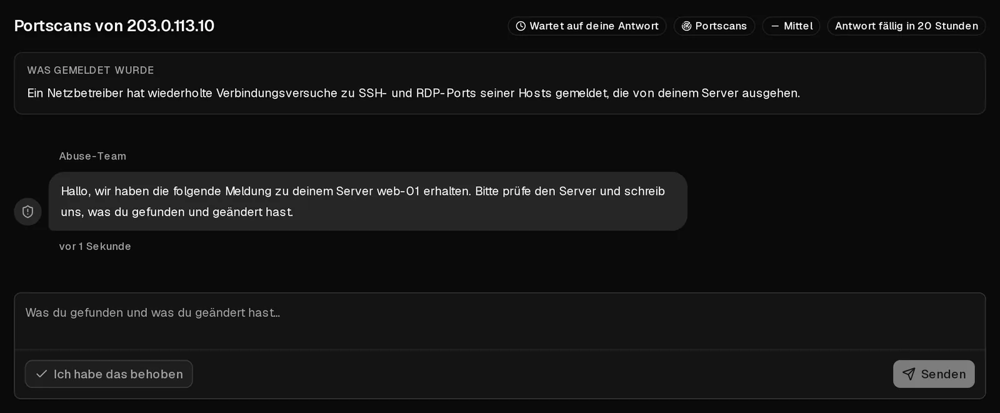

Eine Missbrauchsmeldung bedeutet, dass uns jemand mitgeteilt hat, dass Datenverkehr von einem deiner Server Schaden angerichtet hat: Spam, Phishing, Malware, Portscans, Angriffe auf andere Systeme oder Urheberrechtsverletzungen. Sehr oft hat der Inhaber nichts falsch gemacht, und der Server wurde **kompromittiert**, etwa über ein schwaches Passwort oder eine veraltete Anwendung.

Wenn wir einen Fall eröffnen, erhältst du eine E-Mail und findest den Fall im Kundenportal unter [Missbrauchsmeldungen](https://app.virtbase.com/abuse). **Antworte innerhalb von 24 Stunden.** Meist reicht das schon, damit dein Server ganz normal weiterläuft.

## Auf den Fall antworten

1. Öffne im [Kundenportal](https://app.virtbase.com/abuse) die <Ui>Missbrauchsmeldungen</Ui> und klicke auf <Ui>Fall ansehen</Ui>.
2. Lies <Ui>Was gemeldet wurde</Ui>. Dort stehen der betroffene Server, die Art des Missbrauchs und, falls vorhanden, die Belege.
3. Finde die Ursache auf deinem Server (siehe unten) und behebe sie.
4. Beschreibe, was du gefunden und was du geändert hast, und klicke auf <Ui>Senden</Ui>. Wenn du das Problem bereits behoben hast, klicke auf <Ui>Ich habe das behoben</Ui>.

Sobald du antwortest, zeigt der Fall <Ui>Bei unserem Team</Ui> an, und die Frist ist angehalten. Wir prüfen deine Antwort und schließen den Fall oder stellen Rückfragen. Wenn er geschlossen ist, erhältst du eine E-Mail.

## Die Ursache finden

Beginne mit diesen Prüfungen, als `root` auf dem Server:

- **Was das Netzwerk und die CPU belastet:** `top` und `ss -tunap` für offene Verbindungen.
- **Prozesse, die du nicht kennst,** oft in `/tmp`, `/var/tmp` oder `/dev/shm`.
- **Geplante Aufgaben:** `crontab -l`, `/etc/crontab` und `/etc/cron.*`.
- **Letzte Anmeldungen:** `last` und `/var/log/auth.log` (Debian, Ubuntu) oder `/var/log/secure` (AlmaLinux, Rocky Linux).
- **Mail-Warteschlange, bei Spam-Meldungen:** `mailq`.

Wurde der Server kompromittiert, lässt er sich selten zuverlässig bereinigen. Sichere deine Daten auf einem anderen System, [installiere das Betriebssystem neu](/de/help/article/how-to-change-operating-system), spiele deine Daten wieder ein und ändere jedes Passwort und jeden Schlüssel, der auf dem Server lag.

## Was passiert, wenn du nicht antwortest

Manche Fälle schränken den betroffenen Server sofort ein. Ansonsten wird die Einschränkung Stufe für Stufe verschärft, wenn die Frist ohne Antwort abläuft. Der Fall zeigt die aktuelle Stufe unter <Ui>Eingeschränkt, solange dies offen ist</Ui> an:

| Stufe | Was sie bedeutet |
| --- | --- |
| <Ui>Beobachtet</Ui> | Nichts ist eingeschränkt. Wir behalten die Sache im Blick. |
| <Ui>Netzwerk gedrosselt</Ui> | Die Netzwerkgeschwindigkeit des Servers ist begrenzt. Du kannst dich weiterhin anmelden und das Problem beheben. |
| <Ui>Netzwerk gesperrt</Ui> | Ausgehender Datenverkehr des Servers ist blockiert. Nutze die [Browser-Konsole](/de/help/article/how-to-use-console), um daran zu arbeiten. |
| <Ui>Ausgeschaltet</Ui> | Der Server ist heruntergefahren und kann nicht gestartet werden. Deine Daten bleiben unangetastet. |
| <Ui>Zur Löschung vorgemerkt</Ui> | Nur nach einer Entscheidung unseres Teams, nie automatisch. Antworte sofort, wenn du das für einen Fehler hältst. |

Von selbst gehen die Einschränkungen nie über <Ui>Ausgeschaltet</Ui> hinaus. Das Löschen eines Servers ist immer die Entscheidung eines Menschen.

Solange ein Fall offen ist,

- kannst du weiterhin die Konsole nutzen, Passwörter zurücksetzen, Graphen ansehen und Backups erstellen,
- kannst du keine Firewallregeln ändern, nicht neu installieren, keine Backups wiederherstellen und keine <Term id="iso-image">ISO-Images</Term> einbinden,
- **sind neue Bestellungen, Upgrades und manuelle Verlängerungen ausgesetzt**. [Automatische Verlängerungen](/de/help/article/how-to-set-up-automatic-renewal) laufen wie gewohnt weiter. Schalte die automatische Verlängerung also ein, wenn deine Laufzeit endet, während der Fall offen ist.

Die Einschränkungen werden aufgehoben, wenn wir den Fall schließen, nicht schon, wenn du antwortest. Deine vorherigen Einstellungen, einschließlich deiner eigenen Firewallregeln, werden wiederhergestellt.

## Wenn etwas unklar ist

- **Die Meldung ist falsch.** Schreib das in deiner Antwort und erkläre, warum. Wir prüfen jede Antwort.
- **Der Fall ist geschlossen, aber etwas stimmt noch nicht.** Auf geschlossene Fälle kannst du nicht antworten. [Kontaktiere den Support](/de/contact) und nenne die Fallreferenz aus der E-Mail.
- **Du brauchst mehr Zeit.** Antworte mit dem, was du bisher getan hast. Eine Antwort hält die Frist an.
