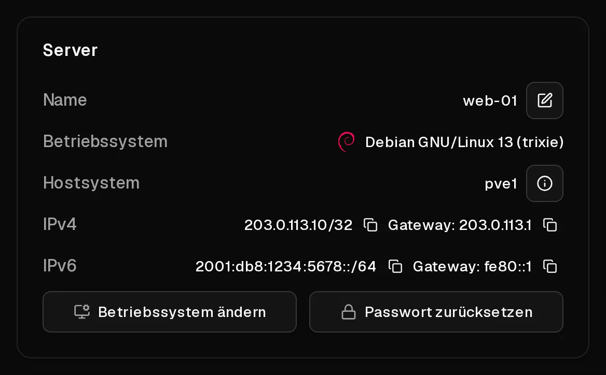

Jeder Virtbase-Server hat:

- **eine IPv4-Adresse**, die gleich bleibt, solange du den Server hast,
- **ein IPv6-/64-Subnetz**, also mehr IPv6-Adressen, als du jemals brauchen wirst.

Beide werden auf den Betriebssystemen, die du bei der Bestellung auswählst, automatisch eingerichtet. Sie bleiben gleich, wenn du den Server neu installierst, upgradest oder wiederherstellst.

## Wo finde ich sie?

- In der [Serverliste](https://app.virtbase.com/servers) kopierst du die <Term id="ipv4">IPv4-Adresse</Term> mit <Ui>IP-Adresse kopieren</Ui>.
- Auf der Seite <Ui>Übersicht</Ui> des Servers zeigen die Bereiche <Ui>IPv4</Ui> und <Ui>IPv6</Ui> jede Adresse mit ihrem <Ui>Gateway</Ui> an, jeweils mit einer Schaltfläche zum Kopieren.



## IPv6 nutzen

Dein Server hat ein ganzes <Term id="ipv6-subnet">/64-Subnetz</Term>, z. B. `2001:db8:1234:5678::/64`. Eine Adresse daraus ist auf dem Server eingerichtet. Weitere Adressen aus demselben /64 kannst du in deinem Server hinzufügen, etwa um mehrere Websites unter eigenen Adressen zu betreiben:

```bash
ip -6 addr add 2001:db8:1234:5678::2/64 dev eth0
```

Damit die Adresse auch nach einem Neustart erhalten bleibt, trage sie in deine Netzwerkkonfiguration ein (je nach System netplan, `/etc/network/interfaces` oder NetworkManager).

Für jede Adresse aus deinem /64 kannst du [Reverse DNS](/de/help/article/how-to-set-reverse-dns) einrichten.

## Kann ich weitere IPv4-Adressen bekommen?

Zusätzliche IPv4-Adressen sind derzeit nicht verfügbar. Jeder Server hat genau eine. Nur die Adressen, die deinem Server zugewiesen sind, können genutzt werden: Datenverkehr von jeder anderen Adresse wird blockiert, um das Netzwerk vor Spoofing zu schützen.

## Netzwerkgeschwindigkeit und Traffic

- **Der Traffic ist unbegrenzt**, im Rahmen einer <Term id="fair-use">Fair-Use-Regelung</Term>. Verbraucht ein Server über lange Zeit übermäßig viel, kann seine Geschwindigkeit vorübergehend gedrosselt werden.
- **Der Uplink wird geteilt:** Die maximale Bandbreite eines Hostsystems teilen sich die Server darauf. Klicke auf der Seite <Ui>Übersicht</Ui> auf <Ui>Details zum Hostsystem anzeigen</Ui>, um den <Term id="uplink">Uplink</Term> des Hostsystems zu sehen, auf dem dein Server läuft.
- Ausgehender Port 25 ist offen, du kannst also direkt von deinem Server [E-Mails versenden](/de/help/article/how-to-set-reverse-dns#e-mails-von-deinem-server-versenden).

## Das Netzwerk selbst konfigurieren

Es gibt kein DHCP: Die Adressen werden statisch konfiguriert. Wenn du ein System von deiner eigenen ISO installierst oder deine Netzwerkkonfiguration nicht mehr funktioniert, richte sie von Hand mit den Werten von der Seite <Ui>Übersicht</Ui> ein. Die genauen Einstellungen findest du unter [Wie installiere ich ein Betriebssystem von einer eigenen ISO?](/de/help/article/how-to-install-from-iso#3-installieren-und-netzwerk-einrichten)
