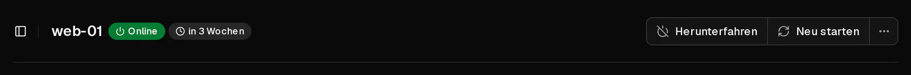
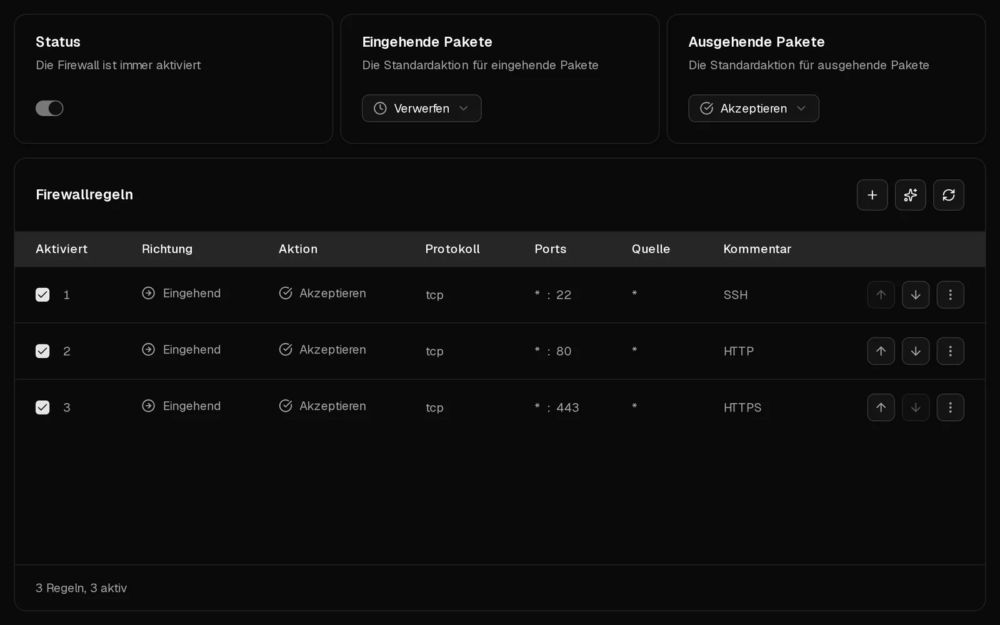

Wenn du deinen Server nicht per <Term id="ssh">SSH</Term> oder <Term id="rdp">RDP</Term> erreichst, liegt es fast immer an einem von vier Dingen: Der Server läuft nicht, eine Firewall verwirft deine Verbindung, der SSH-Dienst im Server lauscht nicht, oder deine Anmeldung wird abgelehnt. Geh die Prüfungen unten der Reihe nach durch. Jede dauert etwa eine Minute, und mit der Browser-Konsole kannst du die meisten Probleme auch dann beheben, wenn dir das Netzwerk verschlossen ist.

Hast du bereits eine Fehlermeldung, spring direkt zu [Was deine SSH-Fehlermeldung bedeutet](#was-deine-ssh-fehlermeldung-bedeutet).

## 1. Prüfen, ob der Server läuft

1. Öffne das [Kundenportal](https://app.virtbase.com/servers) und klicke neben deinem Server auf <Ui>Ansehen</Ui>.
2. Sieh dir den Status auf der Seite <Ui>Übersicht</Ui> an. Dort sollte <Ui>Online</Ui> stehen.



Was du tun kannst, wenn nicht:

- **Offline:** Klicke auf <Ui>Starten</Ui> und warte etwa eine Minute, bis das Betriebssystem hochgefahren ist.
- **Server wird installiert:** Der Server wird gerade eingerichtet, neu installiert oder aus einem Backup wiederhergestellt. Warte, bis das Banner verschwindet.
- **Server deaktiviert:** Die Laufzeit ist abgelaufen. [Verlängere den Server](/de/help/article/how-to-renew-server), dann startet er wieder.

Prüfe auch, ob du die richtige Adresse verwendest. <Ui>IP-Adresse kopieren</Ui> in der [Serverliste](https://app.virtbase.com/servers) kopiert die <Term id="ipv4">IPv4-Adresse</Term> des Servers.

## 2. Die Konsole öffnen

Die [Browser-Konsole](/de/help/article/how-to-use-console) zeigt den Bildschirm deines Servers, ohne das Netzwerk zu nutzen. Öffne den Reiter <Ui>Konsole</Ui>.

- **Du siehst eine Anmeldeaufforderung:** Der Server funktioniert. Das Problem liegt beim Netzwerkweg oder beim SSH-Dienst, mach also mit Prüfung 3 weiter.
- **Du siehst Boot-Fehler, eine Notfall-Shell oder einen schwarzen Bildschirm:** Das Betriebssystem ist nicht richtig gestartet. Siehe [Mein Server startet nicht](#mein-server-startet-nicht) weiter unten.

## 3. Die Virtbase-Firewall prüfen

Die Virtbase-Firewall filtert den Datenverkehr, bevor er deinen Server erreicht. Neue Server lassen sämtlichen Datenverkehr durch. Sie blockiert dich also nur, wenn ihre Einstellungen oder Regeln geändert wurden.

1. Öffne den Reiter <Ui>Firewall</Ui>.
2. Sieh dir <Ui>Eingehende Pakete</Ui> an. Steht dort <Ui>Verwerfen</Ui> oder <Ui>Ablehnen</Ui>, kommt nur Datenverkehr durch, den eine Regel ausdrücklich akzeptiert.
3. Stelle sicher, dass eine aktivierte Regel deine Verbindung akzeptiert: Richtung <Ui>Eingehend</Ui>, Aktion <Ui>Akzeptieren</Ui>, Protokoll <Ui>TCP</Ui>, Zielport **22** (oder der Port, den dein SSH-Server nutzt; **3389** für Windows-Remotedesktop).
4. Hat diese Regel eine <Ui>Quelle</Ui>, gilt sie nur für Datenverkehr von dieser Adresse. Hat sich deine eigene IP-Adresse geändert, was bei Anschlüssen zu Hause und im Mobilfunk häufig vorkommt, trifft die Regel nicht mehr auf dich zu.

Regeln werden von oben nach unten geprüft, und die erste passende Regel entscheidet. Eine <Ui>Eingehend</Ui>-Regel, die Port 22 verwirft und über deiner Akzeptieren-Regel steht, blockiert dich, obwohl die Akzeptieren-Regel existiert.



Änderungen greifen innerhalb weniger Sekunden. Wie Regeln funktionieren, erfährst du unter [Wie richte ich die Firewall für meinen Server ein?](/de/help/article/how-to-use-server-firewall)

## 4. Die Firewall in deinem Server prüfen

Eine Firewall in deinem Server, etwa ufw, firewalld oder nftables, greift zusätzlich zur Virtbase-Firewall: Der Datenverkehr muss beide passieren. Erkennt Virtbase eine solche Firewall, zeigt der Reiter „Firewall“ <Ui>In deinem Server läuft ebenfalls eine Firewall</Ui> an.

Melde dich über die Konsole an und erlaube SSH in der Firewall deines Servers:

```bash tab="ufw" tab-group="firewall"
ufw allow 22/tcp
ufw status
```

```bash tab="firewalld" tab-group="firewall"
firewall-cmd --permanent --add-service=ssh
firewall-cmd --reload
```

Auch Tools wie fail2ban können deine IP-Adresse nach mehreren fehlgeschlagenen Anmeldungen sperren. `fail2ban-client status sshd` listet die gesperrten Adressen auf, und `fail2ban-client unban <deine-ip>` hebt die Sperre auf.

## 5. Prüfen, ob SSH läuft

Prüfe in der Konsole, ob der SSH-Dienst läuft und auf welchem Port er lauscht:

```bash tab="Debian / Ubuntu" tab-group="os"
systemctl status ssh
ss -tlnp | grep ssh
```

```bash tab="AlmaLinux / Rocky Linux / Fedora" tab-group="os"
systemctl status sshd
ss -tlnp | grep ssh
```

Ist der Dienst gestoppt, starte ihn mit `systemctl start ssh` (bzw. `sshd`). Zeigt `ss` einen anderen Port als 22, verbinde dich über diesen Port: `ssh -p 2222 root@<deine-ip>`. Denk daran, diesen Port in beiden Firewalls zu erlauben.

## Was deine SSH-Fehlermeldung bedeutet

**`Connection timed out`**
Nichts antwortet. Der Server ist aus, die Adresse ist falsch, oder eine Firewall verwirft die Verbindung (Prüfungen 1, 3 und 4).

**`Connection refused`**
Der Server ist erreichbar, aber auf diesem Port nimmt nichts Verbindungen an: SSH läuft nicht, lauscht auf einem anderen Port, oder eine <Ui>Ablehnen</Ui>-Regel weist die Verbindung ab (Prüfungen 3 bis 5).

**`Permission denied (publickey)`**
Der Server akzeptiert nur <Term id="ssh-key">SSH-Schlüssel</Term>, und keiner deiner Schlüssel ist berechtigt. Stelle sicher, dass du den richtigen Schlüssel verwendest (`ssh -i ~/.ssh/dein_schluessel root@<deine-ip>`). Um einen Schlüssel hinzuzufügen, melde dich über die Konsole an und hänge ihn an `/root/.ssh/authorized_keys` an.

**`Permission denied, please try again.`**
Das Passwort ist falsch. [Setze das Root-Passwort](/de/help/article/how-to-reset-root-password) im Kundenportal zurück. Wird auch das neue Passwort abgelehnt, erlaubt der SSH-Server für root möglicherweise keine Anmeldung per Passwort: Prüfe `PasswordAuthentication` und `PermitRootLogin` in `/etc/ssh/sshd_config`.

**`WARNING: REMOTE HOST IDENTIFICATION HAS CHANGED!`**
Der Server zeigt einen anderen Host-Schlüssel als den, den sich dein Computer gemerkt hat. Das ist normal, nachdem du [das Betriebssystem gewechselt](/de/help/article/how-to-change-operating-system) oder ein Backup wiederhergestellt hast. Entferne den alten Schlüssel und verbinde dich erneut:

```bash
ssh-keygen -R <deine-ip>
```

Hast du nichts neu installiert oder wiederhergestellt, mach nicht weiter. Kontaktiere zuerst den Support.

## Mein Server startet nicht

Zeigt die Konsole Boot-Fehler, ein beschädigtes Dateisystem oder eine Notfall-Shell, kannst du selbst ein Rettungssystem starten: Lade die ISO eines Live-Systems, etwa des Debian- oder Ubuntu-Installers, als [eigenes ISO-Image](https://app.virtbase.com/account/settings/custom-images) hoch, binde sie mit <Ui>ISO einbinden</Ui> ein, fahre den Server dann herunter und starte ihn wieder. Im Live-System kannst du deine Festplatte einhängen und reparieren.

Ein hochgeladenes <Term id="iso-image">ISO-Image</Term> ist **60 Minuten** lang verfügbar und wird danach automatisch ausgehängt. Schließe die Reparatur also innerhalb dieser Stunde ab oder lade die ISO erneut hoch.

Wenn du unsicher bist, kontaktiere den Support, bevor du etwas änderst.

## Ist mein Server wegen einer Missbrauchsmeldung eingeschränkt?

Ist für deinen Server ein Missbrauchsfall offen, kann sein Netzwerk gedrosselt oder gesperrt oder der Server ausgeschaltet sein. Den Fall findest du dann unter [Missbrauchsmeldungen](https://app.virtbase.com/abuse), und du hast eine E-Mail erhalten. Siehe [Was tue ich, wenn ich eine Missbrauchsmeldung (Abuse) erhalte?](/de/help/article/about-abuse-reports)

## Funktioniert es immer noch nicht?

[Kontaktiere den Support](/de/contact) und gib Folgendes an:

- deine <Ui>Server-ID</Ui> (im Reiter <Ui>Erweitert</Ui>) oder deine Benutzer-ID und den Servernamen,
- was du versucht hast und die genaue Fehlermeldung,
- ob wir uns auf dem Server anmelden oder ihn neu starten dürfen, um das Problem zu untersuchen.
