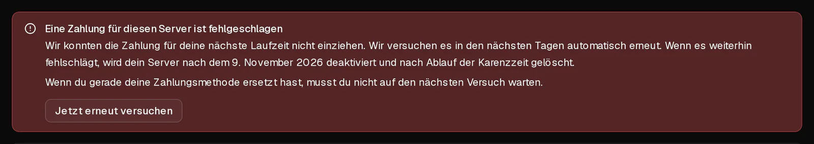

Kann eine automatische Verlängerung nicht abgebucht werden, **läuft dein Server weiter**, und nichts wird gelöscht. Wir versuchen die Zahlung in der folgenden Woche mehrmals erneut und schicken dir jedes Mal eine E-Mail. Du kannst das jederzeit beheben, indem du eine funktionierende Zahlungsmethode hinzufügst und auf <Ui>Jetzt erneut versuchen</Ui> klickst.

Dieser Artikel behandelt die [automatische Verlängerung](/de/help/article/how-to-set-up-automatic-renewal). Wenn du jeden Monat von Hand bezahlst, siehe [Wie verlängere ich meinen Server?](/de/help/article/how-to-renew-server)

## Was passiert, Tag für Tag

| Wann | Was passiert |
| --- | --- |
| Ende der Laufzeit | Wir belasten deine Zahlungsmethode. Schlägt das fehl, erhältst du die E-Mail <Msg>Wir konnten die Zahlung für deinen Server nicht einziehen</Msg>. Der Server läuft weiter. |
| 1, 3, 5 und 7 Tage nach Ende der Laufzeit | Wir versuchen es erneut. Vor dem letzten Versuch erhältst du die E-Mail <Msg>Dein Server wird am … deaktiviert</Msg> mit dem jeweiligen Datum. |
| Nachdem der letzte Versuch fehlgeschlagen ist | Der Server wird deaktiviert und ausgeschaltet, und du erhältst die E-Mail <Msg>Dein Server wurde deaktiviert</Msg>. Deine Daten sind noch vorhanden. |
| 5 Tage nach der Deaktivierung | Der Server und alle seine Daten, einschließlich aller Backups, werden endgültig gelöscht. |

Teilt uns deine Bank mit, dass eine Karte nie wieder belastet werden kann, etwa weil sie gekündigt wurde, versuchen wir es mit dieser Karte sofort nicht mehr, und die E-Mails weisen darauf hin. Dann passiert nichts weiter, bis du eine andere Zahlungsmethode hinzufügst.

## So behebst du es

1. Öffne im [Kundenportal](https://app.virtbase.com/account/settings/billing) <Ui>Konto</Ui> › <Ui>Abrechnung</Ui> und klicke auf <Ui>Karte hinzufügen</Ui>. Gib die neue Karte ein und klicke auf <Ui>Karte speichern</Ui>. Beim Hinzufügen wird nichts abgebucht.
2. Klicke neben der neuen Karte auf <Ui>Für Verlängerungen verwenden</Ui>.
3. Öffne deinen Server und geh zum Reiter <Ui>Plan</Ui>. Dort wird der Hinweis <Ui>Eine Zahlung für diesen Server ist fehlgeschlagen</Ui> angezeigt.
4. Klicke auf <Ui>Jetzt erneut versuchen</Ui>.

Die Zahlung wird sofort abgebucht. Geht sie durch, wird der Server um eine weitere Laufzeit verlängert, und du erhältst die Rechnung per E-Mail.

Klickst du nicht auf <Ui>Jetzt erneut versuchen</Ui>, wird die neue Karte beim nächsten geplanten Versuch belastet.

## Prüfen, ob es geklappt hat

Im Reiter <Ui>Plan</Ui> zeigt die Plan-Karte <Ui>Verlängert sich automatisch am</Ui>, gefolgt vom nächsten Datum, und der Zahlungshinweis ist verschwunden.

## Wenn es nicht geklappt hat

- <Msg>Deine Bank möchte, dass du diese Zahlung bestätigst. Sieh in deiner Banking-App nach.</Msg> Gib die Zahlung in deiner Banking-App frei. Klicke in der Zwischenzeit nicht noch einmal auf <Ui>Jetzt erneut versuchen</Ui>, sonst wird dir der Betrag womöglich doppelt abgebucht. Wir warten bis zu 72 Stunden auf die Bestätigung.
- <Msg>Die Zahlung wurde erneut abgelehnt. Wir versuchen es automatisch noch einmal.</Msg> Nutze eine andere Karte oder frag deine Bank, warum sie die Zahlung ablehnt. Banken nennen uns den Grund nicht.
- <Msg>Die Zahlung wurde abgelehnt und es sind keine Versuche mehr übrig.</Msg> Füge eine funktionierende Zahlungsmethode hinzu und [verlängere den Server](/de/help/article/how-to-renew-server) dann im Reiter <Ui>Plan</Ui>.
- **Der Server ist bereits deaktiviert:** Wenn du ihn im Reiter <Ui>Plan</Ui> verlängerst, wird er verlängert und wieder gestartet. Das geht, bis er gelöscht wird, also bis 5 Tage nach der Deaktivierung.

Du kannst bis zu dreimal pro Stunde auf <Ui>Jetzt erneut versuchen</Ui> klicken.

## Warum funktioniert eine Karte nicht mehr?

Die Kartenliste unter <Ui>Konto</Ui> › <Ui>Abrechnung</Ui> zeigt den Grund an:

- **Abgelaufen — ersetze sie, damit die automatische Verlängerung weiterläuft:** Das Ablaufdatum der Karte ist überschritten.
- **Von deiner Bank gestoppt — ersetze sie, damit die automatische Verlängerung weiterläuft:** Die Erlaubnis, die Karte zu belasten, wurde widerrufen.
- **Abgelehnt — ersetze sie, damit die automatische Verlängerung weiterläuft:** Deine Bank hat die letzte Verlängerung abgelehnt und uns gebeten, es nicht noch einmal zu versuchen.

Füge in jedem dieser Fälle eine andere Karte hinzu und wähle sie mit <Ui>Für Verlängerungen verwenden</Ui> aus.

Bist du dir bei einer Abbuchung unsicher, [kontaktiere den Support](/de/contact) mit deiner Benutzer-ID und dem Servernamen, bevor der Server gelöscht wird.
