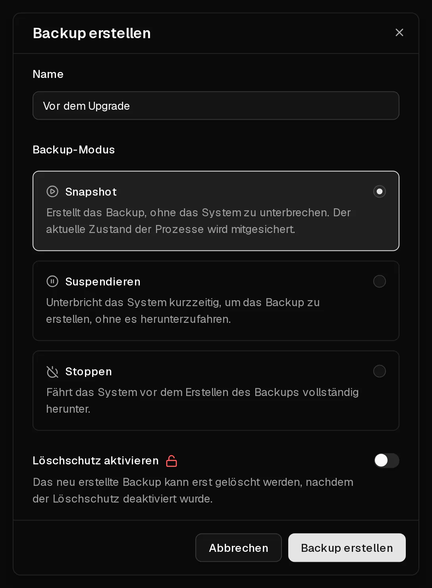

Ein Backup ist eine Kopie der gesamten Festplatte deines Servers zu einem bestimmten Zeitpunkt: Betriebssystem, Anwendungen und Daten. Du erstellst es im Reiter <Ui>Backups</Ui> und kannst es später [wiederherstellen](/de/help/article/how-to-restore-backup), um den Server genau in diesen Zustand zurückzuversetzen.

Backups bleiben erhalten, bis du sie löschst – auch wenn du das Betriebssystem wechselst. Sie werden jedoch zusammen mit dem Server gelöscht. Wird ein Server gelöscht, weil er nicht verlängert wurde, schützen sie dich also nicht.

## Ein Backup erstellen

1. Klicke im [Kundenportal](https://app.virtbase.com/servers) neben deinem Server auf <Ui>Ansehen</Ui> und öffne den Reiter <Ui>Backups</Ui>.
2. Klicke neben <Ui>Backups</Ui> auf die Schaltfläche <Ui>+</Ui>.
3. Gib unter <Ui>Name</Ui> etwas ein, das du später wiedererkennst, z. B. `Vor dem Upgrade auf Debian 13`.
4. Wähle einen <Ui>Backup-Modus</Ui> (siehe unten). <Ui>Snapshot</Ui> ist in den meisten Fällen richtig.
5. Optional: Wähle <Ui>Löschschutz aktivieren</Ui> für ein Backup, das du lange aufbewahren möchtest.
6. Klicke auf <Ui>Backup erstellen</Ui>.

Das Backup erscheint mit dem Status <Ui>Wird erstellt…</Ui> in der Liste. Sobald es fertig ist, zeigt die Liste seine Größe an. Wie lange das dauert, hängt davon ab, wie viele Daten auf der Festplatte liegen.

## Welchen Backup-Modus sollte ich wählen?

| Modus | Was passiert | Wann du ihn nutzt |
| --- | --- | --- |
| <Ui>Snapshot</Ui> | Der Server läuft weiter. Sein Zustand wird im laufenden Betrieb erfasst. | Fast immer. |
| <Ui>Suspendieren</Ui> | Der Server wird kurz angehalten, während das Backup erstellt wird, und läuft dann weiter. | Anwendungen schreiben viele Daten gleichzeitig, etwa stark ausgelastete Datenbanken, und du möchtest eine konsistente Kopie. |
| <Ui>Stoppen</Ui> | Der Server wird heruntergefahren, gesichert und wieder gestartet. | Du möchtest eine möglichst saubere Kopie und kannst einige Minuten Ausfallzeit verkraften. |

Beim <Ui>Snapshot</Ui> schreibt der <Term id="guest-agent">QEMU-Gast-Agent</Term> im Server ausstehende Schreibvorgänge kurz auf die Festplatte, damit die Kopie konsistent ist. Der Agent ist auf jedem Betriebssystem installiert, das du bei der Bestellung auswählst.

## Ein Backup vor dem Löschen schützen

Ein gesperrtes Backup lässt sich erst löschen, wenn du es entsperrst. So schützt du wichtige Backups davor, versehentlich entfernt zu werden – auch von jemand anderem, der deinen <Term id="api-key">API-Schlüssel</Term> verwendet.

- Um ein fertiges Backup zu sperren, wähle in seinem Menü <Ui>Sperren</Ui>.
- Um es später zu löschen, wähle zuerst <Ui>Entsperren</Ui> und dann <Ui>Löschen</Ui>.

Der Löschschutz gilt nicht über den Server hinaus: Wird ein Server gelöscht, werden alle seine Backups mitgelöscht, ob gesperrt oder nicht.

## Limits

- Du kannst bis zu **5 Backups pro Tag** erstellen, gezählt über alle deine Server.
- Pro Server kann immer nur **ein Backup gleichzeitig** laufen.
- Während der Server installiert wird oder deaktiviert ist, lassen sich keine Backups erstellen.
- Ein Backup, das nach 12 Stunden nicht fertig ist, wird als <Ui>Fehlgeschlagen</Ui> markiert. Ein fehlgeschlagenes Backup enthält nichts und kann jederzeit gelöscht werden.

## Wann sollte ich ein Backup erstellen?

Erstelle ein Backup vor allem, was du eventuell rückgängig machen möchtest:

- bevor du das Betriebssystem wechselst oder auf eine neue Version upgradest,
- bevor du unbekannte Software installierst oder größere Änderungen an der Konfiguration vornimmst,
- regelmäßig, wenn dir die Daten auf dem Server wichtig sind.

Denk daran, dass Backups bei Virtbase gespeichert werden. Für Daten, deren Verlust du dir nicht leisten kannst, solltest du zusätzlich eine Kopie außerhalb von Virtbase aufbewahren, z. B. mit `rsync` oder einem Backup-Tool wie restic oder Borg.

## Kann ich ein Backup herunterladen?

Nicht über das Kundenportal. Wenn du ein Backup als Datei brauchst, [kontaktiere den Support](/de/contact) und nenne die <Ui>Server-ID</Ui> aus dem Reiter <Ui>Erweitert</Ui> sowie den Namen des Backups.

## Wenn es nicht geklappt hat

- <Msg>Das Backup konnte nicht erstellt werden.</Msg> Es läuft noch ein anderes Backup dieses Servers, du hast das Limit von 5 Backups pro Tag erreicht, oder der Server wird gerade installiert oder ist deaktiviert. Warte, bis das laufende Backup fertig ist, oder versuche es morgen erneut.
- <Msg>Das Backup konnte nicht gelöscht werden.</Msg> Das Backup ist gesperrt. Wähle zuerst <Ui>Entsperren</Ui>.
- **Das Backup zeigt „Fehlgeschlagen“ an:** Lösche es und erstelle ein neues. Schlägt es erneut fehl, [kontaktiere den Support](/de/contact).
