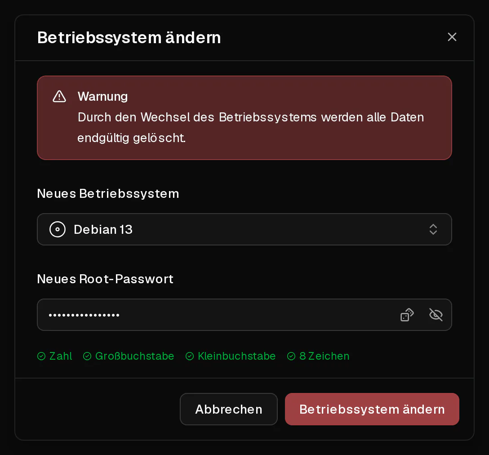

Du kannst deinen Server mit wenigen Klicks mit jedem Betriebssystem aus unserer Liste neu installieren. Die Neuinstallation **löscht alles auf der Festplatte** und richtet den Server von Grund auf neu ein, als hättest du ihn gerade erst bestellt.

Gleich bleiben: die IP-Adressen des Servers, sein Plan und seine Laufzeit, seine Firewallregeln, seine <Term id="ptr-record">Reverse-DNS-Einträge</Term> und seine Backups.

## Bevor du loslegst

- Erstelle ein [Backup](/de/help/article/how-to-backup-server), wenn auf dem Server etwas liegt, das du vielleicht noch brauchst. Backups überstehen die Neuinstallation, du kannst also zurück.
- Überleg dir ein neues Root-Passwort: 8 bis 64 Zeichen, mit mindestens einem Großbuchstaben, einem Kleinbuchstaben und einer Ziffer. Virtbase speichert es nicht.

## Das Betriebssystem wechseln

1. Klicke im [Kundenportal](https://app.virtbase.com/servers) neben deinem Server auf <Ui>Ansehen</Ui>.
2. Klicke auf der Seite <Ui>Übersicht</Ui> in der Karte <Ui>Server</Ui> auf <Ui>Betriebssystem ändern</Ui>.
3. Wähle unter <Ui>Neues Betriebssystem</Ui> das System, das installiert werden soll.
4. Gib unter <Ui>Neues Root-Passwort</Ui> das neue Passwort ein.
5. Bestätige.



Der Server zeigt <Ui>Server wird installiert</Ui> an und ist offline, bis das neue System eingerichtet ist. Sobald das Banner verschwindet, kannst du dich anmelden.

Hast du bei der Bestellung einen <Term id="ssh-key">SSH-Schlüssel</Term> hinzugefügt, wird er auf dem neuen System wieder eingerichtet.

## Prüfen, ob es geklappt hat

Verbinde dich mit dem neuen Passwort:

```bash
ssh root@<deine-ip>
```

<Term id="ssh">SSH</Term> warnt dich mit `WARNING: REMOTE HOST IDENTIFICATION HAS CHANGED!`. Das ist normal: Das neue System hat neue Host-Schlüssel. Entferne den alten Eintrag und verbinde dich erneut:

```bash
ssh-keygen -R <deine-ip>
```

Das Feld <Ui>Betriebssystem</Ui> auf der Seite <Ui>Übersicht</Ui> zeigt das neue System an.

## Ein System installieren, das nicht in der Liste steht

Um etwas zu installieren, das wir nicht anbieten, etwa Windows, pfSense oder eine Distribution deiner Wahl, nutze dein eigenes <Term id="iso-image">ISO-Image</Term>. Siehe [Wie installiere ich ein Betriebssystem von einer eigenen ISO?](/de/help/article/how-to-install-from-iso)

## Wenn es nicht geklappt hat

- <Msg>Das Betriebssystem konnte nicht geändert werden.</Msg> Der Server ist deaktiviert oder wird noch installiert, oder das Passwort erfüllt die Anforderungen nicht. Du kannst höchstens zwei Neuinstallationen pro Minute starten.
- **Das gewünschte System fehlt in der Liste:** Angeboten werden nur Systeme, die auf der Hardware verfügbar sind, auf der dein Server läuft. Nutze [deine eigene ISO](/de/help/article/how-to-install-from-iso) oder [kontaktiere den Support](/de/contact), um danach zu fragen.
- **Der Server zeigt länger als 30 Minuten „Server wird installiert“ an:** [Kontaktiere den Support](/de/contact) mit deiner <Ui>Server-ID</Ui> aus dem Reiter <Ui>Erweitert</Ui>.
