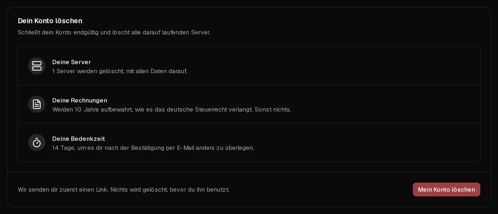

Du kannst dein Virtbase-Konto im Kundenportal selbst schließen. Dabei **werden alle Server im Konto mit allen Daten und Backups vernichtet**. Damit dir kein Fehler passiert, wird nichts gelöscht, bevor du per E-Mail bestätigt hast, und danach hast du noch 14 Tage Zeit, es dir anders zu überlegen.

Willst du nur für einen einzelnen Server nicht mehr zahlen, musst du dein Konto nicht löschen: [Kündige stattdessen das Abonnement dieses Servers](/de/help/article/how-to-set-up-automatic-renewal#abonnement-kündigen).

## Bevor du loslegst

- **Kopiere alles, was du behalten willst,** von deinen Servern herunter. Die Backups werden mit ihnen gelöscht.
- **Bezahle alle offenen Rechnungen.** Ein Konto mit unbezahlten Rechnungen kann nicht gelöscht werden.
- Optional: [Lade vorher eine Kopie deiner Daten herunter](/de/help/article/how-to-export-data).

## Dein Konto löschen

1. Öffne im [Kundenportal](https://app.virtbase.com/account/settings/privacy) <Ui>Konto</Ui> › <Ui>Datenschutz</Ui>.
2. Prüfe unter <Ui>Dein Konto löschen</Ui> die Zusammenfassung: wie viele Server vernichtet werden und wie lange deine Rechnungen aufbewahrt werden.
3. Klicke auf <Ui>Mein Konto löschen</Ui> und tippe `DELETE` ein.
4. Klicke auf <Ui>Link zusenden</Ui>.
5. Bestätige unter <Ui>Bestätige, dass du es bist</Ui> mit deinem Passwort, einem <Term id="passkey">Passkey</Term> oder einem Code, den wir dir per E-Mail schicken.
6. Öffne die E-Mail, die wir dir senden, und bestätige über den Link. Er ist 24 Stunden gültig.

Die Seite <Ui>Datenschutz</Ui> zeigt nun das Datum an, an dem alles gelöscht wird.

## Wie es weitergeht

| Wann | Was passiert |
| --- | --- |
| Nachdem du per E-Mail bestätigt hast | Dein Konto ist zur Löschung vorgemerkt. Deine Server laufen weiter. |
| 14 Tage später | Dein Konto, alle deine Server, ihre Backups und deine personenbezogenen Daten werden endgültig gelöscht. |

Wir bewahren deine **Rechnungen 10 Jahre lang** auf, weil das deutsche Steuerrecht es vorschreibt – und sonst nichts.

## Es dir anders überlegen

Öffne bis zum angezeigten Datum <Ui>Konto</Ui> › <Ui>Datenschutz</Ui> und klicke auf <Ui>Mein Konto behalten</Ui>. Alles bleibt, wie es war.

Dich nur anzumelden stoppt die Löschung nicht. Du musst auf <Ui>Mein Konto behalten</Ui> klicken.

## Wenn es nicht geklappt hat

- <Msg>Begleiche zuerst deine offenen Rechnungen.</Msg> Bezahle die offenen Rechnungen unter [Rechnungen](https://app.virtbase.com/invoices) und versuche es dann erneut.
- <Msg>Eine Bestellung wird noch verarbeitet.</Msg> Warte ein paar Minuten, bis die Bestellung abgeschlossen ist.
- **Die E-Mail kommt nicht an:** Sieh in deinem Spam-Ordner nach. Der Link ist 24 Stunden gültig; danach musst du von vorn beginnen.

## Konten, die niemand nutzt

Hatte ein Konto 6 Monate lang keine Server und nichts Abrechenbares, merken wir es ebenfalls zur Löschung vor. Du erhältst 30 Tage vorher eine E-Mail und 7 Tage vorher eine Erinnerung. Meldest du dich in dieser Zeit an, bleibt dein Konto bestehen.
