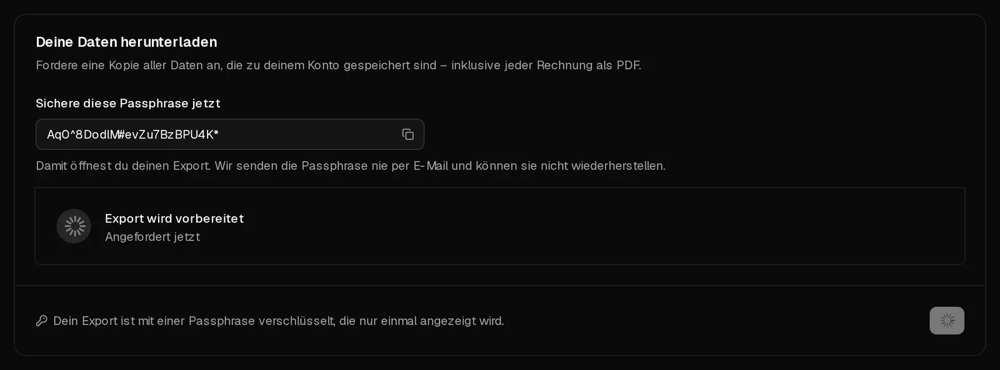

Du kannst jederzeit eine Kopie von allem herunterladen, was Virtbase zu deinem Konto speichert: dein Profil, Server, Bestellungen, Zahlungen, Missbrauchsfälle und mehr, dazu ein PDF jeder Rechnung. Der Export ist eine einzige PDF-Datei, verschlüsselt mit einer Passphrase, die nur du zu sehen bekommst.

Der Export enthält Daten über dein Konto, nicht aber die Dateien auf deinen Servern. Um diese zu behalten, kopiere sie vom Server herunter oder erstelle ein [Backup](/de/help/article/how-to-backup-server).

## Einen Export anfordern

1. Öffne [Konto > Datenschutz](https://app.virtbase.com/account/settings/privacy).
2. Klicke unter <Ui>Deine Daten herunterladen</Ui> auf <Ui>Export anfordern</Ui>.
3. Bestätige unter <Ui>Bestätige, dass du es bist</Ui> mit deinem Passwort, einem <Term id="passkey">Passkey</Term> oder einem Code, den wir dir per E-Mail schicken.
4. <Ui>Sichere diese Passphrase jetzt</Ui>: Kopiere sie in deinen Passwort-Manager. Sie öffnet deinen Export, und wir können sie dir weder erneut anzeigen noch zuschicken.

Die Karte zeigt <Ui>Export wird vorbereitet</Ui> an. Sobald er fertig ist, erhältst du die E-Mail <Msg>Dein Datenexport ist bereit</Msg>.

## Herunterladen und öffnen

1. Öffne erneut <Ui>Konto</Ui> › <Ui>Datenschutz</Ui> und klicke unter <Ui>Dein Export ist fertig</Ui> auf <Ui>Herunterladen</Ui>.
2. Öffne das PDF in einem PDF-Reader und gib die Passphrase ein.

Das PDF beschreibt deine Daten in lesbarer Form und enthält als Anhänge die vollständigen Daten als JSON-Datei sowie deine Rechnungen. Die meisten PDF-Reader listen Anhänge in einer Seitenleiste auf.

Der Download ist **7 Tage** lang verfügbar. Danach steht dort <Ui>Dein Export ist abgelaufen</Ui>, und du kannst einen neuen anfordern.

## Limits

Du kannst einen Export pro Tag anfordern. Versuchst du es erneut, siehst du <Msg>Du hast heute bereits einen Export angefordert. Bitte versuche es morgen erneut.</Msg>

## Wenn es nicht geklappt hat

- **Dein Export konnte nicht erstellt werden:** Fordere am nächsten Tag einen neuen an. Schlägt es erneut fehl, [kontaktiere den Support](/de/contact).
- **Du hast die Passphrase verloren:** Ohne sie lässt sich der Export nicht öffnen. Fordere am nächsten Tag einen neuen Export an und sichere die neue Passphrase.
- **Du möchtest deine Daten auf anderem Weg anfordern,** etwa nach Art. 15 DSGVO per E-Mail: [Kontaktiere den Support](/de/contact) von der E-Mail-Adresse deines Kontos aus.
