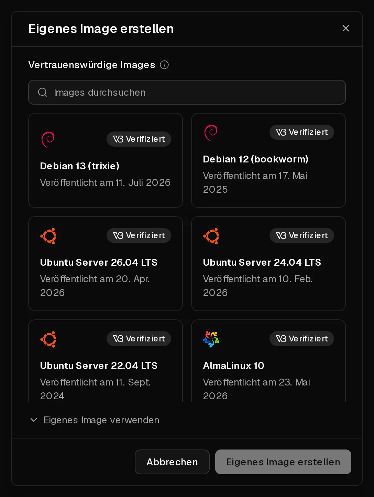
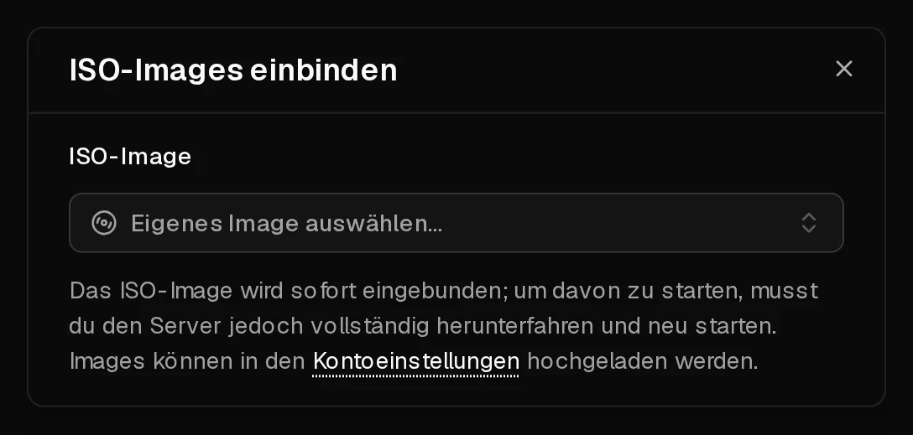

Ist das gewünschte System nicht in unserer Liste, kannst du es von einem <Term id="iso-image">ISO-Image</Term> installieren, genau wie auf einem physischen Rechner: Datenträger einlegen, davon booten, Installer ausführen. Auf diese Weise kannst du auch ein Live-System booten, um einen Server zu retten, der nicht mehr startet.

Die Installation von einer ISO richtet sich an erfahrene Nutzer. Anders als bei unseren fertigen Systemen wird nichts für dich eingerichtet: Das Netzwerk konfigurierst du selbst, und das Kundenportal kann Passwörter nur zurücksetzen oder das System nur auslesen, wenn du den <Term id="guest-agent">QEMU-Gast-Agent</Term> installierst.

## Bevor du loslegst

- **Sichere** alles, was du behalten willst. Bei der Installation eines neuen Systems wird die Festplatte in der Regel gelöscht.
- **Notiere dir deine Netzwerkeinstellungen.** Dein Server hat statische Adressen, und es gibt kein DHCP. Kopiere auf der Seite <Ui>Übersicht</Ui> die <Ui>IPv4</Ui>-Adresse und ihr <Ui>Gateway</Ui> und das Gleiche für <Ui>IPv6</Ui>.
- **Plane 60 Minuten ein.** Ein ISO-Image ist 60 Minuten lang verfügbar, nachdem du es hinzugefügt hast. Danach wird es automatisch ausgehängt und entfernt.

## 1. Das ISO-Image hinzufügen

1. Öffne [Konto > ISO-Images](https://app.virtbase.com/account/settings/custom-images) und klicke auf <Ui>Eigenes Image erstellen</Ui>.
2. Wähle unter <Ui>Vertrauenswürdige Images</Ui> ein Image aus, etwa Debian, Ubuntu, AlmaLinux, Rocky Linux, Fedora, Alpine, Arch Linux, NixOS, FreeBSD oder die VirtIO-Treiber für Windows. Mit <Ui>Verifiziert</Ui> markierte Images werden mit der Prüfsumme des Herstellers abgeglichen.
3. Oder wähle <Ui>Eigenes Image verwenden</Ui> und gib unter <Ui>Name</Ui> einen Namen und unter <Ui>URL</Ui> die Adresse der ISO-Datei ein.
4. Klicke auf <Ui>Eigenes Image erstellen</Ui>.



Das Image wird auf unseren Speicher heruntergeladen. Die Liste zeigt den Fortschritt als <Ui>Wird hochgeladen</Ui> mit einer Prozentangabe an und mit <Ui>Läuft … ab</Ui> den Zeitpunkt, zu dem es entfernt wird.

Eine eigene URL muss

- mit `https://` beginnen und einen Domainnamen verwenden, keine IP-Adresse,
- direkt auf eine Datei mit der Endung `.iso` verweisen, ohne Anmeldung,
- die Dateigröße angeben, und die Datei darf höchstens 10 GB groß sein.

Du kannst bis zu **3** ISO-Images gleichzeitig haben und bis zu 10 pro Stunde hinzufügen.

## 2. Einbinden und davon booten

1. Öffne deinen Server. Öffne in der Reihe der Power-Buttons das Menü und wähle <Ui>ISO einbinden</Ui>.
2. Wähle unter <Ui>ISO-Image</Ui> dein Image aus. Es wird sofort eingebunden.
3. **Fahre den Server herunter und starte ihn wieder.** Ein Neustart aus dem Server heraus reicht nicht: Der Server bootet erst nach einem vollständigen Stopp und Start von der ISO. Klicke auf <Ui>Herunterfahren</Ui>, warte, bis der Server <Ui>Offline</Ui> ist, und klicke dann auf <Ui>Starten</Ui>.
4. Öffne den Reiter <Ui>Konsole</Ui>. Dort siehst du den Installer oder das Live-System.



## 3. Installieren und Netzwerk einrichten

Führe den Installer in der [Konsole](/de/help/article/how-to-use-console) aus. Wenn er nach dem Netzwerk fragt, wähle die manuelle Konfiguration und gib Folgendes ein:

| Einstellung | Wert |
| --- | --- |
| <Term id="ipv4">IPv4-Adresse</Term> | Die Adresse von der Seite <Ui>Übersicht</Ui>, mit dem Präfix `/32` |
| IPv4-<Term id="gateway">Gateway</Term> | Das <Ui>Gateway</Ui> von der Seite <Ui>Übersicht</Ui> |
| DNS-Server | `9.9.9.9` und `149.112.112.112` oder deine eigenen |
| IPv6-Adresse | Eine Adresse aus deinem /64, mit dem Präfix `/64` |
| IPv6-Gateway | Das IPv6-<Ui>Gateway</Ui> von der Seite <Ui>Übersicht</Ui> |

Da die Adresse ein `/32` ist, liegt das Gateway nicht im selben Subnetz. Viele Installer kommen damit zurecht; falls deiner es nicht tut, lege zuerst eine Route zum Gateway an. Mit netplan zum Beispiel so:

```yaml title="/etc/netplan/01-network.yaml"
network:
  version: 2
  ethernets:
    eth0:
      addresses: [203.0.113.10/32]
      routes:
        - to: 203.0.113.1/32
          scope: link
        - to: 0.0.0.0/0
          via: 203.0.113.1
          on-link: true
      nameservers:
        addresses: [9.9.9.9, 149.112.112.112]
```

## 4. Die ISO aushängen

Wenn die Installation abgeschlossen ist, öffne erneut <Ui>ISO einbinden</Ui> und klicke neben dem Image auf die Schaltfläche zum Aushängen. Fahre den Server herunter und starte ihn wieder, damit er von seiner Festplatte bootet.

Installiere anschließend den QEMU-Gast-Agent, z. B. mit `apt install qemu-guest-agent`. Ohne ihn kann das Kundenportal keine [Passwörter zurücksetzen](/de/help/article/how-to-reset-root-password), keine Festplattenauslastung anzeigen und keine Firewall-Empfehlungen geben.

## Windows installieren

Windows ist auf Virtbase-Servern erlaubt. Wir stellen keine Windows-Images oder -Lizenzen bereit: Du installierst es von deiner eigenen ISO und nutzt deine eigene Lizenz.

1. Stelle im Reiter <Ui>Erweitert</Ui> das BIOS auf <Ui>UEFI</Ui> und das <Term id="tpm">TPM</Term> auf <Ui>v2.0</Ui>. Ohne diese Einstellungen lässt sich Windows 11 nicht installieren.
2. Füge deine Windows-ISO hinzu, außerdem die <Ui>VirtIO-Treiber</Ui> aus der Liste <Ui>Vertrauenswürdige Images</Ui>.
3. Binde die Windows-ISO ein und starte den Installer wie oben beschrieben.
4. Findet der Installer keine Festplatte, binde stattdessen die ISO mit den VirtIO-Treibern ein. Sie ersetzt die Windows-ISO im virtuellen Laufwerk. Wähle im Installer <Ui>Treiber laden</Ui> und dann den Speichertreiber von der Treiber-CD.
5. Binde wieder die Windows-ISO ein und setze die Installation fort.
6. Installiere nach der Installation die übrigen VirtIO-Treiber und den Gast-Agent von der Treiber-ISO und richte das Netzwerk wie in der Tabelle oben ein.

## Einen Server retten, der nicht startet

Um ein beschädigtes System zu reparieren, binde ein Live-System wie den Debian- oder Ubuntu-Installer ein, boote es und hänge von dort aus deine Festplatte ein. Häng die ISO aus, wenn du fertig bist. Wenn du dir nicht sicher bist, was zu tun ist, [kontaktiere den Support](/de/contact), bevor du etwas änderst.

## Wenn es nicht geklappt hat

- **Das ISO-Image wird nicht hinzugefügt:** Prüfe, dass die URL mit `https://` beginnt, auf `.iso` endet und keine Anmeldung erfordert und dass die Datei nicht größer als 10 GB ist.
- <Msg>Du kannst bis zu 3 aktive ISO-Images haben.</Msg> Warte, bis eines abläuft; Images werden 60 Minuten nach dem Hinzufügen entfernt.
- **Der Server bootet das alte System:** Du hast neu gestartet, statt herunterzufahren und zu starten. Fahre ihn vollständig herunter und starte ihn dann.
- **Kein Netzwerk nach der Installation:** Prüfe das Adresspräfix (`/32`), die Route zum Gateway und die DNS-Server. Siehe [Server nicht erreichbar: Ich kann mich nicht verbinden](/de/help/article/cant-connect-to-server).
- <Msg>ISO-Image konnte nicht eingebunden werden.</Msg> Das Image wird noch heruntergeladen oder ist abgelaufen, oder der Server wird gerade installiert, ist deaktiviert oder durch einen Missbrauchsfall eingeschränkt.
