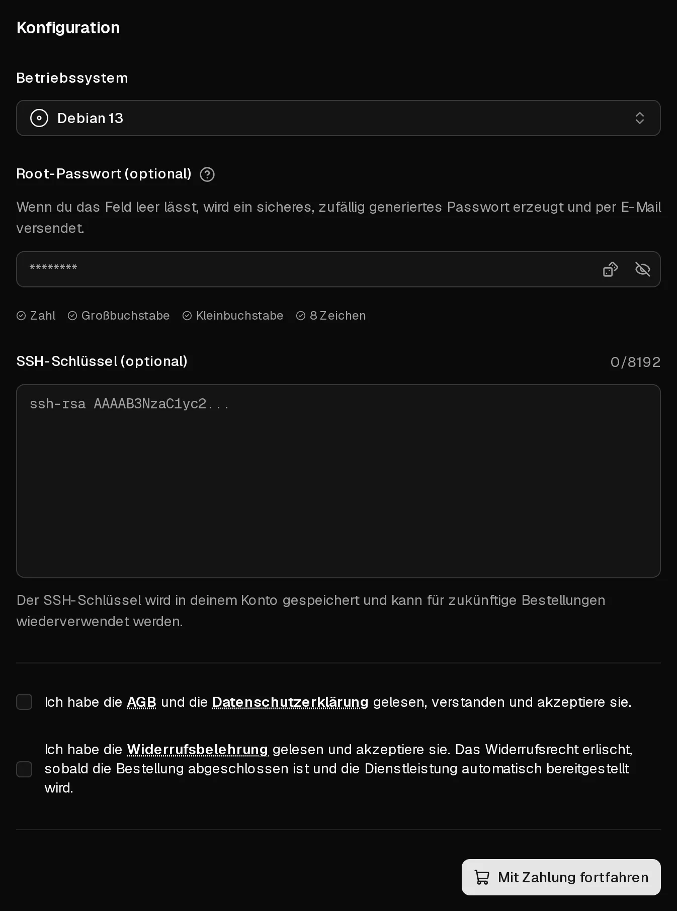

Eine Bestellung dauert nur ein paar Minuten: Du wählst einen Plan und das Betriebssystem aus und bezahlst. Virtbase installiert den Server dann automatisch und schickt dir eine E-Mail, sobald du dich anmelden kannst. Du brauchst ein Virtbase-Konto, das du auch während der Bestellung anlegen kannst.

Jeder Plan enthält eine <Term id="ipv4">IPv4-Adresse</Term>, ein <Term id="ipv6-subnet">IPv6-/64-Subnetz</Term> und unbegrenzten Traffic im Rahmen einer <Term id="fair-use">Fair-Use-Regelung</Term>. Die Preise gelten pro Monat und enthalten die gesetzliche Mehrwertsteuer, sofern sie anfällt.

## Die Bestellung aufgeben

1. Wähle auf der [Virtbase-Startseite](/de) einen Plan und klicke auf <Ui>Jetzt konfigurieren</Ui>. Zeigt ein Plan <Ui>Ausverkauft</Ui> an, kann er derzeit nicht bestellt werden.
2. Melde dich an oder klicke auf <Ui>Registrieren</Ui>, um ein Konto anzulegen.
3. Wähle unter <Ui>Betriebssystem</Ui> das System, das installiert werden soll.
4. Optional: Wähle unter <Ui>SSH-Schlüssel (optional)</Ui> einen vorhandenen Schlüssel aus oder klicke auf <Ui>Neuen SSH-Schlüssel hinzufügen</Ui> und füge deinen öffentlichen Schlüssel ein. Dann kannst du dich ohne Passwort anmelden.
5. Optional: Lege unter <Ui>Root-Passwort (optional)</Ui> ein Passwort für `root` fest. Lässt du das Feld leer, wird ein sicheres Zufallspasswort erzeugt und dir per E-Mail geschickt.
6. Akzeptiere die AGB, die Datenschutzerklärung und die Widerrufsbelehrung.
7. Klicke auf <Ui>Mit Zahlung fortfahren</Ui>.

<Hint>
Virtbase speichert dein Root-Passwort nicht. Notiere es dir oder nutze einen <Term id="ssh-key">SSH-Schlüssel</Term>. Du kannst das Passwort jederzeit im Kundenportal [zurücksetzen](/de/help/article/how-to-reset-root-password).
</Hint>

## Bezahlen

1. Gib deine <Ui>Rechnungsadresse</Ui> ein. Sie wird für die Rechnung und zur Berechnung der Mehrwertsteuer verwendet.
2. Wähle eine <Ui>Zahlungsmethode</Ui>: Karte, <Term id="sepa-mandate">SEPA-Lastschrift</Term> oder PayPal. Bei Bestellungen ab 5,00 € kannst du auch <Ui>Anonym mit Kryptowährung bezahlen</Ui> wählen.
3. Klicke auf <Ui>Jetzt kaufen</Ui> und schließe eine eventuelle Bestätigung ab, die deine Bank verlangt.

Zahlungen per Karte und PayPal werden innerhalb von Sekunden bestätigt. Bei SEPA-Lastschrift und Kryptowährung siehst du <Ui>Zahlung wird verarbeitet</Ui>: Die Bestellung wird erst ausgeführt, wenn die Zahlung eingegangen ist, was länger dauern kann.

Mit dem Abschluss der Bestellung stimmst du zu, dass der Server sofort bereitgestellt wird. Dein Widerrufsrecht erlischt daher, sobald der Server eingerichtet ist, wie in der Widerrufsbelehrung beschrieben.

## Nach der Zahlung

Dein Server erscheint in der [Serverliste](https://app.virtbase.com/servers) mit dem Status <Ui>Wird installiert…</Ui>. Die Installation läuft automatisch und dauert meist nur ein paar Minuten.

Ist sie abgeschlossen, erhältst du die E-Mail <Msg>Dein Server ist nun bereit</Msg> mit dem Benutzernamen und, falls du keines festgelegt hast, dem generierten Root-Passwort. Aus Sicherheitsgründen enthält die E-Mail nicht die IP-Adresse. Klicke in der Serverliste auf <Ui>IP-Adresse kopieren</Ui>, um sie zu kopieren.

Als Nächstes: [Verbinde dich zum ersten Mal mit deinem Server](/de/help/article/how-to-connect-to-server).

Dein Server läuft einen Monat lang. Damit er weiterläuft, [verlängere ihn](/de/help/article/how-to-renew-server) oder [schalte die automatische Verlängerung ein](/de/help/article/how-to-set-up-automatic-renewal). Deine Rechnung findest du unter [Rechnungen](https://app.virtbase.com/invoices), und du bekommst sie per E-Mail.

## Wenn etwas schiefgelaufen ist

### Die Zahlungsseite zeigt ein Problem an

- <Ui>Bestellung erfordert Aktion</Ui> oder **Bestellung erfordert Bestätigung:** Deine Bank möchte, dass du die Zahlung bestätigst, z. B. in deiner Banking-App. Bestätige sie und kehre zur Seite zurück.
- **Zahlung konnte nicht abgeschlossen werden:** Die Zahlung wurde abgelehnt. Prüfe deine Angaben oder versuche es mit einer anderen Zahlungsmethode.
- **Bestellung abgebrochen:** Es wurde nichts berechnet. Starte eine neue Bestellung.

### Ich habe bezahlt, aber es gibt keinen Server

- Bei SEPA-Lastschrift oder Kryptowährung wird der Server erst eingerichtet, wenn die Zahlung eingegangen ist.
- Sieh in der [Serverliste](https://app.virtbase.com/servers) nach. Ein Server mit dem Status <Ui>Wird installiert…</Ui> wird gerade eingerichtet; die E-Mail folgt, sobald er fertig ist.
- Sieh in deinem Spam-Ordner nach der E-Mail <Msg>Dein Server ist nun bereit</Msg>.

Trifft nach einer Stunde nichts davon zu, [kontaktiere den Support](/de/contact) mit deiner Benutzer-ID, die du in deinen [Kontoeinstellungen](https://app.virtbase.com/account/settings) unter <Ui>Deine Benutzer-ID</Ui> findest.

### Neue Bestellungen sind ausgesetzt

Siehst du <Msg>Neue Bestellungen sind ausgesetzt, solange ein Missbrauchsfall offen ist.</Msg>, ist eine Missbrauchsmeldung zu einem deiner Server noch offen. Beantworte sie unter [Missbrauchsmeldungen](https://app.virtbase.com/abuse); siehe [Was tue ich, wenn ich eine Missbrauchsmeldung (Abuse) erhalte?](/de/help/article/about-abuse-reports)
