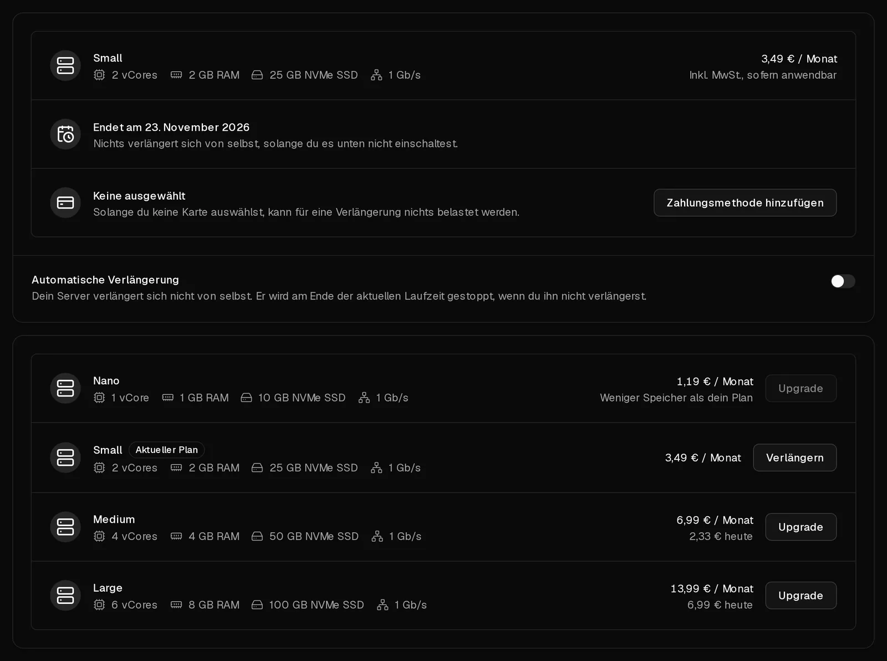

Ein Virtbase-Server wird Monat für Monat bezahlt. Damit er weiterläuft, verlängere ihn vor Ende seiner Laufzeit – entweder von Hand, wie hier beschrieben, oder [automatisch](/de/help/article/how-to-set-up-automatic-renewal), damit du nie wieder daran denken musst.

Du kannst jederzeit verlängern. Der neue Monat wird an das Ende der aktuellen Laufzeit angehängt, frühzeitiges Verlängern kostet dich also nichts.

## Einen Server verlängern

1. Klicke im [Kundenportal](https://app.virtbase.com/servers) neben deinem Server auf <Ui>Verlängern</Ui>. Dadurch öffnet sich sein Reiter <Ui>Plan</Ui>.
2. Dein aktueller Plan ist mit <Ui>Aktueller Plan</Ui> markiert. Klicke bei diesem Plan auf <Ui>Verlängern</Ui>.
3. Prüfe den Preis und klicke auf die Schaltfläche <Ui>Für … verlängern</Ui>, die den Betrag anzeigt.
4. Wähle eine Zahlungsmethode und klicke auf <Ui>Jetzt kaufen</Ui>.

Sobald die Zahlung durchgegangen ist, verlängert sich die Laufzeit um einen Monat. Du erhältst die E-Mail <Msg>Dein Server wurde verlängert</Msg> mit dem neuen Enddatum und findest die Rechnung unter [Rechnungen](https://app.virtbase.com/invoices).

Möchtest du stattdessen auf einen größeren Plan wechseln, siehe [Wie mache ich ein Upgrade meines Servers auf einen größeren Plan?](/de/help/article/how-to-upgrade-server)

## Was passiert, wenn ich nicht verlängere?

| Wann | Was passiert |
| --- | --- |
| 5 Tage vor Ende der Laufzeit | Der Server zeigt <Ui>Server läuft ab</Ui> an, und du erhältst die E-Mail <Msg>Dein Server läuft bald ab</Msg>. |
| Ende der Laufzeit | Der Server wird deaktiviert und ausgeschaltet, und du erhältst die E-Mail <Msg>Dein Server wurde deaktiviert</Msg>. Deine Daten sind noch vorhanden. |
| 5 Tage nach der Deaktivierung | Der Server und alle seine Daten, einschließlich aller Backups und seiner <Term id="ptr-record">Reverse-DNS-Einträge</Term>, werden endgültig gelöscht. Du erhältst die E-Mail <Msg>Dein Server wurde gelöscht</Msg>. |

Ein gelöschter Server lässt sich nicht wiederherstellen, auch nicht durch unser Support-Team.

## Einen deaktivierten Server verlängern

Solange er nicht gelöscht ist, lässt sich ein deaktivierter Server auf dieselbe Weise verlängern. Durch die Verlängerung wird er mit all seinen Daten wieder eingeschaltet. Solange er deaktiviert ist, kannst du ihn nicht starten, die Konsole nicht nutzen, keine Backups wiederherstellen und ihn nicht neu installieren.

## Wenn es nicht geklappt hat

- **Eine Bestellung wartet auf Zahlung:** Du hast die Zahlung geschlossen, bevor sie durchgegangen ist. Es wurde nichts berechnet. Klicke auf <Ui>Zahlung fortsetzen</Ui> oder auf <Ui>Verwerfen</Ui> und beginne von vorn.
- <Msg>Neue Bestellungen sind ausgesetzt, solange ein Missbrauchsfall offen ist.</Msg> Solange ein [Missbrauchsfall](/de/help/article/about-abuse-reports) offen ist, ist eine manuelle Verlängerung nicht möglich. Beantworte den Fall oder schalte die automatische Verlängerung ein, die weiterhin funktioniert.
- **Die Zahlung wird abgelehnt:** Versuche es mit einer anderen Zahlungsmethode. Bei <Term id="sepa-mandate">SEPA-Lastschrift</Term> wird die Verlängerung erst wirksam, wenn die Zahlung eingegangen ist.

Steht die Löschung des Servers kurz bevor und kannst du nicht rechtzeitig bezahlen, [kontaktiere den Support](/de/contact) vor dem Löschdatum.
