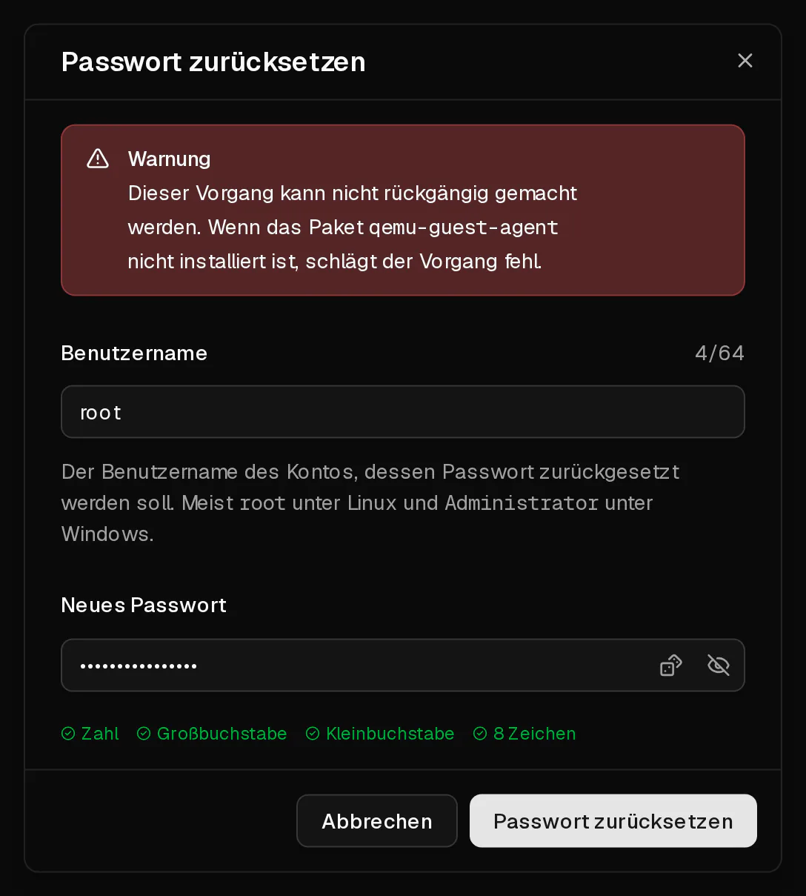

Im Kundenportal kannst du für jeden Benutzer auf deinem Server ein neues Passwort festlegen, auch für `root`. Das neue Passwort gilt sofort. Der Server wird nicht neu gestartet, und deine Daten bleiben unangetastet.

Virtbase speichert dein Root-Passwort nicht, deshalb können wir dir das alte nicht nennen. Über das Zurücksetzen kommst du wieder hinein.

## Bevor du loslegst

- Der Server läuft: Sein Status auf der Seite <Ui>Übersicht</Ui> ist <Ui>Online</Ui>.
- Im Server läuft der **QEMU-Gast-Agent**. Er ist auf jedem Betriebssystem installiert, das du bei der Bestellung auswählst. Hast du das System selbst von einem <Term id="iso-image">ISO-Image</Term> installiert, [installiere zuerst den Agent](#das-zurücksetzen-schlägt-fehl).
- Das neue Passwort hat 8 bis 64 Zeichen, mit mindestens einem Großbuchstaben, einem Kleinbuchstaben und einer Ziffer.

## Das Passwort zurücksetzen

1. Klicke im [Kundenportal](https://app.virtbase.com/servers) neben deinem Server auf <Ui>Ansehen</Ui>.
2. Klicke auf der Seite <Ui>Übersicht</Ui> in der Karte <Ui>Server</Ui> auf <Ui>Passwort zurücksetzen</Ui>.
3. Gib unter <Ui>Benutzername</Ui> den Benutzer ein, dessen Passwort du ändern möchtest. Unter Linux ist das meist `root`, unter Windows `Administrator`.
4. Gib unter <Ui>Neues Passwort</Ui> das neue Passwort ein.
5. Klicke auf <Ui>Passwort zurücksetzen</Ui>.



Der Dialog schließt sich, und das neue Passwort ist aktiv.

## Prüfen, ob es geklappt hat

Melde dich mit dem neuen Passwort an:

```bash
ssh root@<deine-ip>
```

Oder melde dich über die [Browser-Konsole](/de/help/article/how-to-use-console) an, falls <Term id="ssh">SSH</Term> nicht erreichbar ist.

## Wenn es nicht geklappt hat

### Das Zurücksetzen schlägt fehl

Das Kundenportal zeigt <Msg>Das Passwort konnte nicht zurückgesetzt werden.</Msg> an, wenn der Server nicht läuft oder der <Term id="guest-agent">Gast-Agent</Term> nicht antwortet.

- Starte den Server, warte etwa eine Minute, bis er hochgefahren ist, und versuche es erneut.
- Prüfe, ob der Agent läuft. Melde dich, falls das noch geht, über die Konsole an und führe Folgendes aus:

  ```bash
  systemctl status qemu-guest-agent
  ```

  Fehlt er, installiere und starte ihn:

  ```bash tab="Debian / Ubuntu" tab-group="os"
  apt install qemu-guest-agent
  systemctl enable --now qemu-guest-agent
  ```

  ```bash tab="AlmaLinux / Rocky Linux / Fedora" tab-group="os"
  dnf install qemu-guest-agent
  systemctl enable --now qemu-guest-agent
  ```

  Unter Windows ist der Agent Teil des VirtIO-Treiberpakets (`virtio-win`).

Du kannst ein Passwort höchstens dreimal pro Minute zurücksetzen. Siehst du <Msg>Du machst das zu oft. Bitte warte einen Moment.</Msg>, warte eine Minute und versuche es erneut.

### SSH lehnt das neue Passwort weiterhin ab

Das Passwort wurde geändert, aber dein SSH-Server erlaubt für root keine Anmeldung per Passwort. Melde dich über die Konsole an und prüfe diese beiden Einstellungen in `/etc/ssh/sshd_config`:

```text title="/etc/ssh/sshd_config"
PasswordAuthentication yes
PermitRootLogin yes
```

Starte SSH anschließend mit `systemctl restart ssh` (bzw. `sshd`) neu. Ein [SSH-Schlüssel](https://app.virtbase.com/account/settings/ssh-keys) statt eines Passworts ist sicherer und erspart dir dieses Problem ganz.

### Du kannst dich gar nicht anmelden, und der Agent ist nicht installiert

Ohne den Agent kann das Kundenportal das Passwort nicht ändern. Du hast zwei Möglichkeiten:

- Boote ein Rettungssystem von einem eigenen ISO-Image und ändere das Passwort von dort aus (siehe [Mein Server startet nicht](/de/help/article/cant-connect-to-server#mein-server-startet-nicht)), oder
- [kontaktiere den Support](/de/contact) mit deiner <Ui>Server-ID</Ui> aus dem Reiter <Ui>Erweitert</Ui> und teile uns mit, ob wir den Server neu starten dürfen.

Auch [ein Wechsel des Betriebssystems](/de/help/article/how-to-change-operating-system) gibt dir ein neues Root-Passwort, löscht aber alles auf der Festplatte.
