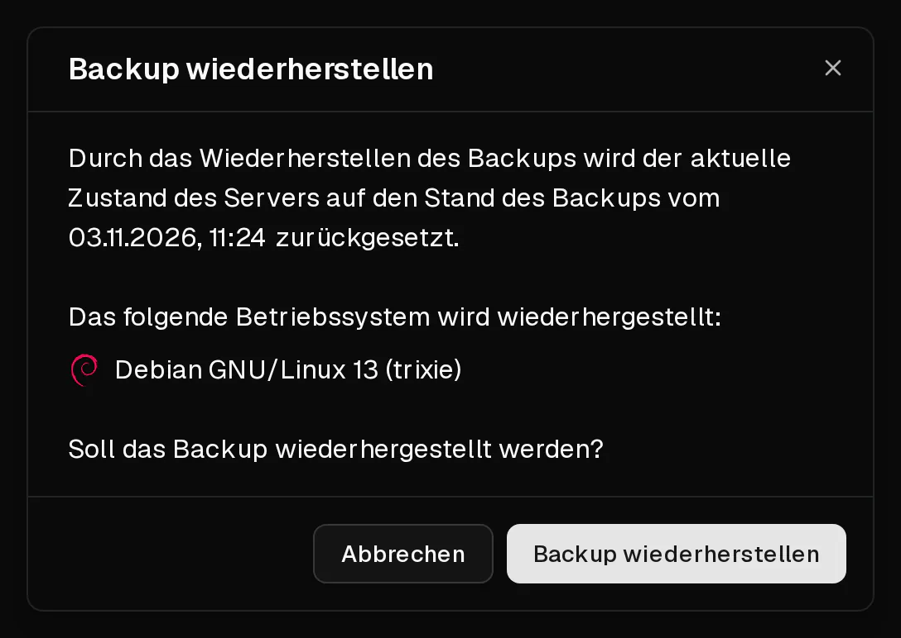

Beim Wiederherstellen eines Backups wird die Festplatte deines Servers in den Zustand zurückversetzt, in dem sie war, als das Backup erstellt wurde. **Alles, was seitdem auf dem Server erstellt oder geändert wurde, geht verloren.**

Ersetzt wird nur die Festplatte. Der Server behält seine IP-Adressen, seine Firewallregeln, seine <Term id="ptr-record">Reverse-DNS-Einträge</Term> und seinen Plan.

## Bevor du loslegst

- Hat sich seit dem Backup etwas auf dem Server geändert, das du behalten möchtest, erstelle zuerst ein [neues Backup](/de/help/article/how-to-backup-server). So kannst du bei Bedarf zum aktuellen Stand zurückkehren.
- Das Backup muss fertig sein. Backups mit dem Status <Ui>Wird erstellt…</Ui> oder <Ui>Fehlgeschlagen</Ui> lassen sich nicht wiederherstellen.
- Plane eine kurze Ausfallzeit ein: Während das Backup wiederhergestellt wird, ist der Server offline.

## Das Backup wiederherstellen

1. Klicke im [Kundenportal](https://app.virtbase.com/servers) neben deinem Server auf <Ui>Ansehen</Ui> und öffne den Reiter <Ui>Backups</Ui>.
2. Öffne das Menü des gewünschten Backups und wähle <Ui>Wiederherstellen</Ui>.
3. Prüfe im Dialog das Datum und das Betriebssystem. Das angezeigte Betriebssystem ist das, das danach auf dem Server sein wird.
4. Bestätige die Wiederherstellung.

Während das Backup wiederhergestellt wird, zeigt der Server <Ui>Server wird installiert</Ui> an. Ist der Vorgang abgeschlossen, startet er wieder.

## Prüfen, ob es geklappt hat

Sobald das Banner verschwunden ist, melde dich an und prüfe, ob deine Daten im erwarteten Zustand sind.

Wenn du dich per <Term id="ssh">SSH</Term> verbindest, siehst du möglicherweise `WARNING: REMOTE HOST IDENTIFICATION HAS CHANGED!`, falls das Backup von einer früheren Installation stammt. Das ist normal. Entferne den alten Schlüssel mit `ssh-keygen -R <deine-ip>` und verbinde dich erneut.

Es gilt das Root-Passwort, das zum Zeitpunkt des Backups gültig war. Kennst du es nicht mehr, [setze es zurück](/de/help/article/how-to-reset-root-password).

## Limits

- Du kannst bis zu **5 Backups pro Tag** wiederherstellen, gezählt über alle deine Server.
- Eine Wiederherstellung kann nicht starten, solange ein anderes Backup oder eine andere Wiederherstellung desselben Servers läuft.
- Solange der Server deaktiviert ist oder durch einen Missbrauchsfall eingeschränkt wird, ist keine Wiederherstellung möglich.

## Wenn es nicht geklappt hat

- <Msg>Das Backup konnte nicht wiederhergestellt werden.</Msg> Ein Backup oder eine Wiederherstellung läuft noch, du hast das Tageslimit erreicht, oder der Server ist deaktiviert. Warte und versuche es erneut.
- **Der Server startet nach der Wiederherstellung nicht:** Öffne die [Konsole](/de/help/article/how-to-use-console), um zu sehen, was beim Booten passiert, und siehe [Server nicht erreichbar: Ich kann mich nicht verbinden](/de/help/article/cant-connect-to-server).
- **Die Wiederherstellung scheint festzuhängen:** Zeigt der Server nach einer Stunde immer noch <Ui>Server wird installiert</Ui> an, [kontaktiere den Support](/de/contact) mit deiner <Ui>Server-ID</Ui> und dem Namen des Backups.
