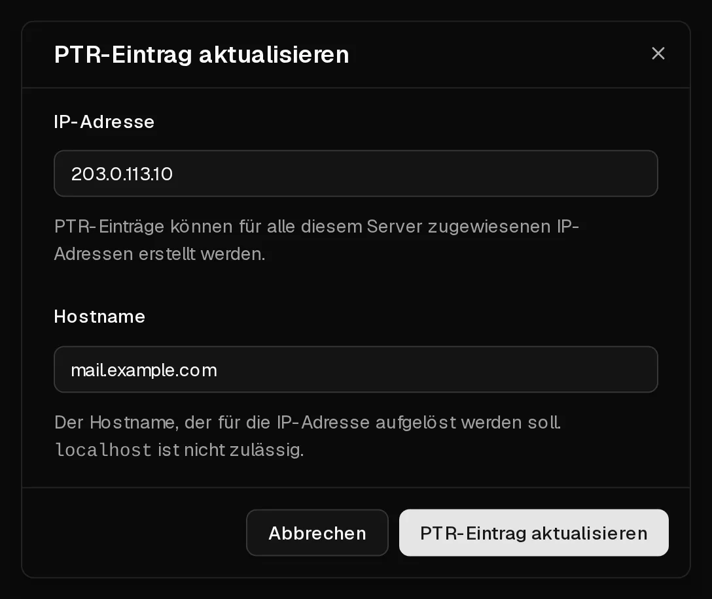

Reverse DNS beantwortet die Frage „Welcher Hostname gehört zu dieser IP-Adresse?“. Festgelegt wird das mit einem <Term id="ptr-record">PTR-Eintrag</Term>. Im Reiter <Ui>rDNS</Ui> kannst du einen solchen Eintrag für die <Term id="ipv4">IPv4-Adresse</Term> deines Servers und für jede Adresse in seinem <Term id="ipv6-subnet">IPv6-/64-Subnetz</Term> anlegen.

Die meisten brauchen ihn aus einem einzigen Grund: **zum Versenden von E-Mails**. Viele Mailserver lehnen E-Mails von einer Adresse ohne PTR-Eintrag oder mit einem nicht passenden PTR-Eintrag ab oder markieren sie.

## Bevor du loslegst

Lege zuerst bei deinem Domain-Anbieter einen DNS-Eintrag für den Hostnamen an, der auf den Server zeigt:

- einen **A**-Eintrag für die IPv4-Adresse, z. B. `mail.example.com` → `203.0.113.10`,
- einen **AAAA**-Eintrag, wenn du auch IPv6 nutzt.

Der PTR-Eintrag und dieser Eintrag sollten aufeinander verweisen. Genau diese Übereinstimmung, Forward-Confirmed Reverse DNS genannt, prüfen empfangende Mailserver.

## Einen PTR-Eintrag festlegen

1. Klicke im [Kundenportal](https://app.virtbase.com/servers) neben deinem Server auf <Ui>Ansehen</Ui> und öffne den Reiter <Ui>rDNS</Ui>.
2. Klicke neben <Ui>PTR-Einträge</Ui> auf das Stift-Symbol.
3. Gib unter <Ui>IP-Adresse</Ui> die Adresse ein, z. B. `203.0.113.10` oder `2001:db8::10`.
4. Gib unter <Ui>Hostname</Ui> den vollständigen Hostnamen in Kleinbuchstaben ein, z. B. `mail.example.com`.
5. Klicke auf <Ui>PTR-Eintrag aktualisieren</Ui>.



Der Eintrag erscheint in der Tabelle. Um ihn zu ändern, wiederhole die Schritte mit derselben IP-Adresse und einem neuen Hostnamen.

## Prüfen, ob es geklappt hat

Frag die Adresse von deinem Computer oder vom Server aus ab:

```bash
dig -x 203.0.113.10 +short
```

Die Ausgabe ist dein Hostname, gefolgt von einem Punkt: `mail.example.com.`. Andere DNS-Resolver haben die alte Antwort eventuell noch eine Weile im Cache.

## Einen PTR-Eintrag entfernen

Klicke in der Zeile des Eintrags auf das Papierkorb-Symbol und bestätige. Die Adresse verweist dann nicht mehr auf deinen Hostnamen, und E-Mails von ihr werden möglicherweise abgelehnt.

## E-Mails von deinem Server versenden

Ausgehender Port 25 ist auf Virtbase-Servern offen, dein Server kann E-Mails also direkt zustellen. Damit sie ankommen und nicht im Spam landen, brauchst du mehr als Reverse DNS:

- einen **PTR-Eintrag**, der zu einem **A**-/**AAAA**-Eintrag passt, wie oben beschrieben,
- **SPF**-, **DKIM**- und **DMARC**-Einträge für deine Domain,
- einen Mailserver, der sich mit demselben Hostnamen meldet (bei Postfix `myhostname` in `/etc/postfix/main.cf`).

Wer Spam versendet oder E-Mails von einem kompromittierten Server verschickt, bekommt [Missbrauchsmeldungen](/de/help/article/about-abuse-reports) und riskiert, dass die Adresse auf Blocklisten landet.

## Wenn es nicht geklappt hat

- <Msg>Der PTR-Eintrag konnte nicht gespeichert werden.</Msg> Prüfe, ob die IP-Adresse zu diesem Server gehört und ob der Hostname ein gültiger, vollständig qualifizierter Name in Kleinbuchstaben ist. `localhost` ist nicht erlaubt.
- <Msg>Du machst das zu oft. Bitte warte einen Moment.</Msg> Du kannst bis zu 10 PTR-Einträge pro Stunde speichern. Warte und versuche es erneut.
- **Der Reiter „rDNS“ lässt sich nicht bearbeiten:** Solange der Server deaktiviert ist, lassen sich PTR-Einträge nicht ändern. [Verlängere den Server](/de/help/article/how-to-renew-server) zuerst.

Wird ein Server gelöscht, werden auch seine PTR-Einträge entfernt.
