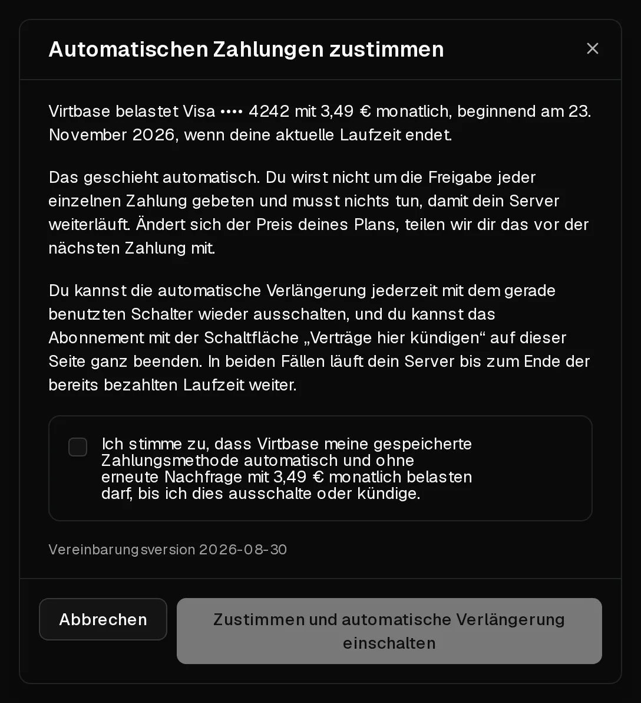

Mit der automatischen Verlängerung verlängert sich dein Server am Ende jeder Laufzeit von selbst: Wir belasten deine gespeicherte Karte, und der Server läuft weiter, ohne dass du etwas tun musst. Ohne sie endet der Server mit Ablauf der Laufzeit, es sei denn, du [verlängerst ihn von Hand](/de/help/article/how-to-renew-server).

## Bevor du loslegst

Du brauchst eine gespeicherte Zahlungsmethode. Um eine hinzuzufügen, öffne [Konto > Abrechnung](https://app.virtbase.com/account/settings/billing), klicke auf <Ui>Karte hinzufügen</Ui>, gib die Karte ein und klicke auf <Ui>Karte speichern</Ui>. Beim Hinzufügen wird nichts abgebucht.

Zahlungen mit Kryptowährung lassen sich nicht speichern, deshalb ist die automatische Verlängerung damit nicht möglich.

## Die automatische Verlängerung einschalten

1. Klicke im [Kundenportal](https://app.virtbase.com/servers) neben deinem Server auf <Ui>Ansehen</Ui> und öffne den Reiter <Ui>Plan</Ui>.
2. Schalte unter <Ui>Automatische Verlängerung</Ui> den Schalter ein.
3. Lies die Vereinbarung im Dialog <Ui>Automatischen Zahlungen zustimmen</Ui>. Er zeigt den Betrag, die Karte und das Datum der ersten Abbuchung an.
4. Setze das Häkchen und klicke auf <Ui>Zustimmen und automatische Verlängerung einschalten</Ui>.

Die Plan-Karte zeigt jetzt <Ui>Verlängert sich automatisch am</Ui>, gefolgt von dem Datum, an dem deine aktuelle Laufzeit endet. Die erste Abbuchung erfolgt an diesem Datum, nicht heute.

Die automatische Verlängerung wird für jeden Server einzeln eingestellt. Wiederhole diese Schritte für jeden Server, der sich automatisch verlängern soll.

## Die belastete Karte ändern

Verlängerungen werden von der Karte abgebucht, die für Verlängerungen markiert ist. Um sie zu ändern, öffne [Konto > Abrechnung](https://app.virtbase.com/account/settings/billing) und klicke neben einer anderen Karte auf <Ui>Für Verlängerungen verwenden</Ui>. Im Reiter <Ui>Plan</Ui> jedes Servers siehst du, welche Karte er nutzt.

## Die automatische Verlängerung ausschalten

Schalte im Reiter <Ui>Plan</Ui> den Schalter unter <Ui>Automatische Verlängerung</Ui> aus. Der Server läuft bis zum Ende der Laufzeit weiter, die du bezahlt hast. Danach endet er, es sei denn, du verlängerst ihn von Hand.

## Abonnement kündigen

Mit der Kündigung endet der Server zum Ende der aktuellen Laufzeit.

1. Klicke im Reiter <Ui>Plan</Ui> unter <Ui>Kündigung</Ui> auf <Ui>Verträge hier kündigen</Ui>.
2. Bestätige mit <Ui>Jetzt kündigen</Ui>.

Heute wird nichts abgeschaltet, und es wird nichts mehr abgebucht. Der Server läuft bis zum angezeigten Datum, wird dann heruntergefahren und 5 Tage später mit allen Daten und Backups gelöscht. Lade bis dahin alles herunter, was du behalten möchtest.

Du hast es dir anders überlegt? Klicke vor Ende der Laufzeit auf <Ui>Abonnement fortsetzen</Ui>. Dadurch wird die automatische Verlängerung nicht wieder eingeschaltet – schalte den Schalter danach also erneut ein.

## Wenn es nicht geklappt hat

- <Msg>Füge zuerst eine Zahlungsmethode hinzu. Die automatische Verlängerung braucht eine Karte, die wir am Ende deiner Laufzeit belasten können.</Msg> Füge unter <Ui>Konto</Ui> › <Ui>Abrechnung</Ui> eine Karte hinzu und versuche es dann erneut.
- <Msg>Die Zahlungsmethode, die wir belasten würden, kann nicht verwendet werden.</Msg> Die Karte ist abgelaufen oder wurde abgelehnt. Wähle mit <Ui>Für Verlängerungen verwenden</Ui> eine andere Karte aus.
- <Msg>Setze dieses Abonnement fort, bevor du die automatische Verlängerung wieder einschaltest.</Msg> Das Abonnement wurde gekündigt. Klicke zuerst auf <Ui>Abonnement fortsetzen</Ui>.
- <Msg>Der bezahlte Zeitraum ist abgelaufen.</Msg> Ein Abonnement lässt sich nur fortsetzen, solange seine Laufzeit noch läuft. [Verlängere den Server](/de/help/article/how-to-renew-server) stattdessen von Hand, solange er noch nicht gelöscht ist.

Schlägt die Zahlung für eine Verlängerung fehl, siehe [Zahlung für die Verlängerung fehlgeschlagen – was passiert jetzt?](/de/help/article/failed-payment)
