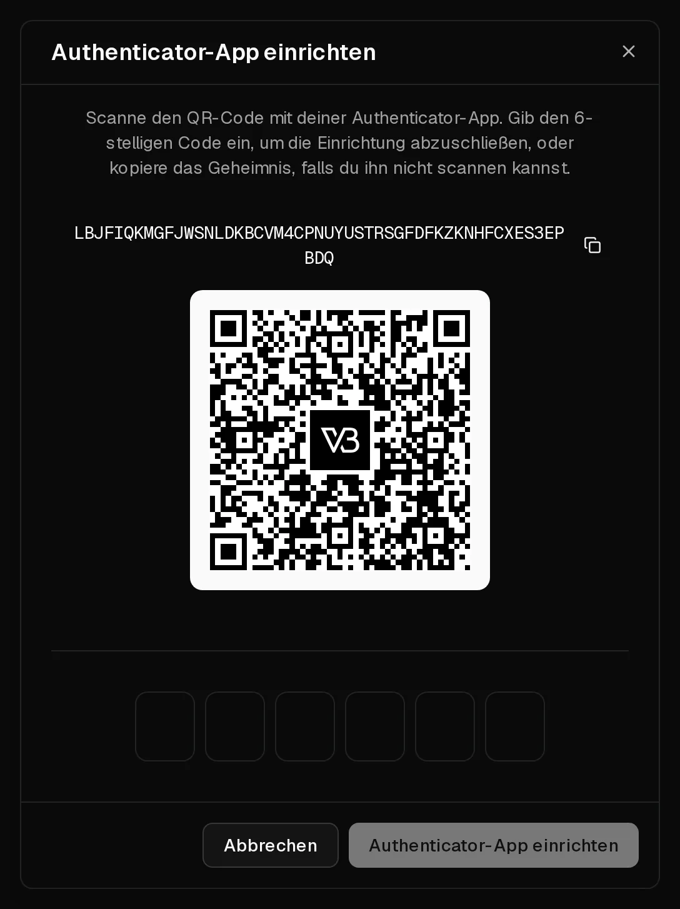

Dein Virtbase-Konto steuert deine Server, deshalb verdient es mehr als nur ein Passwort. Auf der Seite <Ui>Sicherheit</Ui> deines Kontos kannst du

- bei der Anmeldung einen Code aus einer **Authenticator-App** verlangen (<Term id="two-factor-authentication">Zwei-Faktor-Authentifizierung</Term>),
- dich mit einem <Ui>Passkey</Ui> statt mit einem Passwort anmelden,
- <Ui>Google</Ui>, <Ui>GitHub</Ui> oder <Ui>Discord</Ui> für die Anmeldung verknüpfen,
- sehen, wo du angemeldet bist, und andere Geräte abmelden.

## Zwei-Faktor-Authentifizierung einrichten

Du brauchst eine Authenticator-App wie 1Password, Google Authenticator oder Microsoft Authenticator.

1. Öffne [Konto > Sicherheit](https://app.virtbase.com/account/settings/authentication).
2. Klicke unter <Ui>Zwei-Faktor-Authentifizierung</Ui> neben <Ui>Authenticator-App (TOTP)</Ui> auf <Ui>Einrichten</Ui>.
3. Bestätige mit deinem Passwort.
4. Scanne den QR-Code mit deiner App. Kannst du ihn nicht scannen, kopiere stattdessen den geheimen Schlüssel in die App.
5. Gib den 6-stelligen Code ein, den die App anzeigt, und bestätige.

<Ui>Authenticator-App (TOTP)</Ui> zeigt jetzt <Ui>Eingerichtet</Ui> an. Ab sofort wirst du nach deinem Passwort nach dem aktuellen Code aus deiner App gefragt.

Deine <Ui>Wiederherstellungscodes</Ui> findest du unter <Ui>Zwei-Faktor-Authentifizierung</Ui>. Bewahre sie in einem Passwort-Manager auf oder drucke sie aus. Klicke auf <Ui>Neu generieren</Ui>, um sie durch neue zu ersetzen.

Um die Zwei-Faktor-Authentifizierung auf ein neues Handy umzuziehen, klicke auf <Ui>Ersetzen</Ui> und scanne den neuen QR-Code mit dem neuen Handy.

## Einen Passkey hinzufügen

Mit einem <Term id="passkey">Passkey</Term> meldest du dich per Fingerabdruck, Gesichtserkennung, Geräte-PIN oder Sicherheitsschlüssel an, und er ist vor Phishing geschützt.

1. Klicke auf der Seite <Ui>Sicherheit</Ui> unter <Ui>Passkeys</Ui> auf <Ui>Passkey hinzufügen</Ui>.
2. Folge den Anweisungen deines Browsers oder Geräts.

Um dich damit anzumelden, klicke auf der Anmeldeseite auf <Ui>Mit Passkey fortfahren</Ui>. Du kannst mehrere Passkeys registrieren, z. B. einen auf deinem Laptop und einen auf deinem Handy.

## Mit Google, GitHub oder Discord anmelden

Klicke unter <Ui>Anmeldemethoden</Ui> neben einem Anbieter auf <Ui>Verknüpfen</Ui> und bestätige bei diesem Anbieter. Danach kannst du dich darüber anmelden. Wenn du Discord verknüpfst, kannst du außerdem den [Discord-Bot](/de/help/article/discord-integration) nutzen. Klicke auf <Ui>Trennen</Ui>, um einen Anbieter wieder zu lösen.

## Andere Geräte abmelden

<Ui>Aktive Sitzungen</Ui> listet jedes Gerät auf, das bei deinem Konto angemeldet ist, mit seiner IP-Adresse und dem Zeitpunkt der Anmeldung. Klicke neben jeder Sitzung, die du nicht kennst, auf <Ui>Abmelden</Ui>.

Sitzungen enden von selbst 3 Tage nach der letzten Anmeldung. Setzt du dein Passwort über <Ui>Passwort vergessen?</Ui> zurück, werden alle Sitzungen beendet.

Siehst du eine Sitzung, die du nicht kennst, melde sie ab, [ändere dein Passwort](/de/help/article/how-to-change-account-settings) und prüfe deine [API-Schlüssel](/de/help/article/how-to-use-public-api).

## Wenn es nicht geklappt hat

- <Msg>Ungültiger Code. Bitte versuche es erneut.</Msg> Achte darauf, dass die Uhrzeit auf deinem Handy automatisch eingestellt wird: Authenticator-Codes hängen von der richtigen Uhrzeit ab. Gib den Code ein, der gerade angezeigt wird, nicht einen, der gleich wechselt.
- **Du hast das Handy mit deiner Authenticator-App verloren:** Melde dich mit einem Passkey an, falls du einen registriert hast, und klicke dann auf <Ui>Ersetzen</Ui>, um die App auf deinem neuen Handy einzurichten. Ohne Passkey [kontaktiere den Support](/de/contact) von der E-Mail-Adresse deines Kontos aus.
- **Die Passkey-Abfrage erscheint nicht:** Dein Browser oder Gerät unterstützt Passkeys möglicherweise nicht. Nutze einen aktuellen Browser oder ein anderes Gerät.
