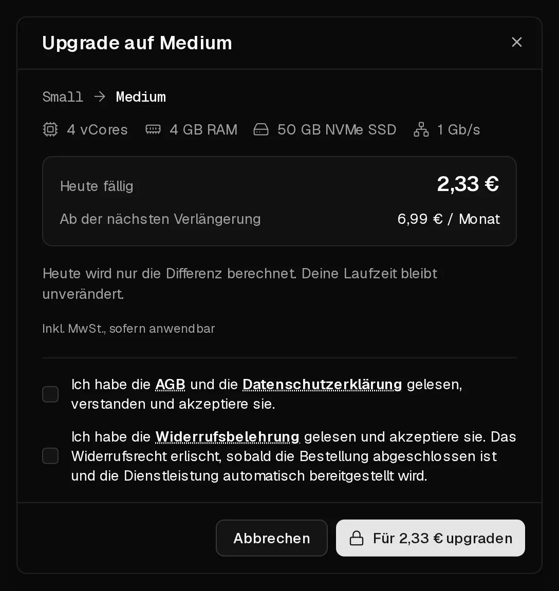

Du kannst deinen Server jederzeit im Reiter <Ui>Plan</Ui> auf einen größeren Plan umstellen. Deine Daten, IP-Adressen und Einstellungen bleiben, wie sie sind. Der Server startet einmal neu, um die neuen Ressourcen zu übernehmen.

## Was es kostet

Du zahlst nur die **Differenz** zwischen den beiden Plänen für die verbleibende Zeit deiner aktuellen Laufzeit. Deine Laufzeit ändert sich nicht. Ab der nächsten Verlängerung zahlst du den Preis des neuen Plans.

**Beispiel:** Dein Plan kostet 6 € im Monat und der neue 10 €. Bleiben noch 15 Tage deiner 30-tägigen Laufzeit, kostet das Upgrade heute (10 € − 6 €) × 15 ÷ 30 = **2 €**. Der Mindestbetrag liegt bei 0,50 €.

Bevor du bezahlst, zeigt der Dialog den genauen Betrag unter <Ui>Heute fällig</Ui> und den künftigen Preis unter <Ui>Verlängerungspreis</Ui> an.

## Bevor du loslegst

- **Fahre den Server sauber herunter**, mit <Ui>Herunterfahren</Ui> im Kundenportal oder `poweroff` im Server. Beim Upgrade wird der Server ausgeschaltet, ohne auf Anwendungen zu warten; sonst können dabei ungespeicherte Daten verloren gehen.
- Optional: Erstelle ein [Backup](/de/help/article/how-to-backup-server).

## Upgrade durchführen

1. Klicke im [Kundenportal](https://app.virtbase.com/servers) neben deinem Server auf <Ui>Ansehen</Ui> und öffne den Reiter <Ui>Plan</Ui>.
2. Wähle einen größeren Plan und klicke auf <Ui>Upgrade</Ui>.
3. Prüfe <Ui>Heute fällig</Ui> und <Ui>Verlängerungspreis</Ui> und klicke dann auf die Schaltfläche <Ui>Für … upgraden</Ui>, die den Betrag anzeigt.
4. Wähle eine Zahlungsmethode und klicke auf <Ui>Jetzt kaufen</Ui>.



Nach der Zahlung wird die Festplatte vergrößert und der Server mit den neuen Ressourcen gestartet, auch wenn du ihn vorher heruntergefahren hast. Das dauert ein paar Minuten.

## Prüfen, ob es geklappt hat

Die Seite <Ui>Übersicht</Ui> zeigt die neue Anzahl an <Term id="vcore">vCores</Term> und den neuen Arbeitsspeicher an. Prüfe im Server:

```bash
nproc       # Anzahl der CPU-Kerne
free -h     # Arbeitsspeicher
df -h /     # freier Speicherplatz
```

Bei unseren fertigen Betriebssystemen wachsen Partition und Dateisystem beim Start des Servers automatisch mit. Zeigt `df -h /` noch die alte Größe, etwa bei einem System, das du von einer ISO installiert hast, vergrößere sie von Hand:

```bash tab="ext4" tab-group="filesystem"
growpart /dev/sda 1
resize2fs /dev/sda1
```

```bash tab="XFS" tab-group="filesystem"
growpart /dev/sda 1
xfs_growfs /
```

Partitionsnummer und Dateisystem können auf deinem System anders sein. `lsblk -f` zeigt sie an.

## Kann ich ein Downgrade machen?

Nein. Du kannst nur auf einen Plan wechseln, der mehr kostet und mindestens genauso viel Speicher hat, weil sich eine Festplatte nicht sicher verkleinern lässt. Um auf einen kleineren Plan zu wechseln, bestelle einen neuen Server, zieh deine Daten um und [kündige den alten](/de/help/article/how-to-set-up-automatic-renewal#abonnement-kündigen).

## Wenn es nicht geklappt hat

- **Weniger Speicher als dein Plan:** Dieser Plan hat eine kleinere Festplatte als deiner und kann nicht gewählt werden.
- **Ausverkauft:** Der Plan ist auf der Hardware deines Servers gerade nicht verfügbar. Versuche es später erneut.
- <Msg>Deine aktuelle Laufzeit ist abgelaufen. Verlängere zuerst deinen Server und mache dann das Upgrade.</Msg> [Verlängere den Server](/de/help/article/how-to-renew-server) und mach dann das Upgrade.
- **Keine Pläne verfügbar:** Auf der Hardware, auf der dein Server läuft, gibt es keinen größeren Plan.
- <Msg>Neue Bestellungen sind ausgesetzt, solange ein Missbrauchsfall offen ist.</Msg> Upgrades sind pausiert, bis der [Missbrauchsfall](/de/help/article/about-abuse-reports) geschlossen ist.
- **Eine Bestellung wartet auf Zahlung:** Klicke auf <Ui>Zahlung fortsetzen</Ui> oder auf <Ui>Verwerfen</Ui> und beginne von vorn.
