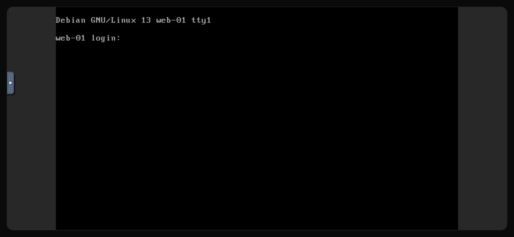

Die Konsole ist Bildschirm und Tastatur deines Servers in einem Browser-Tab. Sie verbindet sich direkt mit der virtuellen Maschine statt über deren Netzwerk und funktioniert daher auch dann, wenn <Term id="ssh">SSH</Term> es nicht tut: nach einem Fehler in der Firewall, bei einer kaputten Netzwerkkonfiguration oder während ein Betriebssystem bootet oder von einem <Term id="iso-image">ISO-Image</Term> installiert wird.

## Die Konsole öffnen

1. Klicke im [Kundenportal](https://app.virtbase.com/servers) neben deinem Server auf <Ui>Ansehen</Ui>.
2. Öffne den Reiter <Ui>Konsole</Ui>.

Die Konsole verbindet sich nach ein paar Sekunden von selbst. Siehst du <Ui>Server läuft nicht</Ui>, starte den Server; die Konsole verbindet sich, sobald er läuft.

Die Konsole ist nicht verfügbar, während der Server installiert wird, während er deaktiviert ist oder während ein Backup erstellt wird. Der Reiter zeigt dir an, was davon zutrifft.

## Anmelden

Melde dich mit dem Benutzer `root` und deinem Root-Passwort an. Unter Windows nutzt du das Konto `Administrator`.

Kennst du das Passwort nicht, [setze es](/de/help/article/how-to-reset-root-password) zuerst im Kundenportal zurück. Ein in der Konsole eingegebenes Passwort wird nicht auf dem Bildschirm angezeigt; das ist normal.

## Sondertasten, Vollbild und neu verbinden

Die Konsole läuft mit [noVNC](https://novnc.com). Die Steuerleiste sitzt am linken Rand der Konsole: Klicke auf den kleinen Reiter, um sie auszuklappen.

- <Ui>Zusatztasten</Ui> sendet Tastenkombinationen, die dein eigener Computer abfangen würde, etwa <Ui>Strg+Alt+Entf</Ui>, oder <Ui>Esc</Ui> und <Ui>Tab</Ui>.
- <Ui>Vollbild</Ui> vergrößert die Konsole auf den ganzen Bildschirm.
- <Ui>Verbindung trennen</Ui> beendet die Verbindung. Lade die Seite neu, um dich wieder zu verbinden.

Reagiert die Konsole nicht mehr, lade die Seite neu. Solange der Tab geöffnet bleibt, wird die Verbindung automatisch erneuert.

## Wenn es nicht geklappt hat

### Es erscheinen falsche Zeichen

Wenn manche Tasten andere Zeichen tippen als erwartet, z. B. zwei Buchstaben gegenüber deiner Tastatur vertauscht sind (bei einer deutschen Tastatur etwa `y` und `z`), weicht das Tastaturlayout deines Computers von dem ab, das die Konsole erwartet. Tippe so, als hättest du ein US-Layout, oder setze ein vorübergehendes Passwort, das nur Buchstaben und Ziffern enthält, die auf beiden Layouts an derselben Stelle liegen. Ändere es danach über SSH.

### Einfügen funktioniert nicht

Text aus deiner Zwischenablage wird nicht an den Server übertragen, Einfügen funktioniert also weder für Passwörter noch für Befehle. Tippe sie von Hand ein oder verbinde dich per [SSH](/de/help/article/how-to-connect-to-server), wo Kopieren und Einfügen ganz normal funktionieren.

### Der Bildschirm ist schwarz

Der Server ist möglicherweise im Ruhezustand oder zeigt einen schwarzen Bildschirmschoner. Drücke eine Taste oder bewege die Maus über die Konsole. Bleibt der Bildschirm schwarz, prüfe den Status auf der Seite <Ui>Übersicht</Ui> und siehe [Server nicht erreichbar: Ich kann mich nicht verbinden](/de/help/article/cant-connect-to-server).

## Konsole über Discord

Nutzt du den [Discord-Bot](/de/help/article/discord-integration), kann <Ui>/menu</Ui> einen einmaligen Konsolen-Link öffnen. Der Link ist 10 Sekunden gültig, öffne ihn also sofort.
