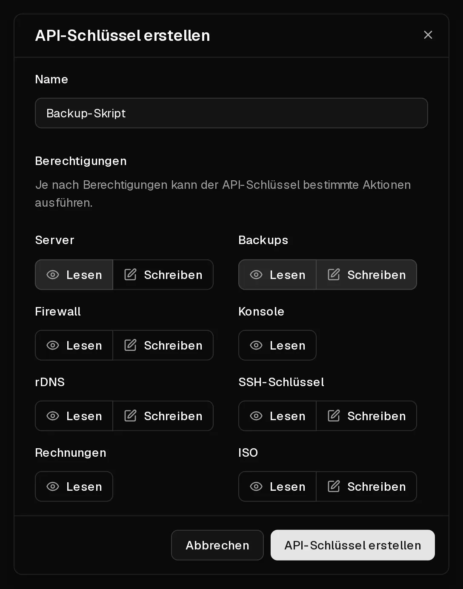

Mit der Virtbase-API verwaltest du deine Server aus deinen eigenen Skripten und Tools: Power-Aktionen, Backups, Firewallregeln, <Term id="ptr-record">Reverse DNS</Term>, <Term id="ssh-key">SSH-Schlüssel</Term>, <Term id="iso-image">ISO-Images</Term> und Rechnungen. Jede Anfrage authentifizierst du mit einem <Term id="api-key">API-Schlüssel</Term>.

Die vollständige Referenz mit allen Endpunkten und einem interaktiven Client findest du in der [API-Dokumentation](/api/docs).

## Einen API-Schlüssel erstellen

1. Öffne im [Kundenportal](https://app.virtbase.com/account/settings/api) <Ui>Konto</Ui> › <Ui>API</Ui>.
2. Klicke auf <Ui>API-Schlüssel erstellen</Ui>.
3. Gib unter <Ui>Name</Ui> ein, wofür der Schlüssel gedacht ist, z. B. `Backup-Skript`.
4. Wähle unter <Ui>Berechtigungen</Ui> für jeden Bereich, den der Schlüssel braucht, <Ui>Lesen</Ui> oder <Ui>Schreiben</Ui>: <Ui>Server</Ui>, <Ui>Backups</Ui>, <Ui>Firewall</Ui>, <Ui>Konsole</Ui>, <Ui>rDNS</Ui>, <Ui>SSH-Schlüssel</Ui>, <Ui>Rechnungen</Ui> und <Ui>ISO</Ui>. Lass alles andere ausgeschaltet.
5. Klicke auf <Ui>API-Schlüssel erstellen</Ui>.
6. Kopiere den Schlüssel aus <Ui>API-Schlüssel erstellt</Ui> und bewahre ihn sicher auf, etwa in einem Passwort-Manager.



<Hint>
Der Schlüssel wird nur einmal angezeigt und lässt sich nicht erneut aufrufen. Verlierst du ihn, lösche ihn und erstelle einen neuen.
</Hint>

API-Schlüssel sind ab dem Tag ihrer Erstellung **ein Jahr** gültig. Erstelle vorher einen neuen Schlüssel und ersetze den alten in deinen Skripten.

## Eine Anfrage senden

Schick den Schlüssel bei jeder Anfrage im Header `X-Virtbase-API-Key` mit. So listest du zum Beispiel deine Server auf:

```bash
curl https://virtbase.com/api/v1/servers \
  -H "X-Virtbase-API-Key: $VIRTBASE_API_KEY"
```

Listen werden über die Query-Parameter `page` (beginnend bei 1) und `per_page` (standardmäßig 10, höchstens 100) seitenweise ausgegeben. Viele Listen lassen sich mit `sort` sortieren, z. B. `sort=name:asc`.

## Rate Limits

Du kannst bis zu **120 Anfragen pro Minute** senden. Für manche Aktionen gelten eigene, strengere Limits, z. B. 5 Power-Aktionen pro Minute oder 5 Backups pro Tag.

Jede Antwort zeigt dir, wo du stehst:

- `X-RateLimit-Limit`: die im Zeitfenster erlaubten Anfragen,
- `X-RateLimit-Remaining`: die Anfragen, die dir noch bleiben,
- `X-RateLimit-Reset`: wann das volle Kontingent wieder zur Verfügung steht, als Unix-Zeitstempel.

Überschreitest du ein Limit, antwortet die API mit `429 Too Many Requests`. Warte bis zum Reset-Zeitpunkt, bevor du es erneut versuchst. Brauchst du ein höheres Limit, [kontaktiere den Support](/de/contact) und beschreibe, was du baust.

## Was die API nicht kann

Zu deiner Sicherheit sind manche Aktionen nur im Kundenportal möglich, während du angemeldet bist:

- Server bestellen, verlängern und upgraden,
- Zahlungsmethoden und Abonnements verwalten,
- Missbrauchsmeldungen beantworten,
- deine Daten exportieren und dein Konto löschen.

## Deine Schlüssel schützen

- Gib jedem Skript einen eigenen Schlüssel mit genau den Berechtigungen, die es braucht. Ein Schlüssel, der nur Rechnungen liest, kann keinen Server löschen.
- Leg einen Schlüssel niemals im Quellcode oder in einem öffentlichen Repository ab. Nutze eine Umgebungsvariable oder einen Secrets-Manager.
- Lösche Schlüssel, die du nicht mehr nutzt, unter <Ui>Konto</Ui> › <Ui>API</Ui>.

Ist ein Schlüssel an die Öffentlichkeit gelangt, lösche ihn sofort und erstelle einen neuen.

## Wenn es nicht geklappt hat

- **`401 Unauthorized`:** Der Schlüssel fehlt, ist falsch geschrieben, gelöscht oder abgelaufen.
- **`403 Forbidden`:** Dem Schlüssel fehlt die Berechtigung für diese Aktion, die Aktion ist nur im Kundenportal verfügbar, oder der Server befindet sich in einem Zustand, der sie nicht zulässt, etwa während der Installation oder wenn er deaktiviert ist.
- **`429 Too Many Requests`:** Du hast ein Rate Limit erreicht. Siehe oben.
