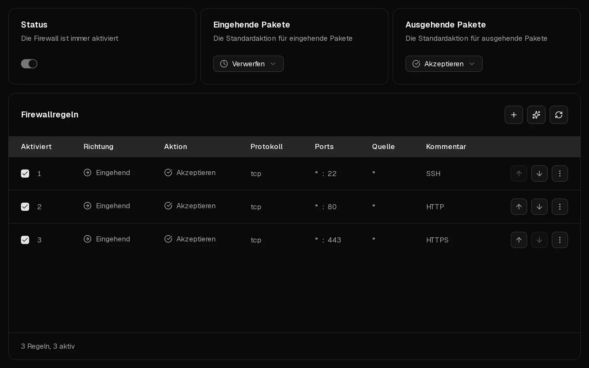
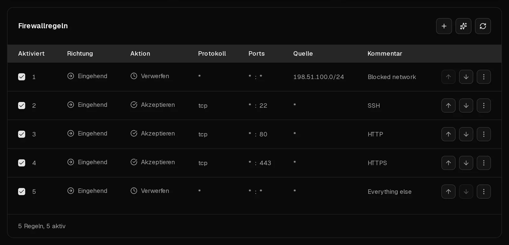

Vor jedem Virtbase-Server sitzt eine Firewall, die du im Reiter <Ui>Firewall</Ui> selbst steuerst. Sie filtert den Datenverkehr, bevor er deinen Server erreicht, und schützt damit auch einen Server, dessen eigene Firewall falsch konfiguriert ist.

Die Firewall ist immer aktiv. **Neue Server lassen sämtlichen Datenverkehr in beide Richtungen durch.** Um einen Server abzusichern, stellst du eingehenden Datenverkehr auf <Ui>Verwerfen</Ui> und erlaubst nur die Ports, die du tatsächlich nutzt.

## Bevor du loslegst: Sperr dich nicht selbst aus

Wenn du die Standardaktion für eingehenden Datenverkehr auf <Ui>Verwerfen</Ui> stellst, bevor eine Regel deinen <Term id="ssh">SSH</Term>-Port erlaubt, bricht deine SSH-Sitzung ab. Lege deshalb zuerst die Regel für Port 22 an. Falls es trotzdem passiert: Die [Konsole](/de/help/article/how-to-use-console) funktioniert weiterhin, und im Kundenportal kannst du die Regeln jederzeit korrigieren.

## Einen neuen Server in vier Schritten absichern

1. Klicke im [Kundenportal](https://app.virtbase.com/servers) neben deinem Server auf <Ui>Ansehen</Ui> und öffne den Reiter <Ui>Firewall</Ui>.
2. Lege eine Regel an, die SSH erlaubt: Klicke auf <Ui>+</Ui> und setze <Ui>Richtung</Ui> auf <Ui>Eingehend</Ui>, <Ui>Aktion</Ui> auf <Ui>Akzeptieren</Ui>, <Ui>Protokoll</Ui> auf <Ui>TCP</Ui> und <Ui>Zielport</Ui> auf `22`. Trage einen <Ui>Kommentar</Ui> wie `SSH` ein und klicke auf <Ui>Firewallregel erstellen</Ui>.
3. Lege eine solche Regel für jeden weiteren Dienst an, der erreichbar sein muss, z. B. `80` und `443` für eine Website.
4. Setze <Ui>Eingehende Pakete</Ui> auf <Ui>Verwerfen</Ui>.

Änderungen greifen innerhalb weniger Sekunden. Antworten auf Verbindungen, die dein Server selbst aufgebaut hat, etwa beim Herunterladen von Paketen, werden immer durchgelassen. <Ui>Ausgehende Pakete</Ui> kannst du deshalb auf <Ui>Akzeptieren</Ui> lassen.

## Eine Regel erstellen

Klicke über der Regelliste auf <Ui>+</Ui> und fülle die Felder aus:

| Feld | Was du einträgst |
| --- | --- |
| <Ui>Richtung</Ui> | <Ui>Eingehend</Ui> für Datenverkehr zu deinem Server, <Ui>Ausgehend</Ui> für Datenverkehr, den er sendet. |
| <Ui>Aktion</Ui> | <Ui>Akzeptieren</Ui>, <Ui>Verwerfen</Ui> oder <Ui>Ablehnen</Ui> (siehe unten). |
| <Ui>Protokoll</Ui> | Meist <Ui>TCP</Ui> oder <Ui>UDP</Ui>. Wähle <Ui>ICMP</Ui>, um Pings zu filtern, und anschließend einen <Ui>ICMP-Typ</Ui>. |
| <Ui>Zielport</Ui> | Einen einzelnen Port wie `443` oder einen Bereich wie `8000:8100`. |
| <Ui>Quelle</Ui> | Optional. Eine Adresse oder ein Netzwerk wie `198.51.100.7` oder `10.0.0.0/8`. Lass das Feld leer, damit die Regel für alle gilt. |
| <Ui>Kommentar</Ui> | Optional, bis zu 64 Zeichen. Notiere, wofür die Regel da ist. |
| <Ui>Aktiviert</Ui> | Schalte es aus, um eine Regel zu behalten, ohne sie anzuwenden. |

Um eine Regel zu ändern, wähle in ihrem Menü <Ui>Bearbeiten</Ui>. Um sie zu entfernen, wähle <Ui>Löschen</Ui>.

## Akzeptieren, Verwerfen oder Ablehnen?

- <Ui>Akzeptieren</Ui> lässt den Datenverkehr durch.
- <Ui>Verwerfen</Ui> verwirft ihn stillschweigend. Der Absender wartet und läuft irgendwann in eine Zeitüberschreitung.
- <Ui>Ablehnen</Ui> verwirft ihn und teilt das dem Absender mit, der sofort „connection refused“ sieht.

Nutze <Ui>Verwerfen</Ui>, um Datenverkehr aus dem Internet zu blockieren: So verrät dein Server nichts darüber, welche Dienste auf ihm laufen. <Ui>Ablehnen</Ui> ist in deinen eigenen Netzwerken nützlich, wo fehlschlagende Verbindungen sofort scheitern sollen.

## In welcher Reihenfolge werden Regeln angewendet?

Regeln werden **von oben nach unten** geprüft. Die erste aktivierte Regel, die zutrifft, entscheidet, was passiert; alle weiteren werden ignoriert. Trifft keine Regel zu, gilt die Standardaktion für die jeweilige Richtung: <Ui>Eingehende Pakete</Ui> oder <Ui>Ausgehende Pakete</Ui>.

Deshalb kommt es auf die Reihenfolge an. Eine Regel, die Port 22 für alle verwirft und über einer Regel steht, die Port 22 von deinem Büro aus akzeptiert, sperrt auch dein Büro aus. Setze spezifische Regeln über allgemeine und verschiebe Regeln in ihrem Menü mit <Ui>Nach oben verschieben</Ui> und <Ui>Nach unten verschieben</Ui>.

## Empfehlungen

Wenn der <Term id="guest-agent">QEMU-Gast-Agent</Term> in einem Linux-Server läuft, vergleicht Virtbase die Dienste, die auf deinem Server lauschen, mit deinen Regeln und zeigt <Ui>Empfehlungen</Ui> an:

- **Ein Dienst ist aus dem Internet erreichbar:** Eine Datenbank, Redis, die Docker-API oder ein ähnlicher Dienst ist für alle offen. Klicke auf <Ui>Regel erstellen</Ui>, um ihn zu blockieren – es sei denn, du wolltest ihn bewusst öffentlich machen.
- **Ein Port wird in deinem Server blockiert:** Deine Virtbase-Regel erlaubt einen Port, aber die Firewall in deinem Server blockiert ihn, sodass der Datenverkehr nie ankommt.
- **Auf einem Port lauscht nichts:** Eine Regel öffnet einen Port, den kein Dienst nutzt. Klicke auf <Ui>Regel entfernen</Ui>, um aufzuräumen.

SSH, HTTP und HTTPS (Ports 22, 80 und 443) werden nie markiert, weil sie öffentlich erreichbar sein sollen.

## Eine Firewall in deinem Server

Läuft auf deinem Server eine eigene Firewall, etwa ufw, firewalld oder nftables, zeigt der Reiter <Ui>In deinem Server läuft ebenfalls eine Firewall</Ui> an. Der Datenverkehr muss **beide** Firewalls passieren: Ein Port ist nur erreichbar, wenn er in beiden offen ist. Kann Virtbase die Regeln in deinem Server auslesen, listet es sie unter deinen eigenen auf, gekennzeichnet mit <Ui>Wird in deinem Server verwaltet</Ui>. Diese Regeln änderst du im Server selbst, nicht im Kundenportal.

## Regeln von der KI vorschlagen lassen

Klicke über der Regelliste auf das Funkel-Symbol, um <Ui>Firewallregeln generieren</Ui> zu öffnen. Beschreibe in eigenen Worten, was du möchtest, z. B. „HTTPS von überall erlauben und SSH nur von 198.51.100.7“, und klicke auf <Ui>Generieren</Ui>. Du erhältst bis zu 5 Regelvorschläge, die du prüfen kannst. Klicke für eine einzelne Regel auf <Ui>Anwenden</Ui> oder auf <Ui>Alle anwenden</Ui>. Solange du nichts anwendest, ändert sich nichts. Du kannst 10-mal pro Tag Regeln generieren.

## Wenn es nicht geklappt hat

- **Du hast dich ausgesperrt:** Öffne im Kundenportal den Reiter <Ui>Firewall</Ui>, der immer erreichbar ist, und lege über jeder Regel, die deinen SSH-Port blockiert, eine <Ui>Akzeptieren</Ui>-Regel für diesen Port an – oder setze <Ui>Eingehende Pakete</Ui> wieder auf <Ui>Akzeptieren</Ui>. Siehe [Server nicht erreichbar: Ich kann mich nicht verbinden](/de/help/article/cant-connect-to-server).
- **Ein Port ist weiterhin nicht erreichbar, obwohl eine Regel ihn erlaubt:** Prüfe, dass keine Regel darüber den Datenverkehr verwirft, dass die Regel aktiviert ist und dass auch die Firewall in deinem Server den Port erlaubt.
- <Msg>Die Firewallregel konnte nicht erstellt werden.</Msg> Ist der Server wegen eines [Missbrauchsfalls](/de/help/article/about-abuse-reports) eingeschränkt, sind Änderungen an der Firewall ausgesetzt, bis der Fall geschlossen ist.
