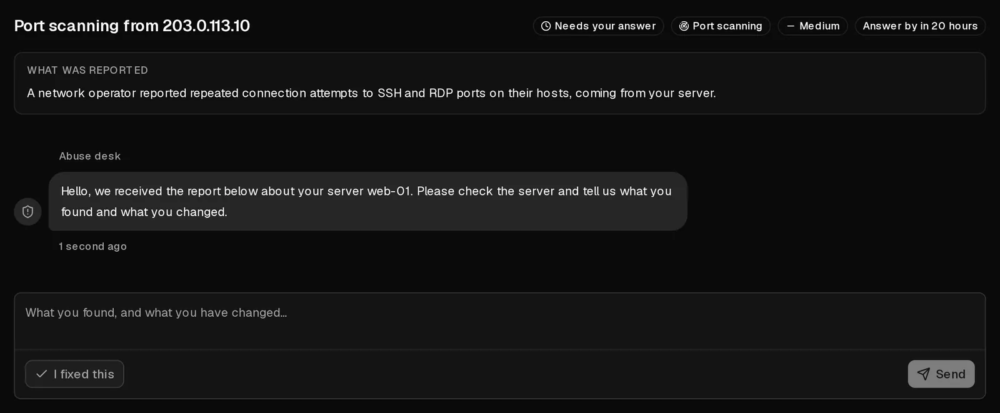

An abuse report means someone told us that traffic from one of your servers caused harm: spam, phishing, malware, port scans, attacks on other systems, or copyright infringement. Very often the owner did nothing wrong and the server was **compromised**, for example through a weak password or an outdated application.

When we open a case, you receive an email and find the case under [Abuse reports](https://app.virtbase.com/abuse) in the customer portal. **Reply within 24 hours.** That is usually all it takes to keep your server running normally.

## Answer the case

1. In the [customer portal](https://app.virtbase.com/abuse), open <Ui>Abuse reports</Ui> and select <Ui>View case</Ui>.
2. Read <Ui>What was reported</Ui>. It names the affected server, the type of abuse and, where available, the evidence.
3. Find the cause on your server (see below) and fix it.
4. Describe what you found and what you changed, then select <Ui>Send</Ui>. If you have already fixed it, select <Ui>I fixed this</Ui>.

Once you reply, the case shows <Ui>With our team</Ui> and the deadline stops. We check your answer and close the case, or ask follow-up questions. You receive an email when it is closed.

## Find the cause

Start with these checks, as `root` on the server:

- **What is using the network and the CPU:** `top`, and `ss -tunap` for open connections.
- **Processes you don't recognise,** often in `/tmp`, `/var/tmp` or `/dev/shm`.
- **Scheduled jobs:** `crontab -l`, `/etc/crontab` and `/etc/cron.*`.
- **Recent logins:** `last` and `/var/log/auth.log` (Debian, Ubuntu) or `/var/log/secure` (AlmaLinux, Rocky Linux).
- **Mail queue, for spam reports:** `mailq`.

If the server was compromised, cleaning it up is rarely reliable. Copy your data off, [reinstall the operating system](/en/help/article/how-to-change-operating-system), restore your data, and change every password and key that was on the server.

## What happens if you don't answer

Some cases restrict the affected server straight away. Otherwise, if the deadline passes without an answer, the restriction steps up one level at a time. The case shows the current level under <Ui>Restricted while this is open</Ui>:

| Level | What it means |
| --- | --- |
| <Ui>Watched</Ui> | Nothing is restricted. We are keeping an eye on it. |
| <Ui>Network limited</Ui> | The server's network speed is limited. You can still log in and fix the problem. |
| <Ui>Network blocked</Ui> | Outgoing traffic from the server is blocked. Use the [browser console](/en/help/article/how-to-use-console) to work on it. |
| <Ui>Powered off</Ui> | The server is shut down and cannot be started. Your data is untouched. |
| <Ui>Scheduled for deletion</Ui> | Only after a decision by our team, never automatically. Reply immediately if you think this is a mistake. |

Restrictions never go beyond <Ui>Powered off</Ui> on their own. Deleting a server is always a decision by a person.

While a case is open:

- you can still use the console, reset passwords, view graphs and create backups,
- you cannot change firewall rules, reinstall, restore backups or mount <Term id="iso-image">ISO images</Term>,
- **new orders, upgrades and renewals by hand are on hold**. [Automatic renewals](/en/help/article/how-to-set-up-automatic-renewal) continue as normal, so turn automatic renewal on if your term ends while the case is open.

Restrictions are lifted when we close the case, not when you reply. Your previous settings, including your own firewall rules, are restored.

## If something is unclear

- **The report is wrong.** Say so in your reply and explain why. We review every answer.
- **The case is closed but something is still wrong.** Closed cases can't be answered. [Contact support](/en/contact) with the case reference from the email.
- **You need more time.** Reply with what you have done so far. A reply stops the deadline.
