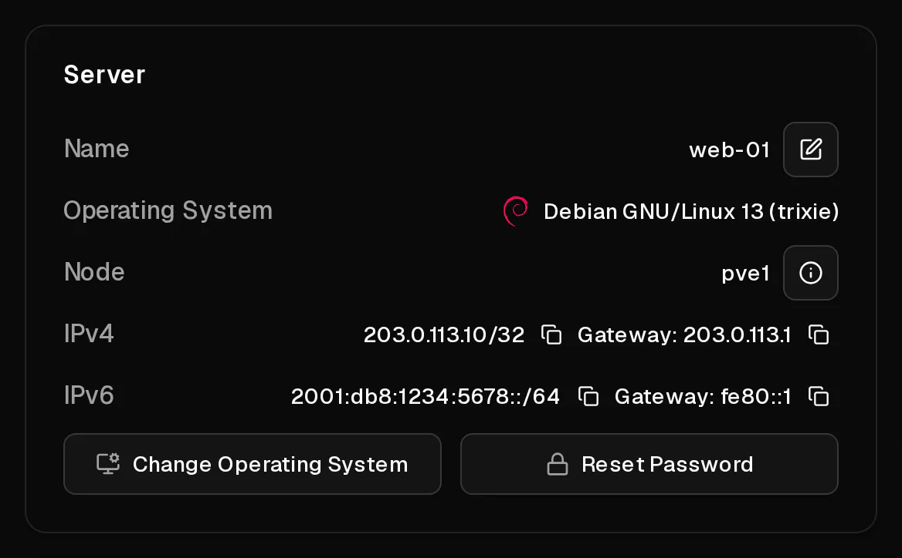

Every Virtbase server comes with:

- **one IPv4 address**, which stays the same for as long as you have the server,
- **one IPv6 /64 subnet**, more IPv6 addresses than you will ever need.

Both are set up automatically on the operating systems you choose when ordering. They stay the same when you reinstall, upgrade or restore the server.

## Where do I find them?

- In the [server list](https://app.virtbase.com/servers), <Ui>Copy IP</Ui> copies the <Term id="ipv4">IPv4 address</Term>.
- On the <Ui>Overview</Ui> page of the server, the <Ui>IPv4</Ui> and <Ui>IPv6</Ui> sections show each address with its <Ui>Gateway</Ui>, each with a copy button.



## Using IPv6

Your server has a whole <Term id="ipv6-subnet">/64 subnet</Term>, for example `2001:db8:1234:5678::/64`. One address from it is configured on the server. You can add more addresses from the same /64 inside your server, for example to run several websites on separate addresses:

```bash
ip -6 addr add 2001:db8:1234:5678::2/64 dev eth0
```

To keep it after a restart, add it to your network configuration (netplan, `/etc/network/interfaces` or NetworkManager, depending on your system).

You can set [reverse DNS](/en/help/article/how-to-set-reverse-dns) for any address in your /64.

## Can I get more IPv4 addresses?

Additional IPv4 addresses are currently not available. Each server has exactly one. Only the addresses assigned to your server can be used: traffic from any other address is blocked, to protect the network from spoofing.

## Network speed and traffic

- **Traffic is unlimited** under a <Term id="fair-use">fair-use</Term> policy. If a server uses an excessive amount over a long time, its speed may be throttled temporarily.
- The **uplink is shared**: the maximum bandwidth of a host is shared by the servers on it. Select <Ui>View Node Details</Ui> on the <Ui>Overview</Ui> page to see the <Term id="uplink">uplink</Term> of the node your server runs on.
- Outgoing port 25 is open, so you can [send email](/en/help/article/how-to-set-reverse-dns#sending-email-from-your-server) directly from your server.

## Configuring the network yourself

There is no DHCP: addresses are configured statically. If you install a system from your own ISO, or your network configuration breaks, set it up by hand with the values from the <Ui>Overview</Ui> page. See [How do I install an operating system from my own ISO?](/en/help/article/how-to-install-from-iso#3-install-and-configure-the-network) for the exact settings.
