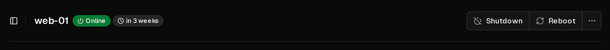
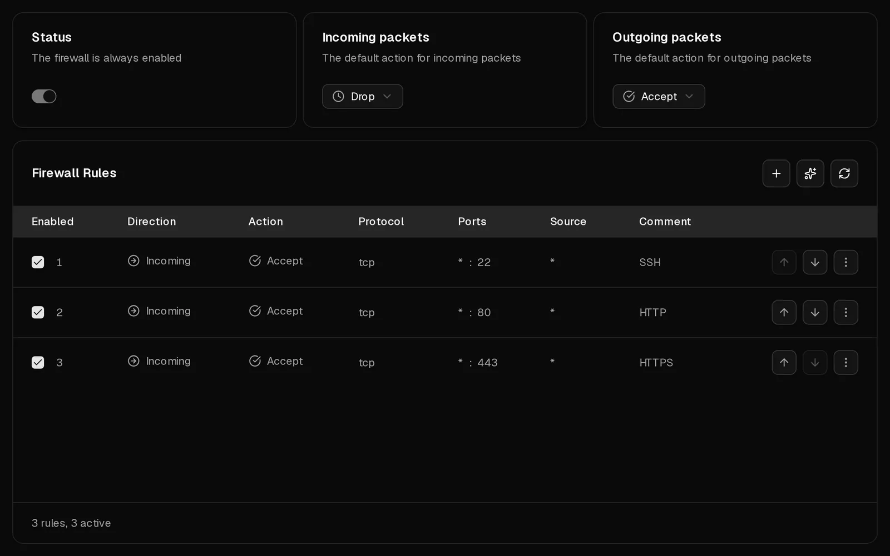

When you cannot reach your server over <Term id="ssh">SSH</Term> or <Term id="rdp">RDP</Term>, the cause is almost always one of four things: the server is not running, a firewall drops your connection, the SSH service inside the server is not listening, or your login is refused. Work through the checks below in order. Each takes about a minute, and the browser console lets you fix most problems even when the network is closed to you.

If you already have an error message, jump to [what your SSH error means](#what-your-ssh-error-means).

## 1. Check that the server is running

1. Open the [customer portal](https://app.virtbase.com/servers) and select <Ui>View</Ui> next to your server.
2. Look at the status on the <Ui>Overview</Ui> page. It should read <Ui>Online</Ui>.



What to do if it does not:

- **Offline:** select <Ui>Start</Ui> and wait about a minute for the operating system to boot.
- **Server is installing:** the server is being set up, reinstalled or restored from a backup. Wait until the banner disappears.
- **Server suspended:** the term ran out. [Renew the server](/en/help/article/how-to-renew-server) and it starts again.

Also check that you are using the right address. <Ui>Copy IP</Ui> in the [server list](https://app.virtbase.com/servers) copies the server's <Term id="ipv4">IPv4 address</Term>.

## 2. Open the console

The [browser console](/en/help/article/how-to-use-console) shows your server's screen without using the network. Open the <Ui>Console</Ui> tab.

- **You see a login prompt:** the server works. The problem is the network path or the SSH service, so continue with check 3.
- **You see boot errors, an emergency shell or a blank screen:** the operating system did not start properly. See [My server does not boot](#my-server-does-not-boot) below.

## 3. Check the Virtbase firewall

The Virtbase firewall filters traffic before it reaches your server. New servers allow all traffic, so it only blocks you if its settings or rules were changed.

1. Open the <Ui>Firewall</Ui> tab.
2. Look at <Ui>Incoming packets</Ui>. If it is set to <Ui>Drop</Ui> or <Ui>Reject</Ui>, only traffic that a rule explicitly accepts gets through.
3. Make sure an enabled rule accepts your connection: direction <Ui>Incoming</Ui>, action <Ui>Accept</Ui>, protocol <Ui>TCP</Ui>, destination port **22** (or the port your SSH server uses; **3389** for Windows Remote Desktop).
4. If that rule has a <Ui>Source</Ui>, it only matches traffic from that address. If your own IP address has changed, which happens often on home and mobile connections, the rule no longer matches you.

Rules are checked from top to bottom, and the first matching rule decides. An <Ui>Incoming</Ui> rule that drops port 22 above your accept rule blocks you, even though the accept rule exists.



Changes take effect within a few seconds. See [How do I use the firewall on my server?](/en/help/article/how-to-use-server-firewall) for how rules work.

## 4. Check the firewall inside your server

A firewall inside your server, such as ufw, firewalld or nftables, applies on top of the Virtbase firewall: traffic has to pass both. If Virtbase detects one, the Firewall tab shows <Ui>A firewall is also running inside your server</Ui>.

Log in through the console and allow SSH in it:

```bash tab="ufw" tab-group="firewall"
ufw allow 22/tcp
ufw status
```

```bash tab="firewalld" tab-group="firewall"
firewall-cmd --permanent --add-service=ssh
firewall-cmd --reload
```

Tools such as fail2ban can also block your IP address after several failed logins. `fail2ban-client status sshd` lists the blocked addresses, and `fail2ban-client unban <your-ip>` lifts the block.

## 5. Check that SSH is running

In the console, check that the SSH service runs and on which port it listens:

```bash tab="Debian / Ubuntu" tab-group="os"
systemctl status ssh
ss -tlnp | grep ssh
```

```bash tab="AlmaLinux / Rocky Linux / Fedora" tab-group="os"
systemctl status sshd
ss -tlnp | grep ssh
```

If the service is stopped, start it with `systemctl start ssh` (or `sshd`). If `ss` shows a port other than 22, connect with that port: `ssh -p 2222 root@<your-ip>`. Remember to allow that port in both firewalls.

## What your SSH error means

**`Connection timed out`**
Nothing answers. The server is off, the address is wrong, or a firewall drops the connection (checks 1, 3 and 4).

**`Connection refused`**
The server is reachable, but nothing accepts connections on that port: SSH is not running, listens on another port, or a <Ui>Reject</Ui> rule refuses the connection (checks 3 to 5).

**`Permission denied (publickey)`**
The server only accepts <Term id="ssh-key">SSH keys</Term>, and none of yours is authorised. Make sure you use the right key (`ssh -i ~/.ssh/your_key root@<your-ip>`). To add a key, log in through the console and append it to `/root/.ssh/authorized_keys`.

**`Permission denied, please try again.`**
The password is wrong. [Reset the root password](/en/help/article/how-to-reset-root-password) in the customer portal. If the new password is refused too, the SSH server may not allow password logins for root: check `PasswordAuthentication` and `PermitRootLogin` in `/etc/ssh/sshd_config`.

**`WARNING: REMOTE HOST IDENTIFICATION HAS CHANGED!`**
The server presents a different host key than the one your computer remembers. This is expected after you [change the operating system](/en/help/article/how-to-change-operating-system) or restore a backup. Remove the old key and connect again:

```bash
ssh-keygen -R <your-ip>
```

If you have not reinstalled or restored anything, do not continue. Contact support first.

## My server does not boot

If the console shows boot errors, a damaged file system or an emergency shell, you can start a rescue system yourself: upload the ISO of a live system, such as the Debian or Ubuntu installer, as a [custom ISO image](https://app.virtbase.com/account/settings/custom-images), mount it with <Ui>Mount ISO</Ui>, then shut the server down and start it again. From the live system you can mount your disk and repair it.

An uploaded <Term id="iso-image">ISO image</Term> is available for **60 minutes** and is unmounted automatically after that, so finish the repair within the hour or upload it again.

If you are unsure, contact support before you change anything.

## Is my server restricted because of an abuse report?

If an abuse case is open for your server, its network can be limited or blocked, or the server can be powered off. You then find the case under [Abuse reports](https://app.virtbase.com/abuse) and have received an email. See [What do I do when I receive an abuse report?](/en/help/article/about-abuse-reports)

## Still not working?

[Contact support](/en/contact) and include:

- your <Ui>Server ID</Ui> (on the <Ui>Advanced</Ui> tab) or your account ID and the server name,
- what you tried, and the exact error message,
- whether we may log in to the server or restart it to investigate.
