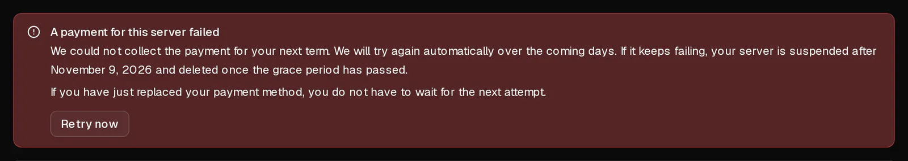

If an automatic renewal cannot be charged, **your server keeps running** and nothing is deleted. We retry the payment several times over the following week and email you each time. You can fix it at any point by adding a working payment method and selecting <Ui>Retry now</Ui>.

This article is about [automatic renewal](/en/help/article/how-to-set-up-automatic-renewal). If you pay each month by hand, see [How can I renew my server?](/en/help/article/how-to-renew-server)

## What happens, day by day

| When | What happens |
| --- | --- |
| End of the term | We charge your payment method. If it fails, you get the email <Msg>We couldn't take payment for your server</Msg>. The server keeps running. |
| 1, 3, 5 and 7 days after the end of the term | We try again. Before the final attempt, you get the email <Msg>Your server will be suspended on</Msg> a given date. |
| After the final attempt fails | The server is suspended and switched off, and you get the email <Msg>Your server has been suspended</Msg>. Your data is still there. |
| 5 days after the suspension | The server and all its data, including every backup, are deleted permanently. |

If your bank tells us that a card can never be charged again, for example because it was cancelled, we stop retrying it straight away and the emails say so. Nothing further happens until you add another payment method.

## Fix it

1. In the [customer portal](https://app.virtbase.com/account/settings/billing), open <Ui>Account</Ui> › <Ui>Billing</Ui> and select <Ui>Add a card</Ui>. Enter the new card and select <Ui>Save card</Ui>. Nothing is charged when you add it.
2. Next to the new card, select <Ui>Use for renewals</Ui>.
3. Open your server and go to the <Ui>Plan</Ui> tab. The notice <Ui>A payment for this server failed</Ui> is shown there.
4. Select <Ui>Retry now</Ui>.

The payment is charged straight away. When it goes through, the server is renewed for another term and you receive the invoice by email.

If you do not select <Ui>Retry now</Ui>, the new card is used at the next scheduled attempt.

## Check that it worked

On the <Ui>Plan</Ui> tab, the plan card shows <Ui>Renews automatically on</Ui> followed by the next date, and the payment notice is gone.

## If it didn't work

- <Msg>Your bank wants you to confirm this payment. Check your banking app.</Msg> Approve the payment in your banking app. Don't select <Ui>Retry now</Ui> again in the meantime, or you could be charged twice. We wait up to 72 hours for the confirmation.
- <Msg>The payment was declined again. We will try again automatically.</Msg> Use a different card, or ask your bank why it declines the payment. Banks don't tell us the reason.
- <Msg>The payment was declined and there are no attempts left.</Msg> Add a working payment method, then [extend the server](/en/help/article/how-to-renew-server) on the <Ui>Plan</Ui> tab.
- **The server is already suspended:** extending it on the <Ui>Plan</Ui> tab renews it and starts it again. This works until it is deleted, 5 days after the suspension.

You can select <Ui>Retry now</Ui> up to three times per hour.

## Why does a card stop working?

The card list under <Ui>Account</Ui> › <Ui>Billing</Ui> shows the reason:

- **Expired — replace it to keep automatic renewal:** the card has passed its expiry date.
- **Stopped by your bank — replace it to keep automatic renewal:** the permission to charge it was withdrawn.
- **Refused — replace it to keep automatic renewal:** your bank refused the last renewal and asked us not to try again.

In each case, add another card and choose it with <Ui>Use for renewals</Ui>.

If you are unsure about a charge, [contact support](/en/contact) with your account ID and the server name before the server is deleted.
