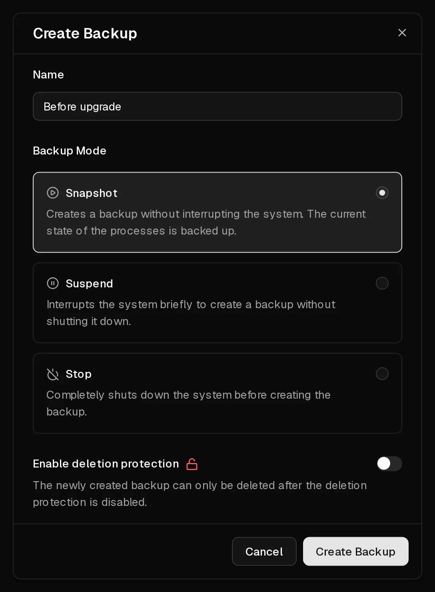

A backup is a copy of your server's entire disk at one moment: the operating system, your applications and your data. You create it on the <Ui>Backups</Ui> tab, and you can [restore it](/en/help/article/how-to-restore-backup) later to put the server back exactly as it was.

Backups are kept until you delete them, even when you change the operating system. They are deleted together with the server, so they do not protect you against a server being deleted because it was not renewed.

## Create a backup

1. In the [customer portal](https://app.virtbase.com/servers), select <Ui>View</Ui> next to your server and open the <Ui>Backups</Ui> tab.
2. Select the <Ui>+</Ui> button next to <Ui>Backups</Ui>.
3. Under <Ui>Name</Ui>, enter something you will recognise later, for example `Before upgrade to Debian 13`.
4. Choose a <Ui>Backup Mode</Ui> (see below). <Ui>Snapshot</Ui> is right in most cases.
5. Optional: select <Ui>Enable deletion protection</Ui> for a backup you want to keep for a long time.
6. Select <Ui>Create Backup</Ui>.

The backup appears in the list with the status <Ui>Creating...</Ui>. When it is finished, the list shows its size. How long that takes depends on how much data is on the disk.

## Which backup mode should I choose?

| Mode | What happens | Use it when |
| --- | --- | --- |
| <Ui>Snapshot</Ui> | The server keeps running. Its state is captured while it works. | Almost always. |
| <Ui>Suspend</Ui> | The server is paused briefly while the backup is taken, then continues. | Applications write a lot of data at once, such as busy databases, and you want a consistent copy. |
| <Ui>Stop</Ui> | The server is shut down, backed up and started again. | You want the cleanest possible copy and can accept a few minutes of downtime. |

With <Ui>Snapshot</Ui>, the <Term id="guest-agent">QEMU guest agent</Term> inside the server briefly flushes pending writes to disk so the copy is consistent. The agent is installed on every operating system you choose when ordering.

## Protect a backup from deletion

A locked backup cannot be deleted until you unlock it. This protects important backups from being removed by accident, including by someone else using your <Term id="api-key">API key</Term>.

- To lock a finished backup, select <Ui>Lock</Ui> in its menu.
- To delete it later, select <Ui>Unlock</Ui> first, then <Ui>Delete</Ui>.

Deletion protection does not survive the server itself: when a server is deleted, all its backups are deleted with it, locked or not.

## Limits

- You can create up to **5 backups per day**, counted across all your servers.
- A server can only have **one backup in progress** at a time.
- Backups cannot be created while the server is installing or suspended.
- A backup that has not finished after 12 hours is marked as <Ui>Failed</Ui>. A failed backup contains nothing and can always be deleted.

## When should I create a backup?

Back up before anything you might want to undo:

- before you change the operating system or upgrade to a new release,
- before you install unfamiliar software or make larger configuration changes,
- regularly, if the data on the server matters to you.

Keep in mind that backups are stored with Virtbase. For data you cannot afford to lose, also keep a copy outside Virtbase, for example with `rsync` or a backup tool such as restic or Borg.

## Can I download a backup?

Not from the customer portal. If you need a backup as a file, [contact support](/en/contact) with your <Ui>Server ID</Ui> from the <Ui>Advanced</Ui> tab and the name of the backup.

## If it didn't work

- <Msg>Could not create the backup.</Msg> Another backup of this server is still running, you reached the limit of 5 backups per day, or the server is installing or suspended. Wait for the running backup to finish, or try again tomorrow.
- <Msg>Could not delete the backup.</Msg> The backup is locked. Select <Ui>Unlock</Ui> first.
- **The backup shows Failed:** delete it and create a new one. If it fails again, [contact support](/en/contact).
