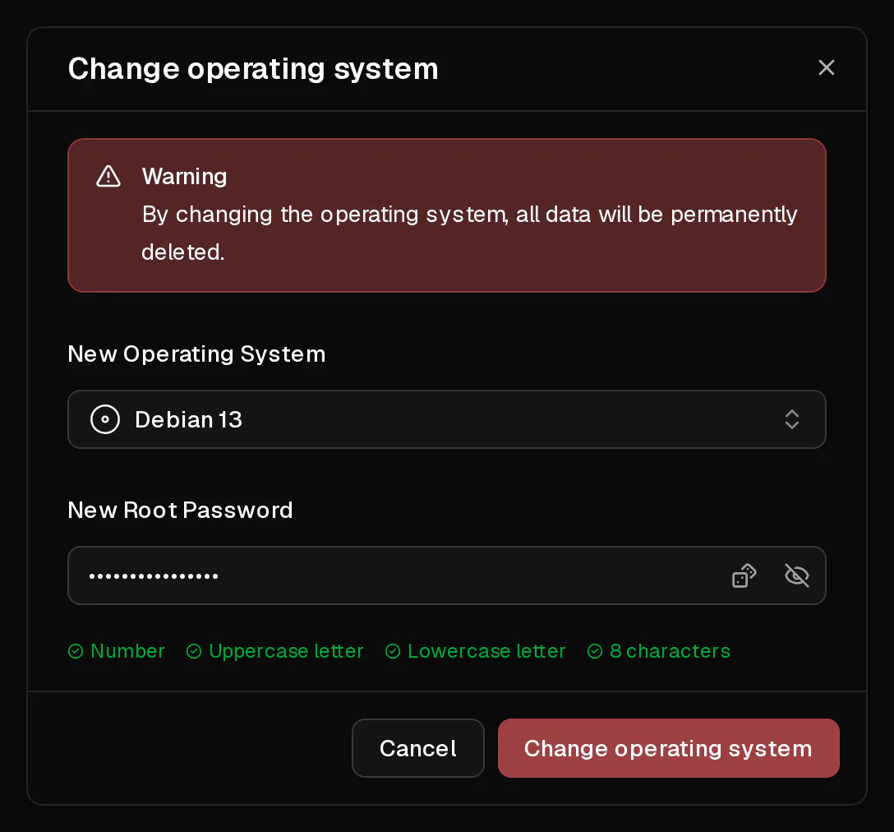

You can reinstall your server with any operating system from our list in a few clicks. The reinstall **erases everything on the disk** and sets the server up from scratch, as if you had just ordered it.

What stays the same: the server's IP addresses, its plan and term, its firewall rules, its <Term id="ptr-record">reverse DNS</Term> entries and its backups.

## Before you start

- Create a [backup](/en/help/article/how-to-backup-server) if there is anything on the server you might need again. Backups survive the reinstall, so you can go back.
- Think of a new root password: 8 to 64 characters, with at least one uppercase letter, one lowercase letter and one digit. Virtbase does not store it.

## Change the operating system

1. In the [customer portal](https://app.virtbase.com/servers), select <Ui>View</Ui> next to your server.
2. On the <Ui>Overview</Ui> page, select <Ui>Change Operating System</Ui> in the <Ui>Server</Ui> card.
3. Under <Ui>New Operating System</Ui>, choose the system to install.
4. Under <Ui>New Root Password</Ui>, enter the new password.
5. Confirm.



The server shows <Ui>Server is installing</Ui> and is offline until the new system has been set up. When the banner disappears, you can log in.

If you added an <Term id="ssh-key">SSH key</Term> when you ordered the server, it is set up again on the new system.

## Check that it worked

Connect with the new password:

```bash
ssh root@<your-ip>
```

<Term id="ssh">SSH</Term> will warn you with `WARNING: REMOTE HOST IDENTIFICATION HAS CHANGED!`. This is expected: the new system has new host keys. Remove the old entry and connect again:

```bash
ssh-keygen -R <your-ip>
```

The <Ui>Operating System</Ui> field on the <Ui>Overview</Ui> page shows the new system.

## Install a system that is not in the list

To install something we do not offer, for example Windows, pfSense or a distribution of your choice, use your own <Term id="iso-image">ISO image</Term>. See [How do I install an operating system from my own ISO?](/en/help/article/how-to-install-from-iso)

## If it didn't work

- <Msg>Could not change the operating system.</Msg> The server is suspended or still installing, or the password does not meet the requirements. You can start at most two reinstalls per minute.
- **The system you want is missing from the list:** only systems available on the hardware your server runs on are offered. Use [your own ISO](/en/help/article/how-to-install-from-iso), or [contact support](/en/contact) to ask for it.
- **The server stays in Server is installing for more than 30 minutes:** [contact support](/en/contact) with your <Ui>Server ID</Ui> from the <Ui>Advanced</Ui> tab.
