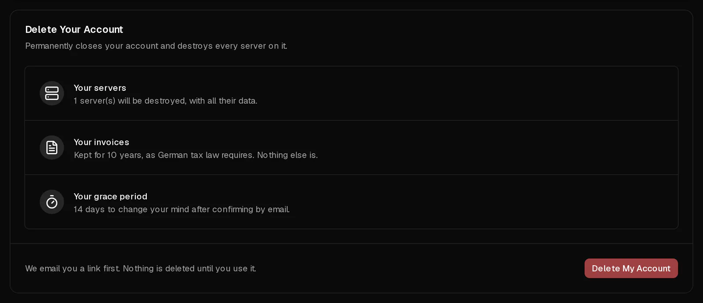

You can close your Virtbase account yourself in the customer portal. Deleting it **destroys every server on the account, with all its data and backups**. To protect you from mistakes, nothing is deleted until you confirm by email, and you then have 14 days to change your mind.

If you only want to stop paying for one server, you do not need to delete your account: [cancel that server's subscription](/en/help/article/how-to-set-up-automatic-renewal#cancel-the-subscription) instead.

## Before you start

- **Copy everything you want to keep** off your servers. Backups are deleted with them.
- **Pay any open invoices.** An account with unpaid invoices cannot be deleted.
- Optional: [download a copy of your data](/en/help/article/how-to-export-data) first.

## Delete your account

1. In the [customer portal](https://app.virtbase.com/account/settings/privacy), open <Ui>Account</Ui> › <Ui>Privacy</Ui>.
2. Under <Ui>Delete Your Account</Ui>, check the summary: how many servers will be destroyed, and how long your invoices are kept.
3. Select <Ui>Delete My Account</Ui> and type `DELETE`.
4. Select <Ui>Email Me The Link</Ui>.
5. Under <Ui>Confirm It's You</Ui>, confirm with your password, a <Term id="passkey">passkey</Term> or a code sent by email.
6. Open the email we send you and use the link to confirm. It is valid for 24 hours.

The Privacy page now shows the date on which everything is deleted.

## What happens next

| When | What happens |
| --- | --- |
| After you confirm by email | Your account is scheduled for deletion. Your servers keep running. |
| 14 days later | Your account, all your servers, their backups and your personal data are deleted permanently. |

We keep your **invoices for 10 years**, because German tax law requires it, and nothing else.

## Change your mind

Until the date shown, open <Ui>Account</Ui> › <Ui>Privacy</Ui> and select <Ui>Keep My Account</Ui>. Everything stays as it was.

Signing in alone does not stop the deletion. You have to select <Ui>Keep My Account</Ui>.

## If it didn't work

- <Msg>Settle your open invoices first.</Msg> Pay the unpaid invoices under [Invoices](https://app.virtbase.com/invoices), then try again.
- <Msg>An order is still being processed.</Msg> Wait a few minutes until the order is finished.
- **The email does not arrive:** check your spam folder. The link is valid for 24 hours; after that, start again.

## Accounts nobody uses

If an account has had no servers and nothing billable for 6 months, we schedule it for deletion as well. You get an email 30 days before, and a reminder 7 days before. Signing in within that time keeps your account.
