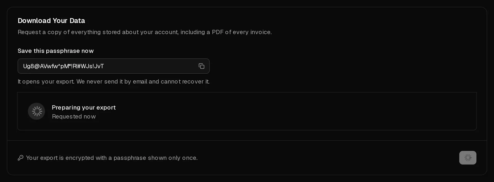

You can download a copy of everything Virtbase stores about your account at any time: your profile, servers, orders, payments, abuse cases and more, plus a PDF of every invoice. The export is a single PDF file, encrypted with a passphrase that only you see.

The export contains data about your account. It does not contain the files on your servers. To keep those, copy them from the server or create a [backup](/en/help/article/how-to-backup-server).

## Request an export

1. Open [Account > Privacy](https://app.virtbase.com/account/settings/privacy).
2. Under <Ui>Download Your Data</Ui>, select <Ui>Request Export</Ui>.
3. Under <Ui>Confirm It's You</Ui>, confirm with your password, a <Term id="passkey">passkey</Term> or a code sent by email.
4. **Save this passphrase now.** Copy it into your password manager. It opens your export, and we cannot show it again or send it to you.

The card shows <Ui>Preparing your export</Ui>. When it is ready, you receive the email <Msg>Your data export is ready</Msg>.

## Download and open it

1. Open <Ui>Account</Ui> › <Ui>Privacy</Ui> again and select <Ui>Download</Ui> under <Ui>Your export is ready</Ui>.
2. Open the PDF in a PDF reader and enter the passphrase.

The PDF describes your data in readable form and carries the full data as a JSON file and your invoices as attachments. Most PDF readers list attachments in a side panel.

The download is available for **7 days**. After that it shows <Ui>Your export has expired</Ui>, and you can request a new one.

## Limits

You can request one export per day. If you try again, you see <Msg>You already requested an export today. Please try again tomorrow.</Msg>

## If it didn't work

- **Your export could not be built:** request a new one the next day. If it fails again, [contact support](/en/contact).
- **You lost the passphrase:** the export cannot be opened without it. Request a new export the next day and save the new passphrase.
- **You want to request your data in another way,** for example under Art. 15 GDPR by email: [contact support](/en/contact) from the email address of your account.
