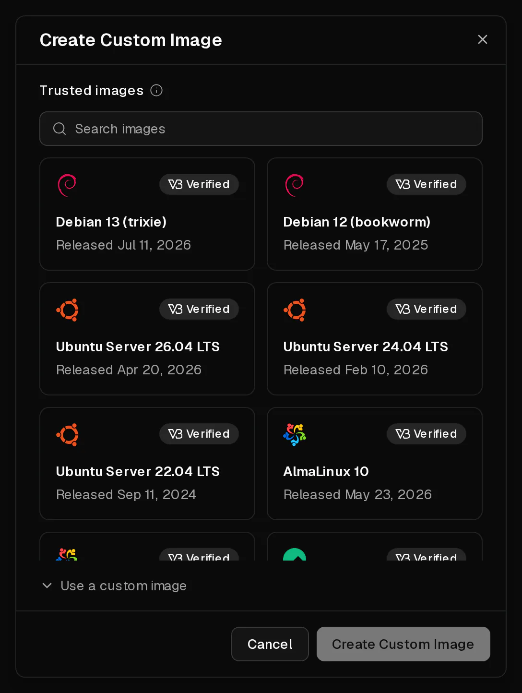
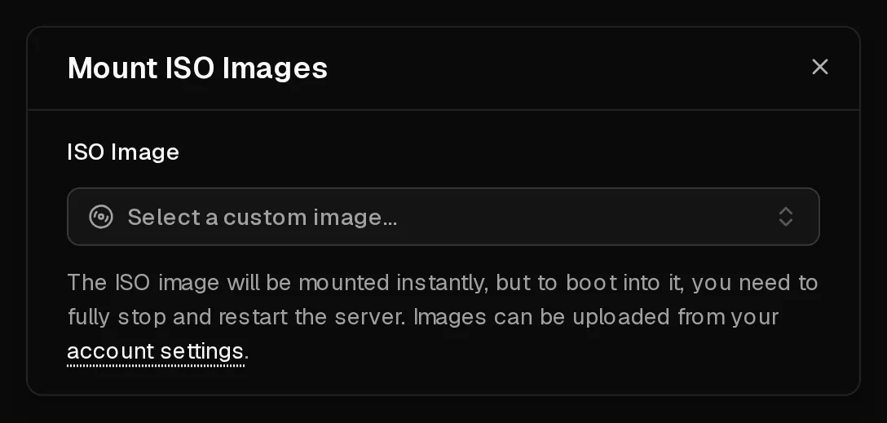

If the system you want is not in our list, you can install it from an <Term id="iso-image">ISO image</Term>, the same way you would on a physical machine: insert the disc, boot from it, run the installer. You can also boot a live system this way to rescue a server that no longer starts.

Installing from an ISO is for experienced users. Unlike our ready-made systems, nothing is set up for you: you configure the network yourself, and the portal can only reset passwords or read the system if you install the <Term id="guest-agent">QEMU guest agent</Term>.

## Before you start

- **Back up** anything you want to keep. Installing a new system usually erases the disk.
- **Note your network settings.** Your server has static addresses, and there is no DHCP. On the <Ui>Overview</Ui> page, copy the <Ui>IPv4</Ui> address and its <Ui>Gateway</Ui>, and the same for <Ui>IPv6</Ui>.
- **Plan for 60 minutes.** An ISO image is available for 60 minutes after you add it. After that it is unmounted and removed automatically.

## 1. Add the ISO image

1. Open [Account > ISO Images](https://app.virtbase.com/account/settings/custom-images) and select <Ui>Create Custom Image</Ui>.
2. Pick an image from <Ui>Trusted images</Ui>, such as Debian, Ubuntu, AlmaLinux, Rocky Linux, Fedora, Alpine, Arch Linux, NixOS, FreeBSD or the VirtIO drivers for Windows. Images marked <Ui>Verified</Ui> are checked against the vendor's checksum.
3. Or select <Ui>Use a custom image</Ui> and enter a <Ui>Name</Ui> and the <Ui>URL</Ui> of the ISO file.
4. Select <Ui>Create Custom Image</Ui>.



The image is downloaded to our storage. The list shows the progress as <Ui>Uploading</Ui> with a percentage, and <Ui>Expires</Ui> with the time it will be removed.

A custom URL must:

- start with `https://` and use a domain name, not an IP address,
- point directly at a file ending in `.iso`, with no login,
- report the file size, which can be at most 10 GB.

You can have up to **3** ISO images at a time, and add up to 10 per hour.

## 2. Mount it and boot from it

1. Open your server. In the row of power buttons, open the menu and select <Ui>Mount ISO</Ui>.
2. Under <Ui>ISO Image</Ui>, choose your image. It is mounted at once.
3. **Shut the server down and start it again.** A reboot from inside the server is not enough: the server only boots from the ISO after a full stop and start. Use <Ui>Shutdown</Ui>, wait until the server is <Ui>Offline</Ui>, then select <Ui>Start</Ui>.
4. Open the <Ui>Console</Ui> tab. You see the installer or live system.



## 3. Install and configure the network

Run the installer in the [console](/en/help/article/how-to-use-console). When it asks for the network, choose manual configuration and enter:

| Setting | Value |
| --- | --- |
| <Term id="ipv4">IPv4 address</Term> | The address from the <Ui>Overview</Ui> page, with prefix `/32` |
| IPv4 <Term id="gateway">gateway</Term> | The <Ui>Gateway</Ui> from the <Ui>Overview</Ui> page |
| DNS servers | `9.9.9.9` and `149.112.112.112`, or your own |
| IPv6 address | An address from your /64, with prefix `/64` |
| IPv6 gateway | The IPv6 <Ui>Gateway</Ui> from the <Ui>Overview</Ui> page |

Because the address is a `/32`, the gateway is not in the same subnet. Many installers handle this; if yours does not, add a route to the gateway first. With netplan, for example:

```yaml title="/etc/netplan/01-network.yaml"
network:
  version: 2
  ethernets:
    eth0:
      addresses: [203.0.113.10/32]
      routes:
        - to: 203.0.113.1/32
          scope: link
        - to: 0.0.0.0/0
          via: 203.0.113.1
          on-link: true
      nameservers:
        addresses: [9.9.9.9, 149.112.112.112]
```

## 4. Unmount the ISO

When the installation is finished, open <Ui>Mount ISO</Ui> again and select the unmount button next to the image. Shut the server down and start it again, so it boots from its disk.

Then install the QEMU guest agent, for example with `apt install qemu-guest-agent`. Without it, the portal cannot [reset passwords](/en/help/article/how-to-reset-root-password), show disk usage or give firewall recommendations.

## Installing Windows

Windows is allowed on Virtbase servers. We do not provide Windows images or licences: you install it from your own ISO and use your own licence.

1. On the <Ui>Advanced</Ui> tab, set the BIOS to <Ui>UEFI</Ui> and the <Term id="tpm">TPM</Term> to <Ui>v2.0</Ui>. Windows 11 does not install without them.
2. Add your Windows ISO and the <Ui>VirtIO drivers</Ui> from <Ui>Trusted images</Ui>.
3. Mount the Windows ISO and start the installer as above.
4. When the installer finds no disk, mount the VirtIO drivers ISO instead. It replaces the Windows ISO in the virtual drive. In the installer, select <Ui>Load driver</Ui> and choose the storage driver from the drivers disc.
5. Mount the Windows ISO again and continue the installation.
6. After the installation, install the remaining VirtIO drivers and the guest agent from the drivers ISO, and set up the network as in the table above.

## Rescue a server that does not boot

To repair a broken system, mount a live system such as the Debian or Ubuntu installer, boot it, and mount your disk from there. Unmount the ISO when you are done. If you are not sure what to do, [contact support](/en/contact) before you change anything.

## If it didn't work

- **The ISO image is not added:** check that the URL starts with `https://`, ends in `.iso`, needs no login and that the file is no larger than 10 GB.
- <Msg>You can have up to 3 active ISO images.</Msg> Wait until one expires; images are removed 60 minutes after you add them.
- **The server boots the old system:** you rebooted instead of shutting down and starting. Shut it down fully, then start it.
- **No network after the installation:** check the address prefix (`/32`), the route to the gateway and the DNS servers. See [I can't connect to my server](/en/help/article/cant-connect-to-server).
- <Msg>Could not mount ISO image.</Msg> The image is still downloading or has expired, or the server is installing, suspended or restricted by an abuse case.
