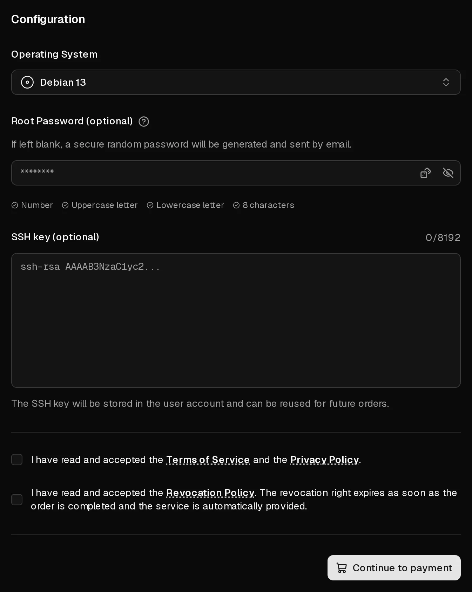

Ordering takes a few minutes: you pick a plan, choose the operating system, and pay. Virtbase then installs the server automatically and sends you an email when you can log in. You need a Virtbase account, which you can create during the order.

Every plan includes one <Term id="ipv4">IPv4 address</Term>, an <Term id="ipv6-subnet">IPv6 /64 subnet</Term> and unlimited traffic under a <Term id="fair-use">fair-use</Term> policy. Prices are per month and include statutory VAT where it applies.

## Place the order

1. On the [Virtbase homepage](/en), choose a plan and select <Ui>Configure now</Ui>. If a plan shows <Ui>Sold out</Ui>, it cannot be ordered at the moment.
2. Sign in, or select <Ui>Sign up</Ui> to create an account.
3. Under <Ui>Operating System</Ui>, choose the system to install.
4. Optional: under <Ui>SSH key (optional)</Ui>, pick an existing key or select <Ui>Add new SSH key</Ui> and paste your public key. You can then log in without a password.
5. Optional: under <Ui>Root Password (optional)</Ui>, set a password for `root`. If you leave it empty, a secure random password is generated and sent to you by email.
6. Accept the Terms of Service, the Privacy Policy and the Revocation Policy.
7. Select <Ui>Continue to payment</Ui>.

<Hint>
Virtbase does not store your root password. Note it down, or use an <Term id="ssh-key">SSH key</Term>. You can [reset the password](/en/help/article/how-to-reset-root-password) in the customer portal at any time.
</Hint>

## Pay

1. Fill in your <Ui>Billing address</Ui>. It is used for the invoice and to calculate VAT.
2. Choose a <Ui>Payment method</Ui>: card, <Term id="sepa-mandate">SEPA Direct Debit</Term> or PayPal. For orders of €5.00 or more you can also select <Ui>Pay anonymously with cryptocurrency</Ui>.
3. Select <Ui>Pay now</Ui> and complete any confirmation your bank asks for.

Card and PayPal payments are confirmed within seconds. With SEPA Direct Debit and cryptocurrency, you see <Ui>Payment is being processed</Ui>: the order is only carried out once the payment has arrived, which can take longer.

By completing the order you agree that the server is provided immediately. Your right of withdrawal therefore expires once the server has been set up, as described in the Revocation Policy.

## After payment

Your server appears in the [server list](https://app.virtbase.com/servers) with the status <Ui>Installing...</Ui>. Installation runs automatically and usually takes a few minutes.

When it is done, you receive the email <Msg>Your server is now ready</Msg> with the username and, if you did not set one, the generated root password. For security reasons the email does not contain the IP address. Select <Ui>Copy IP</Ui> in the server list to copy it.

Next: [connect to your server for the first time](/en/help/article/how-to-connect-to-server).

Your server runs for one month. To keep it running, [renew it](/en/help/article/how-to-renew-server) or [turn on automatic renewal](/en/help/article/how-to-set-up-automatic-renewal). Your invoice is stored under [Invoices](https://app.virtbase.com/invoices) and sent to you by email.

## If something went wrong

### The payment page shows a problem

- <Ui>Order requires action</Ui> or **Order requires confirmation:** your bank wants you to confirm the payment, for example in your banking app. Confirm it and return to the page.
- **Payment could not be completed:** the payment was declined. Check your details, or try a different payment method.
- **Order canceled:** nothing was charged. Start a new order.

### I paid, but there is no server

- With SEPA Direct Debit or cryptocurrency, the server is only set up once the payment has arrived.
- Check the [server list](https://app.virtbase.com/servers). A server with the status <Ui>Installing...</Ui> is being set up; the email follows when it is finished.
- Check your spam folder for the email <Msg>Your server is now ready</Msg>.

If none of this applies after an hour, [contact support](/en/contact) with your account ID, which you find under <Ui>Your User ID</Ui> in your [account settings](https://app.virtbase.com/account/settings).

### New orders are on hold

If you see <Msg>New orders are on hold while an abuse case is open.</Msg>, an abuse report about one of your servers is still open. Answer it under [Abuse reports](https://app.virtbase.com/abuse); see [What do I do when I receive an abuse report?](/en/help/article/about-abuse-reports)
