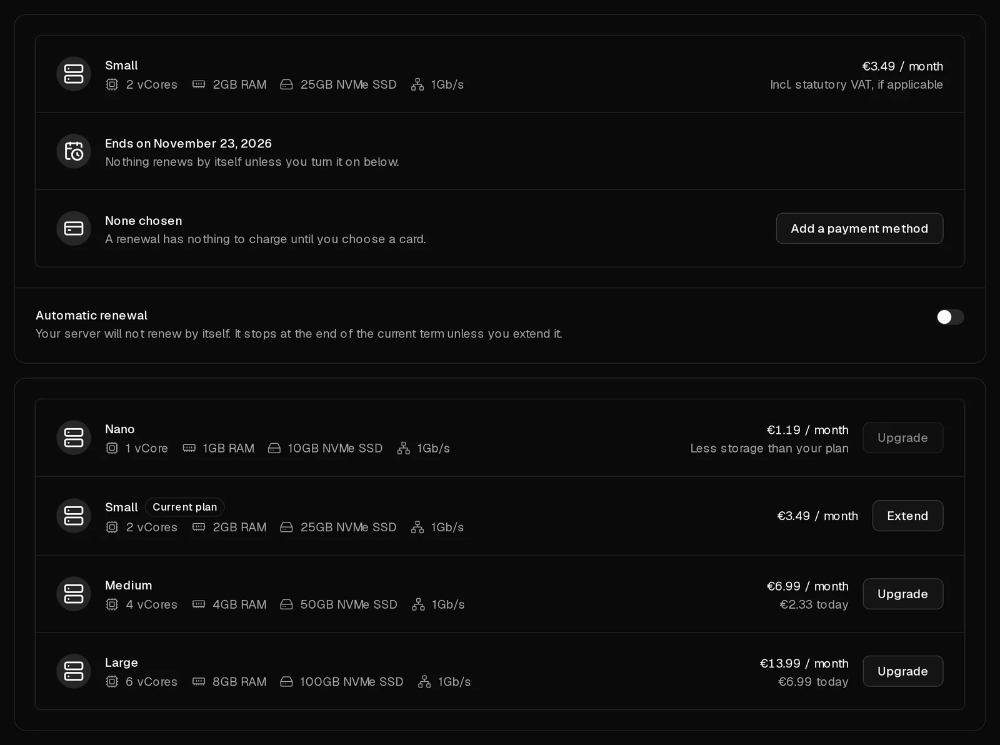

A Virtbase server is paid one month at a time. To keep it running, renew it before its term ends, either by hand as described here, or [automatically](/en/help/article/how-to-set-up-automatic-renewal) so you never have to think about it.

You can renew at any time. The new month is added to the end of the current term, so renewing early costs you nothing.

## Renew a server

1. In the [customer portal](https://app.virtbase.com/servers), select <Ui>Renew</Ui> next to your server. This opens its <Ui>Plan</Ui> tab.
2. Your current plan is marked <Ui>Current plan</Ui>. Select <Ui>Extend</Ui> on it.
3. Check the price and select <Ui>Extend for</Ui> the amount shown.
4. Choose a payment method and select <Ui>Pay now</Ui>.

Once the payment has gone through, the term is extended by one month. You receive the email <Msg>Your server has been renewed</Msg> with the new end date, and the invoice under [Invoices](https://app.virtbase.com/invoices).

To move to a bigger plan instead, see [How do I upgrade my server?](/en/help/article/how-to-upgrade-server)

## What happens if I don't renew?

| When | What happens |
| --- | --- |
| 5 days before the end of the term | The server shows <Ui>Server is expiring</Ui>, and you get the email <Msg>Your server is about to expire</Msg>. |
| End of the term | The server is suspended and switched off, and you get the email <Msg>Your server has been suspended</Msg>. Your data is still there. |
| 5 days after the suspension | The server and all its data, including every backup and its <Term id="ptr-record">reverse DNS</Term> entries, are deleted permanently. You get the email <Msg>Your server has been deleted</Msg>. |

A deleted server cannot be restored, not even by our support team.

## Renew a suspended server

As long as it has not been deleted, a suspended server can be renewed the same way. Renewing it switches it back on, with all its data. While it is suspended you cannot start it, use the console, restore backups or reinstall it.

## If it didn't work

- **An order is waiting to be paid:** you closed the payment before it went through. Nothing was charged. Select <Ui>Resume payment</Ui>, or <Ui>Discard it</Ui> and start again.
- <Msg>New orders are on hold while an abuse case is open.</Msg> Renewing by hand is not possible while an [abuse case](/en/help/article/about-abuse-reports) is open. Answer the case, or turn on automatic renewal, which keeps working.
- **The payment is declined:** try a different payment method. With <Term id="sepa-mandate">SEPA Direct Debit</Term>, the renewal is only applied once the payment has arrived.

If the server is about to be deleted and you cannot pay in time, [contact support](/en/contact) before the deletion date.
