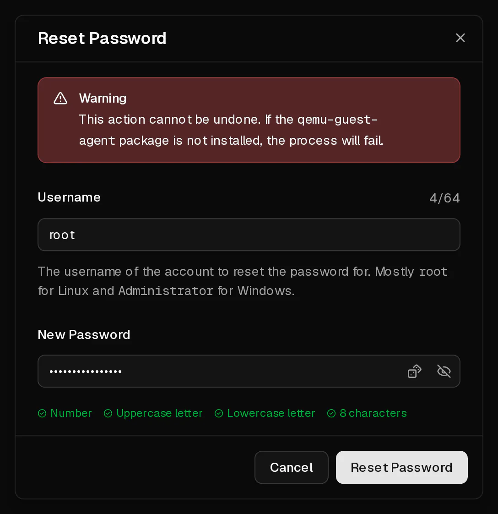

You can set a new password for any user on your server in the customer portal, including `root`. The new password works immediately. The server is not restarted and your data is not touched.

Virtbase does not store your root password, so we cannot tell you the old one. Resetting it is the way back in.

## Before you start

- The server is running: its status on the <Ui>Overview</Ui> page is <Ui>Online</Ui>.
- The **QEMU guest agent** runs inside the server. It is installed on every operating system you choose when ordering. If you installed the system yourself from an <Term id="iso-image">ISO image</Term>, [install the agent first](#the-reset-fails).
- The new password has 8 to 64 characters, with at least one uppercase letter, one lowercase letter and one digit.

## Reset the password

1. In the [customer portal](https://app.virtbase.com/servers), select <Ui>View</Ui> next to your server.
2. On the <Ui>Overview</Ui> page, select <Ui>Reset Password</Ui> in the <Ui>Server</Ui> card.
3. Under <Ui>Username</Ui>, enter the user whose password you want to change. This is usually `root` on Linux and `Administrator` on Windows.
4. Under <Ui>New Password</Ui>, enter the new password.
5. Select <Ui>Reset Password</Ui>.



The dialog closes and the new password is active.

## Check that it worked

Log in with the new password:

```bash
ssh root@<your-ip>
```

Or log in through the [browser console](/en/help/article/how-to-use-console) if <Term id="ssh">SSH</Term> is not reachable.

## If it didn't work

### The reset fails

The portal shows <Msg>Could not reset the password.</Msg> when the server is not running or the <Term id="guest-agent">guest agent</Term> does not answer.

- Start the server and wait about a minute until it has booted, then try again.
- Check that the agent runs. Log in through the console, if you still can, and run:

  ```bash
  systemctl status qemu-guest-agent
  ```

  If it is missing, install and start it:

  ```bash tab="Debian / Ubuntu" tab-group="os"
  apt install qemu-guest-agent
  systemctl enable --now qemu-guest-agent
  ```

  ```bash tab="AlmaLinux / Rocky Linux / Fedora" tab-group="os"
  dnf install qemu-guest-agent
  systemctl enable --now qemu-guest-agent
  ```

  On Windows, the agent is part of the VirtIO driver package (`virtio-win`).

You can reset a password at most three times per minute. If you see <Msg>You are doing that too often. Please wait a moment.</Msg>, wait a minute and try again.

### SSH still refuses the new password

The password was changed, but your SSH server does not accept password logins for root. Log in through the console and check these two settings in `/etc/ssh/sshd_config`:

```text title="/etc/ssh/sshd_config"
PasswordAuthentication yes
PermitRootLogin yes
```

Restart SSH afterwards with `systemctl restart ssh` (or `sshd`). Using an [SSH key](https://app.virtbase.com/account/settings/ssh-keys) instead of a password is safer and avoids this altogether.

### You cannot log in at all and the agent is not installed

Without the agent, the portal cannot change the password. You can either:

- boot a rescue system from a custom ISO image and change the password from there (see [My server does not boot](/en/help/article/cant-connect-to-server#my-server-does-not-boot)), or
- [contact support](/en/contact) with your <Ui>Server ID</Ui> from the <Ui>Advanced</Ui> tab, and tell us whether we may restart the server.

[Changing the operating system](/en/help/article/how-to-change-operating-system) also gives you a new root password, but it deletes everything on the disk.
