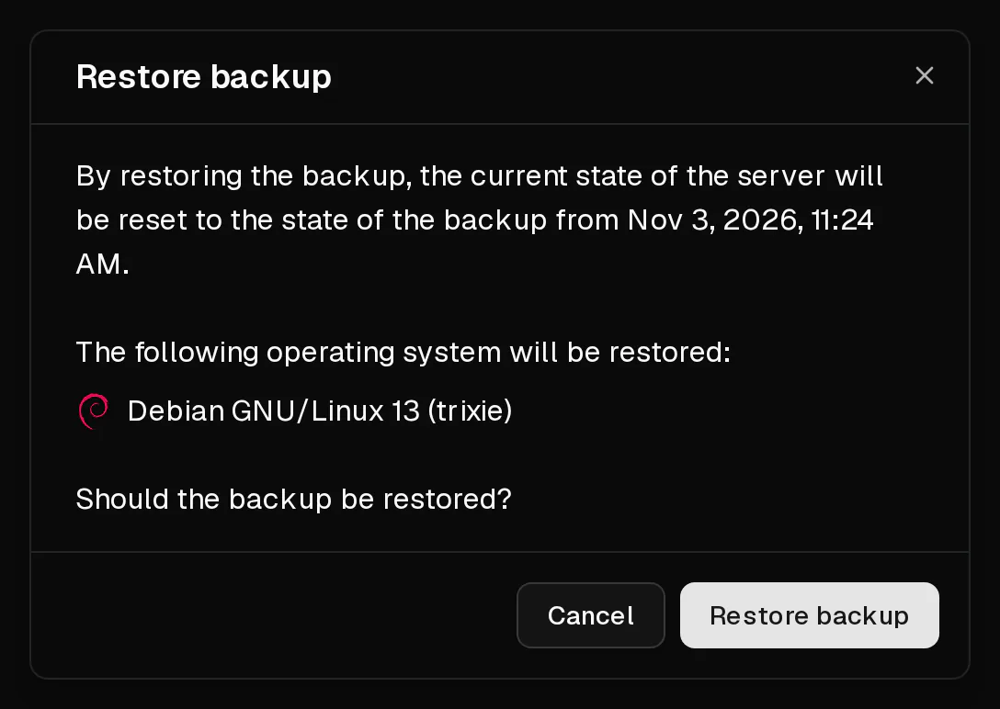

Restoring a backup puts your server's disk back into the state it was in when the backup was taken. **Everything that was created or changed on the server since then is lost.**

Only the disk is replaced. The server keeps its IP addresses, its firewall rules, its <Term id="ptr-record">reverse DNS</Term> entries and its plan.

## Before you start

- If anything on the server has changed since the backup that you want to keep, create a [new backup](/en/help/article/how-to-backup-server) first. You can then go back to the current state if you need to.
- The backup must have finished. Backups showing <Ui>Creating...</Ui> or <Ui>Failed</Ui> cannot be restored.
- Plan for a short downtime: the server is offline while the backup is restored.

## Restore the backup

1. In the [customer portal](https://app.virtbase.com/servers), select <Ui>View</Ui> next to your server and open the <Ui>Backups</Ui> tab.
2. Open the menu of the backup you want and select <Ui>Restore</Ui>.
3. Check the date and the operating system in the dialog. The operating system shown is the one that will be on the server afterwards.
4. Confirm the restore.

The server shows <Ui>Server is installing</Ui> while the backup is restored, and starts again when it is done.

## Check that it worked

Once the banner is gone, log in and check that your data is in the expected state.

When you connect over <Term id="ssh">SSH</Term>, you may see `WARNING: REMOTE HOST IDENTIFICATION HAS CHANGED!` if the backup is from an earlier installation. This is expected. Remove the old key with `ssh-keygen -R <your-ip>` and connect again.

The root password is the one that was valid when the backup was taken. If you no longer know it, [reset it](/en/help/article/how-to-reset-root-password).

## Limits

- You can restore up to **5 backups per day**, counted across all your servers.
- A restore cannot start while another backup or restore of the same server is running.
- Restoring is not possible while the server is suspended, or while an abuse case restricts it.

## If it didn't work

- <Msg>Could not restore the backup.</Msg> A backup or restore is still running, you have reached the daily limit, or the server is suspended. Wait and try again.
- **The server does not start after the restore:** open the [console](/en/help/article/how-to-use-console) to see what happens during boot, and see [I can't connect to my server](/en/help/article/cant-connect-to-server).
- **The restore seems stuck:** if the server still shows <Ui>Server is installing</Ui> after an hour, [contact support](/en/contact) with your <Ui>Server ID</Ui> and the name of the backup.
