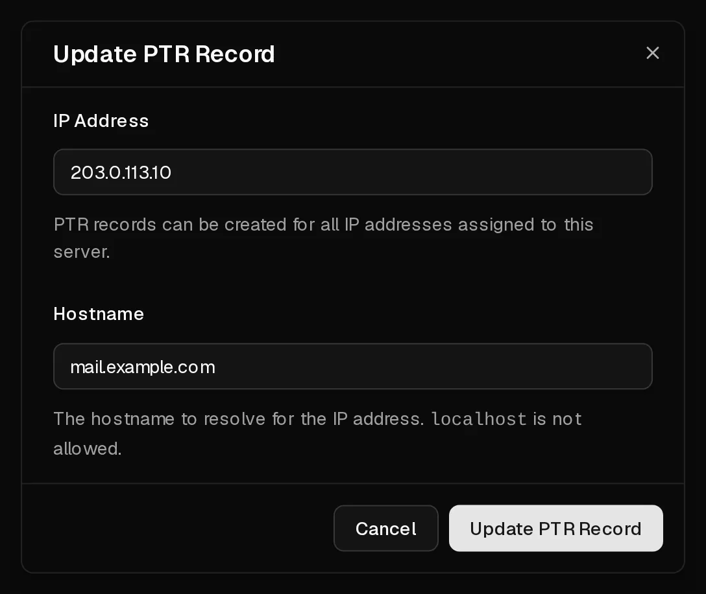

Reverse DNS answers the question "which hostname belongs to this IP address?". It is set with a <Term id="ptr-record">PTR record</Term>. You can set one for your server's <Term id="ipv4">IPv4 address</Term> and for any address in its <Term id="ipv6-subnet">IPv6 /64 subnet</Term> on the <Ui>rDNS</Ui> tab.

Most people need it for one reason: **sending email**. Many mail servers reject or flag mail from an address without a PTR record, or from one whose PTR record does not match.

## Before you start

Create a DNS record for the hostname with your domain provider first, pointing to the server:

- an **A** record for the IPv4 address, for example `mail.example.com` → `203.0.113.10`,
- an **AAAA** record if you also use IPv6.

The PTR record and this record should point to each other. This match, called forward-confirmed reverse DNS, is what receiving mail servers check.

## Set a PTR record

1. In the [customer portal](https://app.virtbase.com/servers), select <Ui>View</Ui> next to your server and open the <Ui>rDNS</Ui> tab.
2. Select the pencil icon next to <Ui>PTR Records</Ui>.
3. Under <Ui>IP Address</Ui>, enter the address, for example `203.0.113.10` or `2001:db8::10`.
4. Under <Ui>Hostname</Ui>, enter the full hostname in lowercase, for example `mail.example.com`.
5. Select <Ui>Update PTR Record</Ui>.



The record appears in the table. To change it, repeat the steps with the same IP address and a new hostname.

## Check that it worked

Look the address up from your computer or the server:

```bash
dig -x 203.0.113.10 +short
```

The output is your hostname, followed by a dot: `mail.example.com.`. Other DNS resolvers may keep the old answer in their cache for a while.

## Remove a PTR record

Select the bin icon in the record's row, then confirm. The address then no longer resolves to your hostname, and mail sent from it may be rejected.

## Sending email from your server

Outgoing port 25 is open on Virtbase servers, so your server can deliver mail directly. For mail to arrive and not end up in spam, you need more than reverse DNS:

- **PTR record** matching an **A**/**AAAA** record, as above.
- **SPF**, **DKIM** and **DMARC** records for your domain.
- A mail server that identifies itself with the same hostname (for Postfix, `myhostname` in `/etc/postfix/main.cf`).

Sending spam, or mail from a server that has been compromised, leads to [abuse reports](/en/help/article/about-abuse-reports) and can get your address blocklisted.

## If it didn't work

- <Msg>Could not save the PTR record.</Msg> Check that the IP address belongs to this server and that the hostname is a valid, fully qualified name in lowercase. `localhost` is not allowed.
- <Msg>You are doing that too often. Please wait a moment.</Msg> You can save up to 10 PTR records per hour. Wait and try again.
- **The rDNS tab cannot be changed:** PTR records cannot be changed while the server is suspended. [Renew the server](/en/help/article/how-to-renew-server) first.

When a server is deleted, its PTR records are removed with it.
