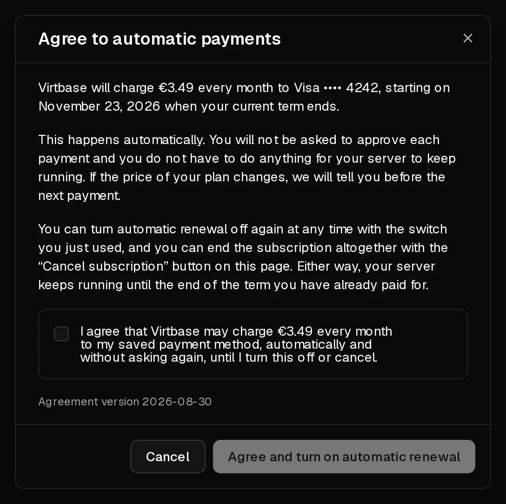

With automatic renewal, your server renews by itself at the end of each term: we charge your saved card and the server keeps running without you doing anything. Without it, the server stops at the end of the term unless you [renew it by hand](/en/help/article/how-to-renew-server).

## Before you start

You need a saved payment method. To add one, open [Account > Billing](https://app.virtbase.com/account/settings/billing), select <Ui>Add a card</Ui>, enter the card and select <Ui>Save card</Ui>. Nothing is charged when you add it.

Cryptocurrency payments cannot be saved, so automatic renewal is not available with them.

## Turn on automatic renewal

1. In the [customer portal](https://app.virtbase.com/servers), select <Ui>View</Ui> next to your server and open the <Ui>Plan</Ui> tab.
2. Under <Ui>Automatic renewal</Ui>, turn on the switch.
3. Read the agreement in the dialog <Ui>Agree to automatic payments</Ui>. It shows the amount, the card and the date of the first charge.
4. Tick the box and select <Ui>Agree and turn on automatic renewal</Ui>.

The plan card now shows <Ui>Renews automatically on</Ui> followed by the date your current term ends. The first charge is on that date, not today.

Automatic renewal is set for each server separately. Repeat these steps for every server you want to renew automatically.

## Change the card that is charged

Renewals are charged to the card marked for renewals. To change it, open [Account > Billing](https://app.virtbase.com/account/settings/billing) and select <Ui>Use for renewals</Ui> next to another card. The <Ui>Plan</Ui> tab of each server shows which card it uses.

## Turn off automatic renewal

Turn off the switch under <Ui>Automatic renewal</Ui> on the <Ui>Plan</Ui> tab. The server keeps running until the end of the term you have paid for. After that it stops, unless you renew it by hand.

## Cancel the subscription

Cancelling ends the server at the end of the current term.

1. On the <Ui>Plan</Ui> tab, select <Ui>Cancel subscription</Ui> under <Ui>Cancellation</Ui>.
2. Confirm with <Ui>Cancel subscription now</Ui>.

Nothing is switched off today and you will not be charged again. The server runs until the date shown, then it is shut down and, 5 days later, deleted with all its data and backups. Download anything you want to keep before then.

Changed your mind? Select <Ui>Resume subscription</Ui> before the term ends. Resuming does not turn automatic renewal back on, so turn on the switch again afterwards.

## If it didn't work

- <Msg>Add a payment method first. Automatic renewal needs a card we can charge when your term ends.</Msg> Add a card under <Ui>Account</Ui> › <Ui>Billing</Ui>, then try again.
- <Msg>The payment method we would charge cannot be used.</Msg> The card has expired or was refused. Choose another card with <Ui>Use for renewals</Ui>.
- <Msg>Resume this subscription before turning automatic renewal back on.</Msg> The subscription was cancelled. Select <Ui>Resume subscription</Ui> first.
- <Msg>The paid-for period has ended.</Msg> A subscription can only be resumed while its term is still running. [Renew the server by hand](/en/help/article/how-to-renew-server) instead, as long as it has not been deleted yet.

If a renewal payment fails, see [My renewal payment failed](/en/help/article/failed-payment).
