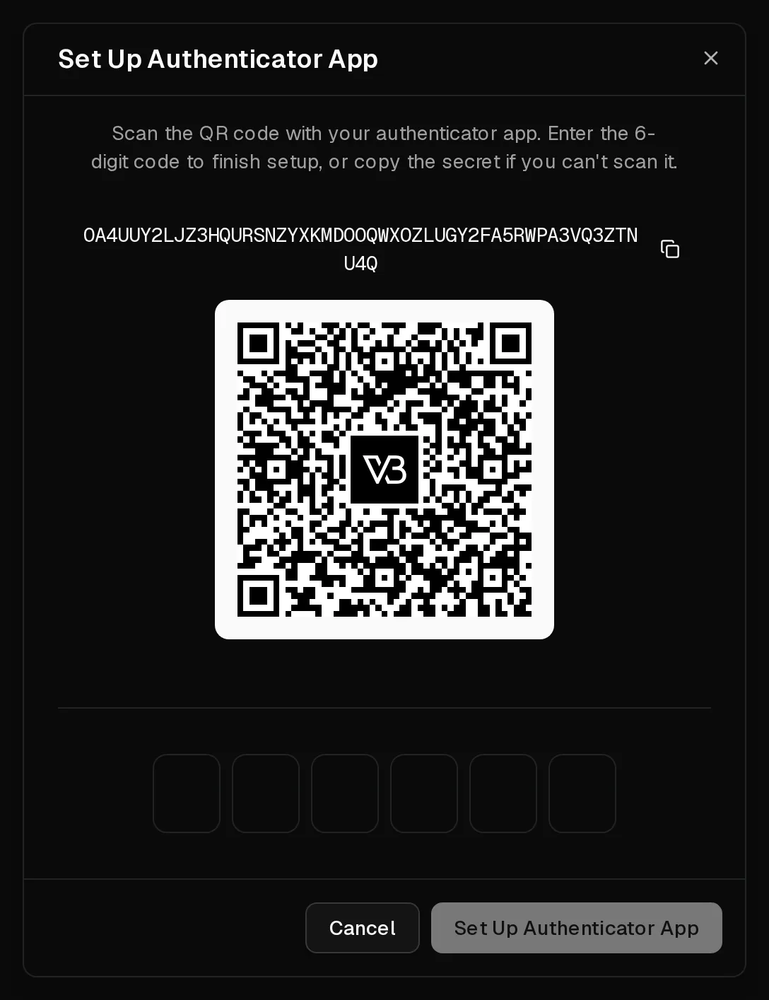

Your Virtbase account controls your servers, so it deserves more than a password. On the <Ui>Security</Ui> page of your account you can:

- require a code from an **authenticator app** at sign-in (<Term id="two-factor-authentication">two-factor authentication</Term>),
- sign in with a **passkey** instead of a password,
- link <Ui>Google</Ui>, <Ui>GitHub</Ui> or <Ui>Discord</Ui> for sign-in,
- see where you are signed in, and sign out other devices.

## Set up two-factor authentication

You need an authenticator app such as 1Password, Google Authenticator or Microsoft Authenticator.

1. Open [Account > Security](https://app.virtbase.com/account/settings/authentication).
2. Under <Ui>Two-Factor Authentication</Ui>, select <Ui>Set Up</Ui> next to <Ui>Authenticator App (TOTP)</Ui>.
3. Confirm with your password.
4. Scan the QR code with your app. If you cannot scan it, copy the secret into the app instead.
5. Enter the 6-digit code the app shows and confirm.

<Ui>Authenticator App (TOTP)</Ui> now shows <Ui>Enrolled</Ui>. From now on, after your password you are asked for the current code from your app.

Your <Ui>Recovery Codes</Ui> are shown under <Ui>Two-Factor Authentication</Ui>. Store them in a password manager or print them. Select <Ui>Regenerate</Ui> to replace them with new ones.

To move two-factor authentication to a new phone, select <Ui>Replace</Ui> and scan the new QR code with the new phone.

## Add a passkey

A <Term id="passkey">passkey</Term> signs you in with your fingerprint, face, device PIN or a security key, and cannot be phished.

1. On the <Ui>Security</Ui> page, select <Ui>Add Passkey</Ui> under <Ui>Passkeys</Ui>.
2. Follow your browser's or device's prompts.

To sign in with it, select <Ui>Continue with Passkey</Ui> on the sign-in page. You can register several passkeys, for example one on your laptop and one on your phone.

## Sign in with Google, GitHub or Discord

Under <Ui>Authentication Methods</Ui>, select <Ui>Link</Ui> next to a provider and confirm with that provider. You can then sign in with it. Linking Discord also lets you use the [Discord bot](/en/help/article/discord-integration). Select <Ui>Unlink</Ui> to remove a provider.

## Sign out other devices

<Ui>Active Sessions</Ui> lists every device signed in to your account, with its IP address and when it signed in. Select <Ui>Sign out</Ui> next to any session you don't recognise.

Sessions end by themselves 3 days after the last sign-in. Resetting your password with <Ui>Forgot password?</Ui> signs out every session.

If you see a session you don't recognise, sign it out, [change your password](/en/help/article/how-to-change-account-settings) and check your [API keys](/en/help/article/how-to-use-public-api).

## If it didn't work

- <Msg>Invalid code. Please try again.</Msg> Make sure the time on your phone is set automatically: authenticator codes depend on the correct time. Enter the code shown now, not one that is about to change.
- **You lost the phone with your authenticator app:** sign in with a passkey if you registered one, then select <Ui>Replace</Ui> to set up the app on your new phone. Without a passkey, [contact support](/en/contact) from the email address of your account.
- **The passkey prompt does not appear:** your browser or device may not support passkeys. Use an up-to-date browser, or a different device.
