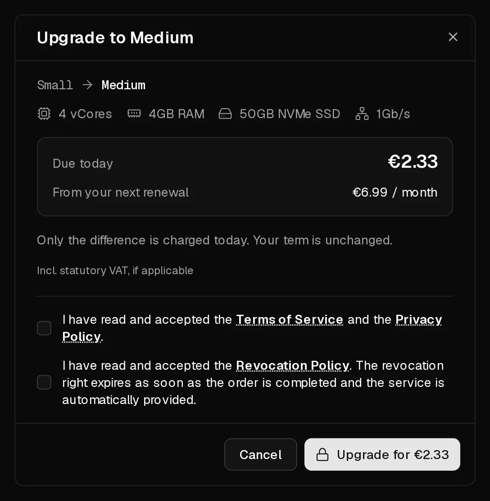

You can move your server to a bigger plan at any time on its <Ui>Plan</Ui> tab. Your data, IP addresses and settings stay as they are. The server restarts once to pick up the new resources.

## What it costs

You pay only the **difference** between the two plans for the time left in your current term. Your term does not change. From your next renewal on, you pay the new plan's price.

**Example:** your plan costs €6 a month and the new one €10. With 15 days of your 30-day term left, the upgrade costs (€10 − €6) × 15 ÷ 30 = **€2** today. The minimum charge is €0.50.

The dialog shows the exact amount under <Ui>Due today</Ui> and the future price under <Ui>Renews at</Ui> before you pay.

## Before you start

- **Shut the server down cleanly** with <Ui>Shutdown</Ui> in the portal or `poweroff` inside the server. The upgrade switches the server off without waiting for applications, which can lose unsaved data otherwise.
- Optional: create a [backup](/en/help/article/how-to-backup-server).

## Upgrade

1. In the [customer portal](https://app.virtbase.com/servers), select <Ui>View</Ui> next to your server and open the <Ui>Plan</Ui> tab.
2. Choose a bigger plan and select <Ui>Upgrade</Ui>.
3. Check <Ui>Due today</Ui> and <Ui>Renews at</Ui>, then select <Ui>Upgrade for</Ui> the amount shown.
4. Choose a payment method and select <Ui>Pay now</Ui>.



After the payment, the disk is enlarged and the server is started with the new resources, also if you shut it down beforehand. This takes a few minutes.

## Check that it worked

The <Ui>Overview</Ui> page shows the new number of <Term id="vcore">vCores</Term> and the new memory. Inside the server, check:

```bash
nproc       # number of CPU cores
free -h     # memory
df -h /     # free disk space
```

On our ready-made operating systems, the partition and file system grow automatically when the server starts. If `df -h /` still shows the old size, for example on a system you installed from an ISO, grow them by hand:

```bash tab="ext4" tab-group="filesystem"
growpart /dev/sda 1
resize2fs /dev/sda1
```

```bash tab="XFS" tab-group="filesystem"
growpart /dev/sda 1
xfs_growfs /
```

The partition number and file system can differ on your system. `lsblk -f` shows them.

## Can I downgrade?

No. You can only move to a plan that costs more and has at least as much storage, because a disk cannot be shrunk safely. To move to a smaller plan, order a new server, move your data, and [cancel the old one](/en/help/article/how-to-set-up-automatic-renewal#cancel-the-subscription).

## If it didn't work

- **Less storage than your plan:** that plan has a smaller disk than yours and cannot be chosen.
- **Sold out:** the plan is not available on your server's hardware at the moment. Try again later.
- <Msg>Your current term has expired. Renew your server first, then upgrade.</Msg> [Renew the server](/en/help/article/how-to-renew-server), then upgrade.
- **No plans available:** there is no bigger plan on the hardware your server runs on.
- <Msg>New orders are on hold while an abuse case is open.</Msg> Upgrades are paused until the [abuse case](/en/help/article/about-abuse-reports) is closed.
- **An order is waiting to be paid:** select <Ui>Resume payment</Ui>, or <Ui>Discard it</Ui> and start again.
