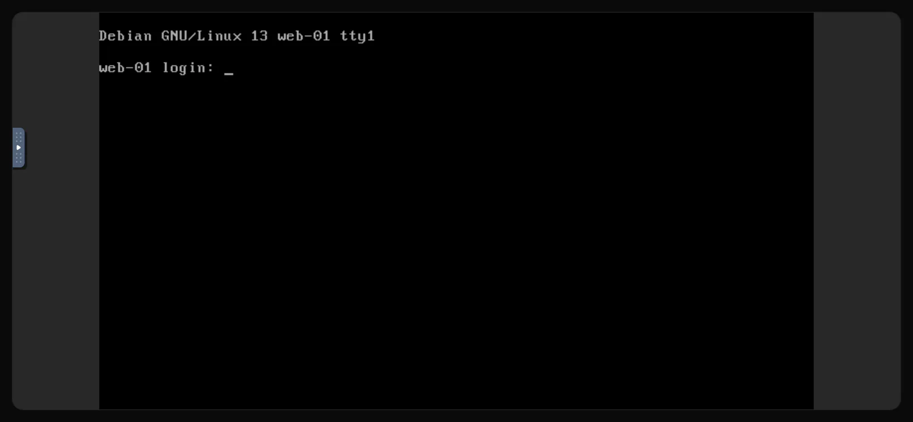

The console is your server's screen and keyboard in a browser tab. It connects to the virtual machine directly rather than over its network, so it works when <Term id="ssh">SSH</Term> does not: after a firewall mistake, a broken network configuration, or while an operating system is booting or being installed from an <Term id="iso-image">ISO image</Term>.

## Open the console

1. In the [customer portal](https://app.virtbase.com/servers), select <Ui>View</Ui> next to your server.
2. Open the <Ui>Console</Ui> tab.

The console connects by itself after a few seconds. If you see <Ui>Server is not running</Ui>, start the server; the console connects as soon as it is up.

The console is not available while the server is installing, while it is suspended, or while a backup is being created. The tab tells you which of these applies.

## Log in

Log in with the user `root` and your root password. On Windows, use the `Administrator` account.

If you do not know the password, [reset it](/en/help/article/how-to-reset-root-password) in the customer portal first. A password typed in the console is not shown on screen, which is normal.

## Special keys, full screen and reconnecting

The console runs [noVNC](https://novnc.com). Its control bar sits at the left edge of the console: select the small tab to open it.

- <Ui>Extra keys</Ui> sends key combinations your own computer would intercept, such as <Ui>Ctrl+Alt+Del</Ui>, or <Ui>Esc</Ui> and <Ui>Tab</Ui>.
- <Ui>Full screen</Ui> enlarges the console to the whole screen.
- <Ui>Disconnect</Ui> closes the connection. Reload the page to connect again.

If the console stops responding, reload the page. The connection is renewed automatically while the tab stays open.

## If it didn't work

### Characters come out wrong

If some keys type different characters than expected, for example two letters are swapped compared to your keyboard, your computer's keyboard layout differs from the one the console expects. Type with the US layout in mind, or set a temporary password that uses only letters and digits that are in the same place on both layouts. Change it afterwards over SSH.

### Pasting does not work

Text from your clipboard is not typed into the server, so paste does not work for passwords or commands. Type them by hand, or connect over [SSH](/en/help/article/how-to-connect-to-server), where copy and paste work normally.

### The screen is black

The server may be asleep or showing a blank screen saver. Press a key, or move the mouse over the console. If it stays black, check the status on the <Ui>Overview</Ui> page and see [I can't connect to my server](/en/help/article/cant-connect-to-server).

## Console from Discord

If you use the [Discord bot](/en/help/article/discord-integration), <Ui>/menu</Ui> can open a one-time console link. The link is valid for 10 seconds, so open it right away.
