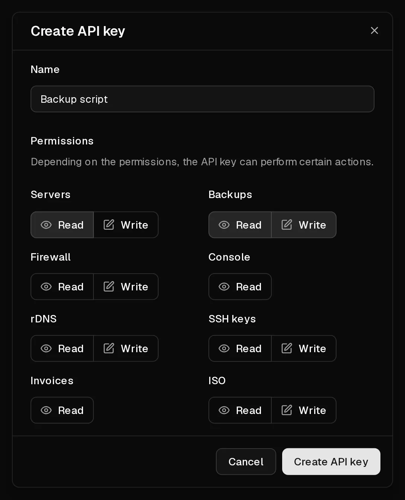

The Virtbase API lets you manage your servers from your own scripts and tools: power actions, backups, firewall rules, <Term id="ptr-record">reverse DNS</Term>, <Term id="ssh-key">SSH keys</Term>, <Term id="iso-image">ISO images</Term> and invoices. You authenticate every request with an <Term id="api-key">API key</Term>.

The full reference, with every endpoint and an interactive client, is in the [API documentation](/api/docs).

## Create an API key

1. In the [customer portal](https://app.virtbase.com/account/settings/api), open <Ui>Account</Ui> › <Ui>API</Ui>.
2. Select <Ui>Create API key</Ui>.
3. Under <Ui>Name</Ui>, enter what the key is for, for example `Backup script`.
4. Under <Ui>Permissions</Ui>, choose <Ui>Read</Ui> or <Ui>Write</Ui> for each area the key needs: <Ui>Servers</Ui>, <Ui>Backups</Ui>, <Ui>Firewall</Ui>, <Ui>Console</Ui>, <Ui>rDNS</Ui>, <Ui>SSH keys</Ui>, <Ui>Invoices</Ui> and <Ui>ISO</Ui>. Leave everything else off.
5. Select <Ui>Create API key</Ui>.
6. Copy the key from <Ui>API key created</Ui> and store it somewhere safe, such as a password manager.



<Hint>
The key is shown only once and cannot be displayed again. If you lose it, delete it and create a new one.
</Hint>

API keys are valid for **one year** from the day you create them. Create a new key before then and replace the old one in your scripts.

## Send a request

Put the key in the `X-Virtbase-API-Key` header of every request. For example, to list your servers:

```bash
curl https://virtbase.com/api/v1/servers \
  -H "X-Virtbase-API-Key: $VIRTBASE_API_KEY"
```

Lists are paginated with the query parameters `page` (starting at 1) and `per_page` (10 by default, at most 100). Many lists can be sorted with `sort`, for example `sort=name:asc`.

## Rate limits

You can send up to **120 requests per minute**. Some actions have stricter limits of their own, for example 5 power actions per minute or 5 backups per day.

Every response tells you where you stand:

- `X-RateLimit-Limit`: the requests allowed in the window,
- `X-RateLimit-Remaining`: the requests you have left,
- `X-RateLimit-Reset`: when the full allowance is available again, as a Unix timestamp.

When you exceed a limit, the API answers `429 Too Many Requests`. Wait until the reset time before you retry. If you need a higher limit, [contact support](/en/contact) and describe what you are building.

## What the API cannot do

For your security, some actions are only possible in the customer portal while you are signed in:

- ordering, renewing and upgrading servers,
- managing payment methods and subscriptions,
- answering abuse reports,
- exporting your data and deleting your account.

## Keep your keys safe

- Give each script its own key with only the permissions it needs. A key that only reads invoices cannot delete a server.
- Never put a key in source code or a public repository. Use an environment variable or a secrets manager.
- Delete keys you no longer use under <Ui>Account</Ui> › <Ui>API</Ui>.

If a key has leaked, delete it at once and create a new one.

## If it didn't work

- **`401 Unauthorized`:** the key is missing, mistyped, deleted or expired.
- **`403 Forbidden`:** the key lacks the permission for this action, the action is only available in the portal, or the server is in a state that does not allow it, such as installing or suspended.
- **`429 Too Many Requests`:** you have hit a rate limit. See above.
