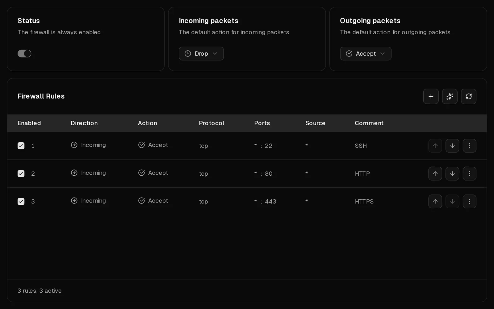
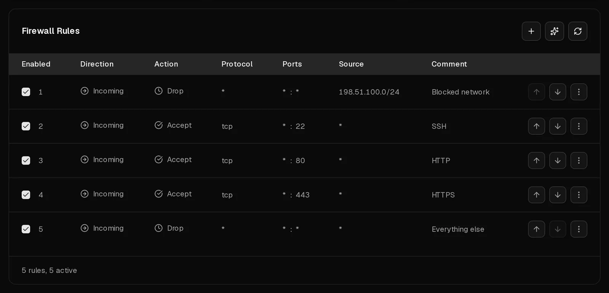

Every Virtbase server has a firewall in front of it that you control on the <Ui>Firewall</Ui> tab. It filters traffic before it reaches your server, so it also protects a server whose own firewall is misconfigured.

The firewall is always on. **New servers accept all traffic in both directions.** To protect a server, set incoming traffic to <Ui>Drop</Ui> and allow only the ports you actually use.

## Before you start: don't lock yourself out

If you change the default for incoming traffic to <Ui>Drop</Ui> before a rule allows your <Term id="ssh">SSH</Term> port, your SSH session stops working. Create the rule for port 22 first. If it happens anyway, the [console](/en/help/article/how-to-use-console) still works, and you can fix the rules in the portal at any time.

## Protect a new server in four steps

1. In the [customer portal](https://app.virtbase.com/servers), select <Ui>View</Ui> next to your server and open the <Ui>Firewall</Ui> tab.
2. Create a rule that allows SSH: select <Ui>+</Ui>, then set <Ui>Direction</Ui> to <Ui>Incoming</Ui>, <Ui>Action</Ui> to <Ui>Accept</Ui>, <Ui>Protocol</Ui> to <Ui>TCP</Ui> and <Ui>Destination port</Ui> to `22`. Enter a <Ui>Comment</Ui> such as `SSH` and select <Ui>Create Firewall Rule</Ui>.
3. Add a rule like this for every other service that must be reachable, for example `80` and `443` for a website.
4. Set <Ui>Incoming packets</Ui> to <Ui>Drop</Ui>.

Changes take effect within a few seconds. Replies to connections your server opened itself, such as package downloads, are always let through, so you can leave <Ui>Outgoing packets</Ui> on <Ui>Accept</Ui>.

## Create a rule

Select <Ui>+</Ui> above the rule list and fill in:

| Field | What to enter |
| --- | --- |
| <Ui>Direction</Ui> | <Ui>Incoming</Ui> for traffic to your server, <Ui>Outgoing</Ui> for traffic it sends. |
| <Ui>Action</Ui> | <Ui>Accept</Ui>, <Ui>Drop</Ui> or <Ui>Reject</Ui> (see below). |
| <Ui>Protocol</Ui> | Usually <Ui>TCP</Ui> or <Ui>UDP</Ui>. Choose <Ui>ICMP</Ui> to filter pings, then pick an <Ui>ICMP type</Ui>. |
| <Ui>Destination port</Ui> | A single port such as `443`, or a range such as `8000:8100`. |
| <Ui>Source</Ui> | Optional. An address or network such as `198.51.100.7` or `10.0.0.0/8`. Leave it empty to match everyone. |
| <Ui>Comment</Ui> | Optional, up to 64 characters. Note what the rule is for. |
| <Ui>Enabled</Ui> | Turn off to keep a rule without applying it. |

To change a rule, select <Ui>Edit</Ui> in its menu. To remove it, select <Ui>Delete</Ui>.

## Accept, Drop or Reject?

- <Ui>Accept</Ui> lets the traffic through.
- <Ui>Drop</Ui> discards it silently. The sender waits and eventually times out.
- <Ui>Reject</Ui> discards it and tells the sender, who sees "connection refused" at once.

Use <Ui>Drop</Ui> to block traffic from the internet: it reveals nothing about which services run on your server. <Ui>Reject</Ui> is useful inside your own networks, where you want failing connections to fail fast.

## In which order are rules applied?

Rules are checked **from top to bottom**. The first enabled rule that matches decides what happens, and the rest are ignored. If no rule matches, the default action for that direction applies: <Ui>Incoming packets</Ui> or <Ui>Outgoing packets</Ui>.

That is why the order matters. A rule that drops port 22 for everyone, placed above a rule that accepts port 22 from your office, blocks your office as well. Put specific rules above general ones, and move rules with <Ui>Move up</Ui> and <Ui>Move down</Ui> in their menu.

## Recommendations

When the <Term id="guest-agent">QEMU guest agent</Term> runs inside a Linux server, Virtbase compares the services listening on your server with your rules and shows <Ui>Recommendations</Ui>:

- **A service can be reached from the internet:** a database, Redis, the Docker API or a similar service is open to everyone. Select <Ui>Create rule</Ui> to block it, unless you meant to publish it.
- **A port is blocked inside your server:** your Virtbase rule allows a port, but the firewall inside your server blocks it, so the traffic never arrives.
- **Nothing is listening on a port:** a rule opens a port no service uses. Select <Ui>Remove rule</Ui> to tidy up.

SSH, HTTP and HTTPS (ports 22, 80 and 443) are never flagged, because they are meant to be public.

## A firewall inside your server

If your server runs its own firewall, such as ufw, firewalld or nftables, the tab shows <Ui>A firewall is also running inside your server</Ui>. Traffic must pass **both** firewalls: a port must be open in each one to be reachable. Where Virtbase can read the rules inside your server, it lists them below your own, marked <Ui>Managed inside your server</Ui>. You change those inside the server, not in the portal.

## Let AI suggest rules

Select the sparkles icon above the rule list to open <Ui>Generate Firewall Rules</Ui>. Describe what you want in plain words, for example "Allow HTTPS from everywhere and SSH only from 198.51.100.7", and select <Ui>Generate</Ui>. You get up to 5 suggested rules to review. Select <Ui>Apply</Ui> for a single rule or <Ui>Apply all</Ui>. Nothing changes until you apply it. You can generate rules 10 times per day.

## If it didn't work

- **You locked yourself out:** open the <Ui>Firewall</Ui> tab in the portal, which always works, and add an <Ui>Accept</Ui> rule for your SSH port above any rule that blocks it, or set <Ui>Incoming packets</Ui> back to <Ui>Accept</Ui>. See [I can't connect to my server](/en/help/article/cant-connect-to-server).
- **A port is still unreachable although a rule allows it:** check that no rule above it drops the traffic, that the rule is enabled, and that the firewall inside your server allows the port too.
- <Msg>Could not create the firewall rule.</Msg> If the server is restricted because of an [abuse case](/en/help/article/about-abuse-reports), firewall changes are on hold until it is closed.
