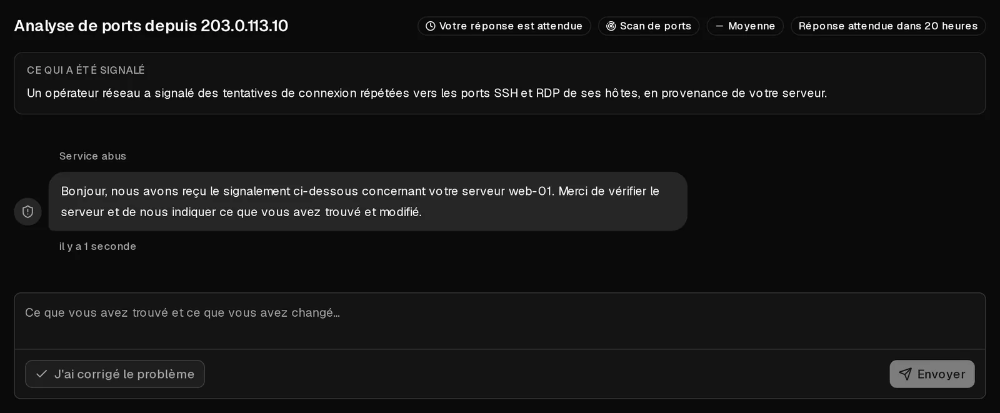

Un signalement d'abus signifie que quelqu'un nous a informés que le trafic provenant de l'un de vos serveurs a causé un préjudice : spam, phishing, logiciel malveillant, scans de ports, attaques contre d'autres systèmes ou violation de droits d'auteur. Très souvent, le propriétaire n'a rien fait de mal et le serveur a été **compromis**, par exemple à cause d'un mot de passe faible ou d'une application obsolète.

Lorsque nous ouvrons un dossier, vous recevez un e-mail et vous trouvez le dossier dans [Signalements d'abus](https://app.virtbase.com/abuse) sur le portail client. **Répondez sous 24 heures.** En général, cela suffit pour que votre serveur continue de fonctionner normalement.

## Répondre au dossier

1. Dans le [portail client](https://app.virtbase.com/abuse), ouvrez <Ui>Signalements d'abus</Ui> et cliquez sur <Ui>Voir le dossier</Ui>.
2. Lisez <Ui>Ce qui a été signalé</Ui>. Vous y trouvez le serveur concerné, le type d'abus et, si elles sont disponibles, les preuves.
3. Trouvez la cause sur votre serveur (voir ci-dessous) et corrigez-la.
4. Décrivez ce que vous avez trouvé et ce que vous avez modifié, puis cliquez sur <Ui>Envoyer</Ui>. Si vous avez déjà corrigé le problème, cliquez sur <Ui>J'ai corrigé le problème</Ui>.

Dès que vous avez répondu, le dossier affiche <Ui>Auprès de notre équipe</Ui> et le délai s'arrête. Nous examinons votre réponse et clôturons le dossier, ou nous vous posons d'autres questions. Vous recevez un e-mail lorsqu'il est clos.

## Trouver la cause

Commencez par ces vérifications, en tant que `root` sur le serveur :

- **Ce qui utilise le réseau et le processeur :** `top`, et `ss -tunap` pour les connexions ouvertes.
- **Des processus que vous ne reconnaissez pas,** souvent dans `/tmp`, `/var/tmp` ou `/dev/shm`.
- **Les tâches planifiées :** `crontab -l`, `/etc/crontab` et `/etc/cron.*`.
- **Les connexions récentes :** `last` et `/var/log/auth.log` (Debian, Ubuntu) ou `/var/log/secure` (AlmaLinux, Rocky Linux).
- **La file d'attente des e-mails, en cas de signalement de spam :** `mailq`.

Si le serveur a été compromis, le nettoyer est rarement fiable. Copiez vos données ailleurs, [réinstallez le système d'exploitation](/fr/help/article/how-to-change-operating-system), restaurez vos données, et changez tous les mots de passe et toutes les clés qui se trouvaient sur le serveur.

## Que se passe-t-il si vous ne répondez pas ?

Certains dossiers restreignent immédiatement le serveur concerné. Sinon, si le délai expire sans réponse, la restriction augmente d'un niveau à la fois. Le dossier indique le niveau actuel sous <Ui>Restreint tant que ce dossier est ouvert</Ui> :

| Niveau | Ce que cela signifie |
| --- | --- |
| <Ui>Sous surveillance</Ui> | Rien n'est restreint. Nous gardons un œil sur la situation. |
| <Ui>Réseau limité</Ui> | Le débit réseau du serveur est limité. Vous pouvez toujours vous connecter et corriger le problème. |
| <Ui>Réseau bloqué</Ui> | Le trafic sortant du serveur est bloqué. Utilisez la [console du navigateur](/fr/help/article/how-to-use-console) pour intervenir dessus. |
| <Ui>Éteint</Ui> | Le serveur est arrêté et ne peut pas être démarré. Vos données restent intactes. |
| <Ui>Suppression programmée</Ui> | Uniquement après une décision de notre équipe, jamais automatiquement. Répondez immédiatement si vous pensez qu'il s'agit d'une erreur. |

Les restrictions ne vont jamais d'elles-mêmes au-delà de <Ui>Éteint</Ui>. La suppression d'un serveur est toujours décidée par une personne.

Tant qu'un dossier est ouvert :

- vous pouvez toujours utiliser la console, réinitialiser des mots de passe, consulter les graphiques et créer des sauvegardes,
- vous ne pouvez pas modifier les règles de pare-feu, réinstaller le serveur, restaurer des sauvegardes ni monter des <Term id="iso-image">images ISO</Term>,
- **les nouvelles commandes, les mises à niveau et les renouvellements manuels sont suspendus**. Les [renouvellements automatiques](/fr/help/article/how-to-set-up-automatic-renewal) continuent normalement : activez donc le renouvellement automatique si votre période se termine pendant que le dossier est ouvert.

Les restrictions sont levées lorsque nous clôturons le dossier, et non lorsque vous répondez. Vos paramètres précédents, y compris vos propres règles de pare-feu, sont rétablis.

## Si quelque chose n'est pas clair

- **Le signalement est erroné.** Dites-le dans votre réponse et expliquez pourquoi. Nous examinons chaque réponse.
- **Le dossier est clos, mais quelque chose ne va toujours pas.** Il n'est pas possible de répondre à un dossier clos. [Contactez le support](/fr/contact) en indiquant la référence du dossier figurant dans l'e-mail.
- **Vous avez besoin de plus de temps.** Répondez en indiquant ce que vous avez fait jusqu'à présent. Une réponse arrête le délai.
