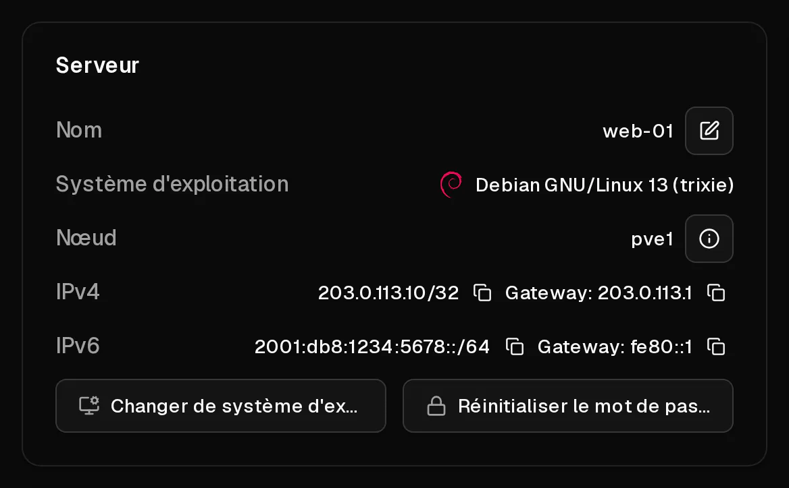

Chaque serveur Virtbase est fourni avec :

- **une adresse IPv4**, qui reste la même tant que vous conservez le serveur,
- **un sous-réseau IPv6 /64**, soit bien plus d'adresses IPv6 que vous n'en utiliserez jamais.

Les deux sont configurés automatiquement sur les systèmes d'exploitation que vous choisissez lors de la commande. Ils restent les mêmes lorsque vous réinstallez, mettez à niveau ou restaurez le serveur.

## Où les trouver ?

- Dans la [liste des serveurs](https://app.virtbase.com/servers), <Ui>Copier l'adresse IP</Ui> copie l'<Term id="ipv4">adresse IPv4</Term>.
- Sur la page <Ui>Aperçu</Ui> du serveur, les sections <Ui>IPv4</Ui> et <Ui>IPv6</Ui> affichent chaque adresse avec sa passerelle (<Ui>Gateway</Ui>), chacune avec un bouton de copie.



## Utiliser l'IPv6

Votre serveur dispose d'un <Term id="ipv6-subnet">sous-réseau /64</Term> complet, par exemple `2001:db8:1234:5678::/64`. Une adresse de ce sous-réseau est configurée sur le serveur. Vous pouvez ajouter d'autres adresses du même /64 à l'intérieur de votre serveur, par exemple pour héberger plusieurs sites web sur des adresses distinctes :

```bash
ip -6 addr add 2001:db8:1234:5678::2/64 dev eth0
```

Pour la conserver après un redémarrage, ajoutez-la à votre configuration réseau (netplan, `/etc/network/interfaces` ou NetworkManager, selon votre système).

Vous pouvez définir un [DNS inversé](/fr/help/article/how-to-set-reverse-dns) pour n'importe quelle adresse de votre /64.

## Puis-je obtenir des adresses IPv4 supplémentaires ?

Les adresses IPv4 supplémentaires ne sont pas disponibles pour le moment. Chaque serveur en possède exactement une. Seules les adresses attribuées à votre serveur peuvent être utilisées : le trafic provenant de toute autre adresse est bloqué, afin de protéger le réseau contre l'usurpation d'adresse (spoofing).

## Débit réseau et trafic

- **Le trafic est illimité**, dans le cadre d'une politique d'<Term id="fair-use">utilisation raisonnable</Term> (fair use). Si un serveur consomme une quantité excessive de trafic sur une longue période, son débit peut être temporairement réduit.
- **La liaison montante (uplink) est partagée** : la bande passante maximale d'un hôte est partagée entre les serveurs qu'il héberge. Cliquez sur <Ui>Afficher les détails du nœud</Ui> sur la page <Ui>Aperçu</Ui> pour voir l'<Term id="uplink">uplink</Term> du nœud sur lequel tourne votre serveur.
- Le port 25 sortant est ouvert : vous pouvez donc [envoyer des e-mails](/fr/help/article/how-to-set-reverse-dns#envoyer-des-e-mails-depuis-votre-serveur) directement depuis votre serveur.

## Configurer le réseau vous-même

Il n'y a pas de DHCP : les adresses sont configurées de manière statique. Si vous installez un système depuis votre propre ISO, ou si votre configuration réseau est cassée, configurez-la manuellement avec les valeurs de la page <Ui>Aperçu</Ui>. Les paramètres exacts sont indiqués dans [Comment installer un système d'exploitation depuis ma propre ISO ?](/fr/help/article/how-to-install-from-iso#3-installer-le-système-et-configurer-le-réseau)
