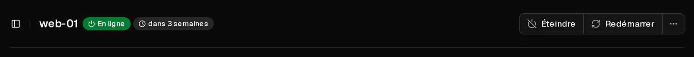
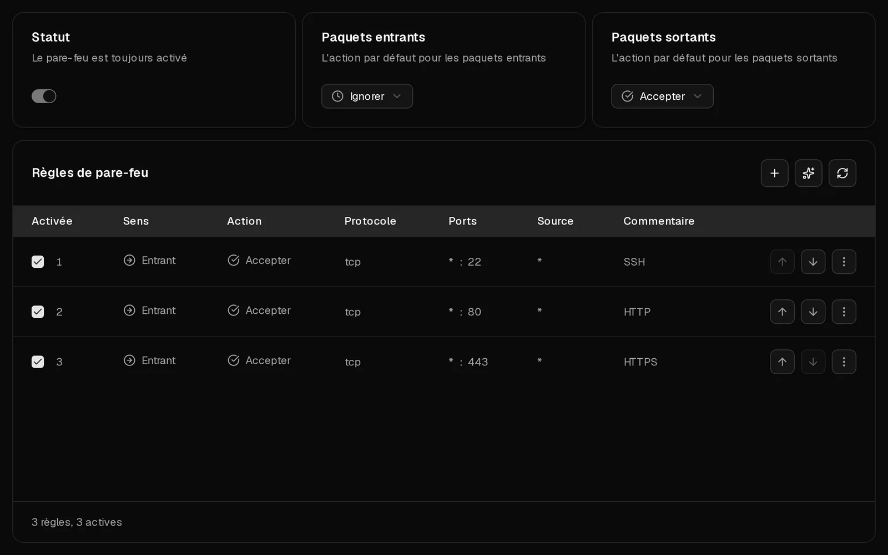

Lorsque vous n'arrivez pas à joindre votre serveur en <Term id="ssh">SSH</Term> ou en <Term id="rdp">RDP</Term>, la cause est presque toujours l'une de ces quatre : le serveur n'est pas en marche, un pare-feu bloque votre connexion, le service SSH du serveur n'est pas à l'écoute, ou votre identification est refusée. Effectuez les vérifications ci-dessous dans l'ordre. Chacune prend environ une minute, et la console du navigateur vous permet de corriger la plupart des problèmes même lorsque le réseau vous est fermé.

Si vous avez déjà un message d'erreur, passez directement à [ce que signifie votre erreur SSH](#ce-que-signifie-votre-erreur-ssh).

## 1. Vérifier que le serveur est en marche

1. Ouvrez le [portail client](https://app.virtbase.com/servers) et cliquez sur <Ui>Voir</Ui> à côté de votre serveur.
2. Regardez le statut sur la page <Ui>Aperçu</Ui>. Il doit indiquer <Ui>En ligne</Ui>.



Si ce n'est pas le cas :

- <Ui>Hors ligne</Ui> : cliquez sur <Ui>Démarrer</Ui> et attendez environ une minute que le système d'exploitation démarre.
- <Ui>Le serveur est en cours d'installation</Ui> : le serveur est en train d'être mis en place, réinstallé ou restauré à partir d'une sauvegarde. Attendez que la bannière disparaisse.
- <Ui>Serveur suspendu</Ui> : la période a expiré. [Renouvelez le serveur](/fr/help/article/how-to-renew-server) et il redémarrera.

Vérifiez aussi que vous utilisez la bonne adresse. <Ui>Copier l'adresse IP</Ui> dans la [liste des serveurs](https://app.virtbase.com/servers) copie l'<Term id="ipv4">adresse IPv4</Term> du serveur.

## 2. Ouvrir la console

La [console du navigateur](/fr/help/article/how-to-use-console) affiche l'écran de votre serveur sans passer par le réseau. Ouvrez l'onglet <Ui>Console</Ui>.

- **Vous voyez une invite de connexion** : le serveur fonctionne. Le problème vient du chemin réseau ou du service SSH ; passez à la vérification 3.
- **Vous voyez des erreurs de démarrage, un shell d'urgence ou un écran vide** : le système d'exploitation n'a pas démarré correctement. Consultez [Mon serveur ne démarre pas](#mon-serveur-ne-démarre-pas) plus bas.

## 3. Vérifier le pare-feu Virtbase

Le pare-feu Virtbase filtre le trafic avant qu'il n'atteigne votre serveur. Les nouveaux serveurs acceptent tout le trafic : il ne vous bloque donc que si ses paramètres ou ses règles ont été modifiés.

1. Ouvrez l'onglet <Ui>Pare-feu</Ui>.
2. Regardez <Ui>Paquets entrants</Ui>. S'il est réglé sur <Ui>Ignorer</Ui> ou <Ui>Rejeter</Ui>, seul le trafic explicitement accepté par une règle passe.
3. Assurez-vous qu'une règle activée accepte votre connexion : sens <Ui>Entrant</Ui>, action <Ui>Accepter</Ui>, protocole <Ui>TCP</Ui>, port de destination **22** (ou le port qu'utilise votre serveur SSH ; **3389** pour le Bureau à distance de Windows).
4. Si cette règle a une <Ui>Source</Ui>, elle ne s'applique qu'au trafic provenant de cette adresse. Si votre propre adresse IP a changé, ce qui arrive souvent avec les connexions domestiques et mobiles, la règle ne vous concerne plus.

Les règles sont vérifiées de haut en bas, et la première règle correspondante l'emporte. Une règle <Ui>Entrant</Ui> qui ignore le port 22, placée au-dessus de votre règle d'acceptation, vous bloque, même si la règle d'acceptation existe.



Les modifications prennent effet en quelques secondes. Le fonctionnement des règles est expliqué dans [Comment utiliser le pare-feu de mon serveur ?](/fr/help/article/how-to-use-server-firewall)

## 4. Vérifier le pare-feu à l'intérieur de votre serveur

Un pare-feu à l'intérieur de votre serveur, comme ufw, firewalld ou nftables, s'ajoute au pare-feu Virtbase : le trafic doit passer les deux. Si Virtbase en détecte un, l'onglet Pare-feu affiche <Ui>Un pare-feu fonctionne également dans votre serveur</Ui>.

Connectez-vous via la console et autorisez SSH dans le pare-feu de votre serveur :

```bash tab="ufw" tab-group="firewall"
ufw allow 22/tcp
ufw status
```

```bash tab="firewalld" tab-group="firewall"
firewall-cmd --permanent --add-service=ssh
firewall-cmd --reload
```

Des outils comme fail2ban peuvent aussi bloquer votre adresse IP après plusieurs échecs de connexion. `fail2ban-client status sshd` liste les adresses bloquées, et `fail2ban-client unban <votre-ip>` lève le blocage.

## 5. Vérifier que SSH fonctionne

Dans la console, vérifiez que le service SSH tourne et sur quel port il écoute :

```bash tab="Debian / Ubuntu" tab-group="os"
systemctl status ssh
ss -tlnp | grep ssh
```

```bash tab="AlmaLinux / Rocky Linux / Fedora" tab-group="os"
systemctl status sshd
ss -tlnp | grep ssh
```

Si le service est arrêté, démarrez-le avec `systemctl start ssh` (ou `sshd`). Si `ss` affiche un autre port que 22, connectez-vous sur ce port : `ssh -p 2222 root@<votre-ip>`. N'oubliez pas d'autoriser ce port dans les deux pare-feu.

## Ce que signifie votre erreur SSH

**`Connection timed out`**
Rien ne répond. Le serveur est éteint, l'adresse est erronée ou un pare-feu bloque la connexion (vérifications 1, 3 et 4).

**`Connection refused`**
Le serveur est joignable, mais rien n'accepte de connexions sur ce port : SSH ne tourne pas, écoute sur un autre port, ou une règle <Ui>Rejeter</Ui> refuse la connexion (vérifications 3 à 5).

**`Permission denied (publickey)`**
Le serveur n'accepte que les <Term id="ssh-key">clés SSH</Term>, et aucune des vôtres n'est autorisée. Assurez-vous d'utiliser la bonne clé (`ssh -i ~/.ssh/votre_cle root@<votre-ip>`). Pour ajouter une clé, connectez-vous via la console et ajoutez-la à la fin de `/root/.ssh/authorized_keys`.

**`Permission denied, please try again.`**
Le mot de passe est incorrect. [Réinitialisez le mot de passe root](/fr/help/article/how-to-reset-root-password) dans le portail client. Si le nouveau mot de passe est lui aussi refusé, il se peut que le serveur SSH n'autorise pas la connexion de root par mot de passe : vérifiez `PasswordAuthentication` et `PermitRootLogin` dans `/etc/ssh/sshd_config`.

**`WARNING: REMOTE HOST IDENTIFICATION HAS CHANGED!`**
Le serveur présente une autre clé d'hôte que celle dont se souvient votre ordinateur. C'est normal après avoir [changé de système d'exploitation](/fr/help/article/how-to-change-operating-system) ou restauré une sauvegarde. Supprimez l'ancienne clé et reconnectez-vous :

```bash
ssh-keygen -R <votre-ip>
```

Si vous n'avez rien réinstallé ni restauré, n'allez pas plus loin. Contactez d'abord le support.

## Mon serveur ne démarre pas

Si la console affiche des erreurs de démarrage, un système de fichiers endommagé ou un shell d'urgence, vous pouvez lancer vous-même un système de secours : téléversez l'ISO d'un système live, comme l'installateur Debian ou Ubuntu, en tant qu'[image ISO personnalisée](https://app.virtbase.com/account/settings/custom-images), montez-la avec <Ui>Monter l'ISO</Ui>, puis éteignez le serveur et rallumez-le. Depuis le système live, vous pouvez monter votre disque et le réparer.

Une <Term id="iso-image">image ISO</Term> téléversée reste disponible **60 minutes**, puis elle est démontée automatiquement : terminez donc la réparation dans l'heure, ou téléversez-la à nouveau.

En cas de doute, contactez le support avant de modifier quoi que ce soit.

## Mon serveur est-il restreint à cause d'un signalement d'abus ?

Si un dossier d'abus est ouvert pour votre serveur, son réseau peut être limité ou bloqué, ou le serveur peut être éteint. Vous trouvez alors le dossier dans [Signalements d'abus](https://app.virtbase.com/abuse) et vous avez reçu un e-mail. Consultez [Que faire si je reçois un signalement d'abus ?](/fr/help/article/about-abuse-reports)

## Le problème persiste ?

[Contactez le support](/fr/contact) en indiquant :

- l'<Ui>ID du serveur</Ui> (dans l'onglet <Ui>Avancé</Ui>), ou votre identifiant de compte et le nom du serveur,
- ce que vous avez essayé, et le message d'erreur exact,
- si nous pouvons nous connecter au serveur ou le redémarrer pour enquêter.
