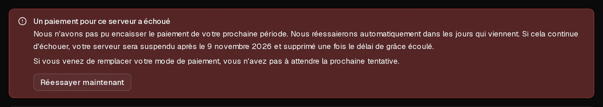

Si un renouvellement automatique ne peut pas être prélevé, **votre serveur continue de fonctionner** et rien n'est supprimé. Nous retentons le paiement plusieurs fois au cours de la semaine suivante et vous envoyons un e-mail à chaque fois. Vous pouvez régler le problème à tout moment en ajoutant un moyen de paiement valide puis en cliquant sur <Ui>Réessayer maintenant</Ui>.

Cet article concerne le [renouvellement automatique](/fr/help/article/how-to-set-up-automatic-renewal). Si vous payez chaque mois manuellement, consultez [Comment renouveler mon serveur ?](/fr/help/article/how-to-renew-server)

## Ce qui se passe, jour après jour

| Quand | Ce qui se passe |
| --- | --- |
| Fin de la période | Nous prélevons votre moyen de paiement. En cas d'échec, vous recevez l'e-mail <Msg>Nous n'avons pas pu encaisser le paiement de votre serveur</Msg>. Le serveur continue de fonctionner. |
| 1, 3, 5 et 7 jours après la fin de la période | Nous réessayons. Avant la dernière tentative, vous recevez l'e-mail <Msg>Votre serveur sera suspendu le</Msg>, suivi d'une date. |
| Après l'échec de la dernière tentative | Le serveur est suspendu et éteint, et vous recevez l'e-mail <Msg>Votre serveur a été suspendu</Msg>. Vos données sont toujours là. |
| 5 jours après la suspension | Le serveur et toutes ses données, y compris toutes ses sauvegardes, sont définitivement supprimés. |

Si votre banque nous indique qu'une carte ne pourra plus jamais être débitée, par exemple parce qu'elle a été résiliée, nous cessons immédiatement de réessayer avec cette carte, et les e-mails le précisent. Plus rien ne se passe tant que vous n'avez pas ajouté un autre moyen de paiement.

## Régler le problème

1. Dans le [portail client](https://app.virtbase.com/account/settings/billing), ouvrez <Ui>Compte</Ui> › <Ui>Facturation</Ui> et cliquez sur <Ui>Ajouter une carte</Ui>. Saisissez la nouvelle carte et cliquez sur <Ui>Enregistrer la carte</Ui>. Rien n'est prélevé lors de l'ajout.
2. À côté de la nouvelle carte, cliquez sur <Ui>Utiliser pour les renouvellements</Ui>.
3. Ouvrez votre serveur et allez dans l'onglet <Ui>Forfait</Ui>. L'avis <Ui>Un paiement pour ce serveur a échoué</Ui> y est affiché.
4. Cliquez sur <Ui>Réessayer maintenant</Ui>.

Le paiement est prélevé immédiatement. S'il aboutit, le serveur est renouvelé pour une nouvelle période et vous recevez la facture par e-mail.

Si vous ne cliquez pas sur <Ui>Réessayer maintenant</Ui>, la nouvelle carte sera utilisée lors de la prochaine tentative prévue.

## Vérifier que cela a fonctionné

Dans l'onglet <Ui>Forfait</Ui>, la carte du forfait affiche <Ui>Se renouvelle automatiquement le</Ui> suivi de la prochaine date, et l'avis de paiement a disparu.

## Si cela n'a pas fonctionné

- <Msg>Votre banque souhaite que vous confirmiez ce paiement. Vérifiez votre application bancaire.</Msg> Approuvez le paiement dans votre application bancaire. Ne cliquez pas à nouveau sur <Ui>Réessayer maintenant</Ui> entre-temps, sinon vous risquez d'être débité deux fois. Nous attendons la confirmation jusqu'à 72 heures.
- <Msg>Le paiement a de nouveau été refusé. Nous réessaierons automatiquement.</Msg> Utilisez une autre carte, ou demandez à votre banque pourquoi elle refuse le paiement. Les banques ne nous communiquent pas le motif.
- <Msg>Le paiement a été refusé et il ne reste plus de tentatives.</Msg> Ajoutez un moyen de paiement valide, puis [prolongez le serveur](/fr/help/article/how-to-renew-server) dans l'onglet <Ui>Forfait</Ui>.
- **Le serveur est déjà suspendu** : le prolonger dans l'onglet <Ui>Forfait</Ui> le renouvelle et le redémarre. C'est possible jusqu'à sa suppression, 5 jours après la suspension.

Vous pouvez cliquer sur <Ui>Réessayer maintenant</Ui> jusqu'à trois fois par heure.

## Pourquoi une carte cesse-t-elle de fonctionner ?

La liste des cartes dans <Ui>Compte</Ui> › <Ui>Facturation</Ui> en indique la raison :

- <Ui>Expirée — remplacez-la pour conserver le renouvellement automatique</Ui> : la carte a dépassé sa date d'expiration.
- <Ui>Bloquée par votre banque — remplacez-la pour conserver le renouvellement automatique</Ui> : l'autorisation de la débiter a été retirée.
- <Ui>Refusée — remplacez-la pour conserver le renouvellement automatique</Ui> : votre banque a refusé le dernier renouvellement et nous a demandé de ne plus réessayer.

Dans chaque cas, ajoutez une autre carte et choisissez-la avec <Ui>Utiliser pour les renouvellements</Ui>.

Si vous avez un doute sur un prélèvement, [contactez le support](/fr/contact) en indiquant votre identifiant de compte et le nom du serveur, avant que le serveur ne soit supprimé.
