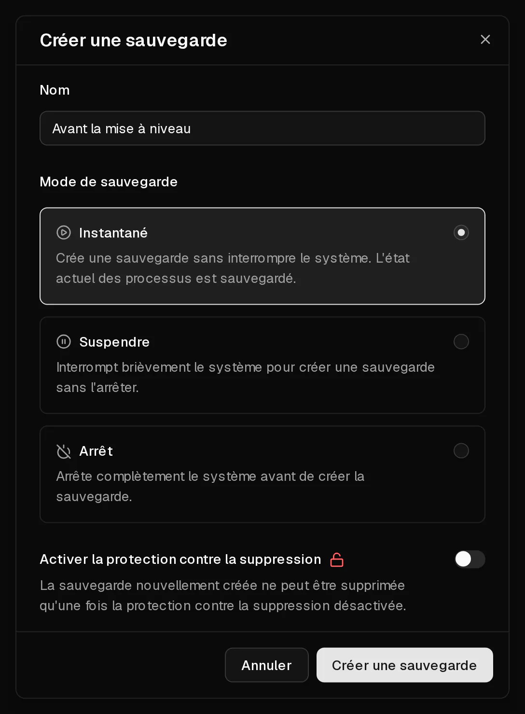

Une sauvegarde est une copie de l'intégralité du disque de votre serveur à un instant donné : le système d'exploitation, vos applications et vos données. Vous la créez dans l'onglet <Ui>Sauvegardes</Ui>, et vous pouvez la [restaurer](/fr/help/article/how-to-restore-backup) plus tard pour remettre le serveur exactement dans l'état où il était.

Les sauvegardes sont conservées jusqu'à ce que vous les supprimiez, même lorsque vous changez de système d'exploitation. Elles sont supprimées en même temps que le serveur : elles ne vous protègent donc pas contre la suppression d'un serveur qui n'a pas été renouvelé.

## Créer une sauvegarde

1. Dans le [portail client](https://app.virtbase.com/servers), cliquez sur <Ui>Voir</Ui> à côté de votre serveur et ouvrez l'onglet <Ui>Sauvegardes</Ui>.
2. Cliquez sur le bouton <Ui>+</Ui> à côté de <Ui>Sauvegardes</Ui>.
3. Sous <Ui>Nom</Ui>, saisissez un nom que vous reconnaîtrez plus tard, par exemple `Avant la mise à niveau vers Debian 13`.
4. Choisissez un <Ui>Mode de sauvegarde</Ui> (voir ci-dessous). <Ui>Instantané</Ui> convient dans la plupart des cas.
5. Facultatif : sélectionnez <Ui>Activer la protection contre la suppression</Ui> pour une sauvegarde que vous souhaitez conserver longtemps.
6. Cliquez sur <Ui>Créer une sauvegarde</Ui>.

La sauvegarde apparaît dans la liste avec le statut <Ui>Création...</Ui>. Une fois terminée, la liste affiche sa taille. La durée dépend de la quantité de données présentes sur le disque.

## Quel mode de sauvegarde choisir ?

| Mode | Ce qui se passe | Quand l'utiliser |
| --- | --- | --- |
| <Ui>Instantané</Ui> | Le serveur continue de fonctionner. Son état est capturé pendant qu'il tourne. | Presque toujours. |
| <Ui>Suspendre</Ui> | Le serveur est brièvement mis en pause pendant la sauvegarde, puis reprend. | Des applications écrivent beaucoup de données à la fois, comme des bases de données très sollicitées, et vous voulez une copie cohérente. |
| <Ui>Arrêt</Ui> | Le serveur est éteint, sauvegardé, puis redémarré. | Vous voulez la copie la plus propre possible et pouvez accepter quelques minutes d'interruption. |

En mode <Ui>Instantané</Ui>, l'<Term id="guest-agent">agent invité QEMU</Term> installé dans le serveur vide brièvement sur le disque les écritures en attente, afin que la copie soit cohérente. L'agent est installé sur tous les systèmes d'exploitation que vous choisissez lors de la commande.

## Protéger une sauvegarde contre la suppression

Une sauvegarde verrouillée ne peut pas être supprimée tant que vous ne l'avez pas déverrouillée. Cela protège les sauvegardes importantes contre une suppression accidentelle, y compris par quelqu'un d'autre qui utiliserait votre <Term id="api-key">clé API</Term>.

- Pour verrouiller une sauvegarde terminée, sélectionnez <Ui>Verrouiller</Ui> dans son menu.
- Pour la supprimer plus tard, sélectionnez d'abord <Ui>Déverrouiller</Ui>, puis <Ui>Supprimer</Ui>.

La protection contre la suppression ne survit pas au serveur lui-même : lorsqu'un serveur est supprimé, toutes ses sauvegardes sont supprimées avec lui, verrouillées ou non.

## Limites

- Vous pouvez créer jusqu'à **5 sauvegardes par jour**, tous serveurs confondus.
- Un serveur ne peut avoir qu'**une seule sauvegarde en cours** à la fois.
- Il n'est pas possible de créer des sauvegardes pendant que le serveur est en cours d'installation ou suspendu.
- Une sauvegarde qui n'est pas terminée au bout de 12 heures affiche <Ui>Échec</Ui>. Une sauvegarde échouée ne contient rien et peut toujours être supprimée.

## Quand créer une sauvegarde ?

Faites une sauvegarde avant toute opération que vous pourriez vouloir annuler :

- avant de changer de système d'exploitation ou de passer à une nouvelle version,
- avant d'installer un logiciel que vous ne connaissez pas ou d'apporter des modifications importantes à la configuration,
- régulièrement, si les données du serveur comptent pour vous.

Gardez à l'esprit que les sauvegardes sont stockées chez Virtbase. Pour les données que vous ne pouvez pas vous permettre de perdre, conservez aussi une copie en dehors de Virtbase, par exemple avec `rsync` ou un outil de sauvegarde comme restic ou Borg.

## Puis-je télécharger une sauvegarde ?

Pas depuis le portail client. Si vous avez besoin d'une sauvegarde sous forme de fichier, [contactez le support](/fr/contact) en indiquant l'<Ui>ID du serveur</Ui>, qui figure dans l'onglet <Ui>Avancé</Ui>, et le nom de la sauvegarde.

## Si cela n'a pas fonctionné

- <Msg>Impossible de créer la sauvegarde.</Msg> Une autre sauvegarde de ce serveur est encore en cours, vous avez atteint la limite de 5 sauvegardes par jour, ou le serveur est en cours d'installation ou suspendu. Attendez la fin de la sauvegarde en cours, ou réessayez demain.
- <Msg>Impossible de supprimer la sauvegarde.</Msg> La sauvegarde est verrouillée. Sélectionnez d'abord <Ui>Déverrouiller</Ui>.
- **La sauvegarde affiche Échec** : supprimez-la et créez-en une nouvelle. Si elle échoue à nouveau, [contactez le support](/fr/contact).
