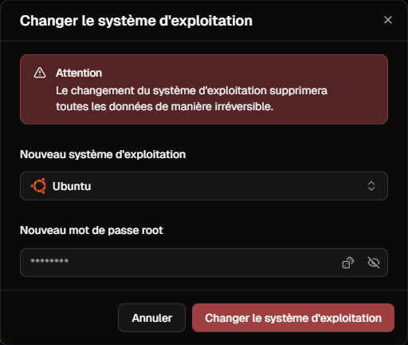

Il arrive souvent que les exigences changent et que vous ayez besoin d'un autre système d'exploitation sur votre serveur.
Vous pouvez modifier le système d'exploitation de votre serveur en quelques clics et en quelques secondes dans l'espace client.

## Comment lancer la réinstallation ?

Suivez ces étapes pour réinitialiser votre serveur :

<Hint>
Lors d'une réinstallation du système d'exploitation, toutes les données sont irrévocablement supprimées.
Nous vous recommandons de commencer par effectuer une sauvegarde de la configuration actuelle.
</Hint>

1. Accédez à votre **serveur** dans le [portail client](https://app.virtbase.com/servers).
2. Cliquez sur **Aperçu** dans la navigation.
3. Sur le côté gauche, cliquez sur **Modifier le système d'exploitation**.
4. Vous pouvez ici sélectionner votre nouveau système d'exploitation et définir un nouveau mot de passe root. 
Votre mot de passe root n'est pas enregistré et ne peut pas être affiché à nouveau, veuillez donc bien le noter.

5. Confirmez la réinitialisation pour lancer le processus.

Votre serveur sera alors arrêté et le système d'exploitation sera changé.

Si vous avez d'autres questions sur nos systèmes d'exploitation ou si vous avez besoin d'aide, [contactez notre équipe d'assistance](/fr/contact).

## Comment puis-je télécharger mes propres fichiers ISO ?

Tu peux télécharger et intégrer jusqu'à trois fichiers ISO personnalisés pour tes serveurs sur le portail client. 
Tu les trouveras dans tes [paramètres de compte](https://app.virtbase.com/account/settings/custom-images).
