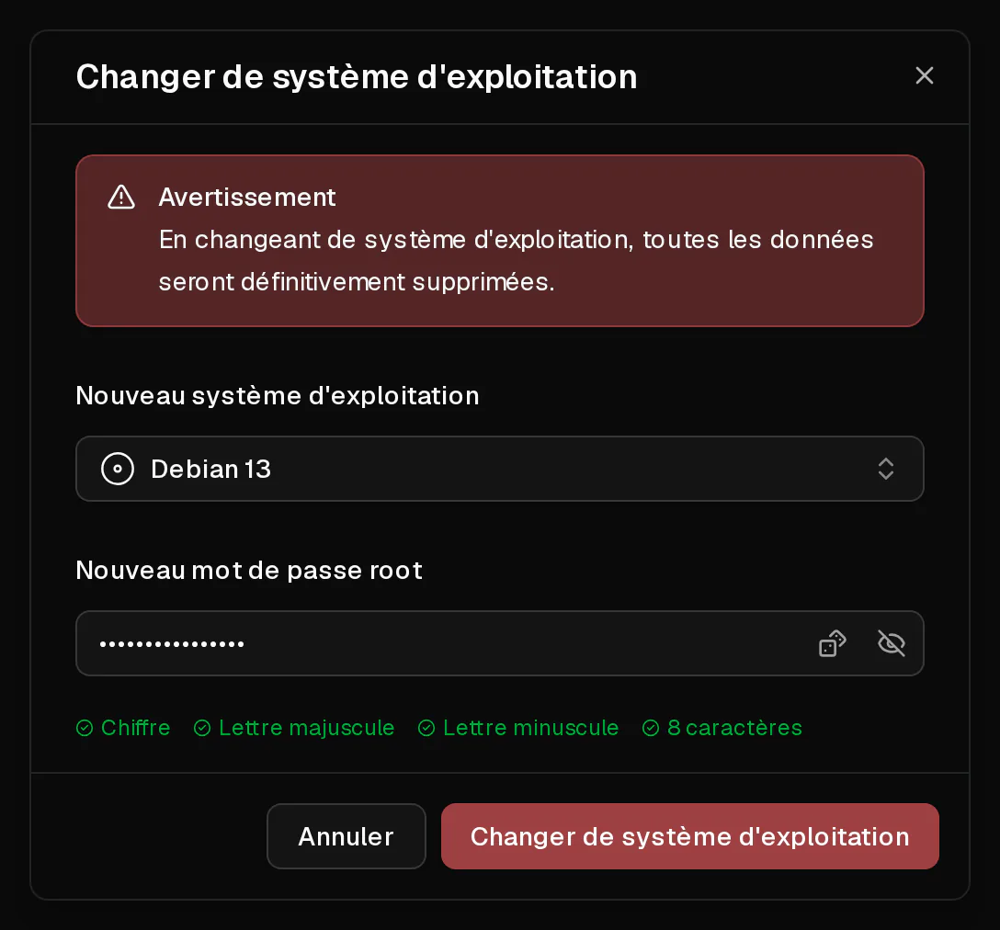

Vous pouvez réinstaller votre serveur en quelques clics avec n'importe quel système d'exploitation de notre liste. La réinstallation **efface tout le contenu du disque** et remet le serveur en place de zéro, comme si vous veniez de le commander.

Ce qui ne change pas : les adresses IP du serveur, son forfait et sa période, ses règles de pare-feu, ses entrées de <Term id="ptr-record">DNS inversé</Term> et ses sauvegardes.

## Avant de commencer

- Créez une [sauvegarde](/fr/help/article/how-to-backup-server) si le serveur contient quoi que ce soit dont vous pourriez encore avoir besoin. Les sauvegardes sont conservées lors de la réinstallation : vous pouvez donc revenir en arrière.
- Choisissez un nouveau mot de passe root : de 8 à 64 caractères, dont au moins une lettre majuscule, une lettre minuscule et un chiffre. Virtbase ne le stocke pas.

## Changer le système d'exploitation

1. Dans le [portail client](https://app.virtbase.com/servers), cliquez sur <Ui>Voir</Ui> à côté de votre serveur.
2. Sur la page <Ui>Aperçu</Ui>, cliquez sur <Ui>Changer de système d'exploitation</Ui> dans la carte <Ui>Serveur</Ui>.
3. Sous <Ui>Nouveau système d'exploitation</Ui>, choisissez le système à installer.
4. Sous <Ui>Nouveau mot de passe root</Ui>, saisissez le nouveau mot de passe.
5. Confirmez.



Le serveur affiche <Ui>Le serveur est en cours d'installation</Ui> et reste hors ligne jusqu'à ce que le nouveau système soit en place. Une fois la bannière disparue, vous pouvez vous connecter.

Si vous avez ajouté une <Term id="ssh-key">clé SSH</Term> lors de la commande du serveur, elle est de nouveau configurée sur le nouveau système.

## Vérifier que cela a fonctionné

Connectez-vous avec le nouveau mot de passe :

```bash
ssh root@<votre-ip>
```

<Term id="ssh">SSH</Term> vous avertira avec `WARNING: REMOTE HOST IDENTIFICATION HAS CHANGED!`. C'est normal : le nouveau système a de nouvelles clés d'hôte. Supprimez l'ancienne entrée et reconnectez-vous :

```bash
ssh-keygen -R <votre-ip>
```

Le champ <Ui>Système d'exploitation</Ui> de la page <Ui>Aperçu</Ui> affiche le nouveau système.

## Installer un système absent de la liste

Pour installer un système que nous ne proposons pas, par exemple Windows, pfSense ou la distribution de votre choix, utilisez votre propre <Term id="iso-image">image ISO</Term>. Consultez [Comment installer un système d'exploitation depuis ma propre ISO ?](/fr/help/article/how-to-install-from-iso)

## Si cela n'a pas fonctionné

- <Msg>Impossible de changer le système d'exploitation.</Msg> Le serveur est suspendu ou encore en cours d'installation, ou le mot de passe ne respecte pas les exigences. Vous pouvez lancer au maximum deux réinstallations par minute.
- **Le système que vous voulez ne figure pas dans la liste** : seuls les systèmes disponibles sur le matériel sur lequel tourne votre serveur sont proposés. Utilisez [votre propre ISO](/fr/help/article/how-to-install-from-iso), ou [contactez le support](/fr/contact) pour en faire la demande.
- **Le serveur reste sur Le serveur est en cours d'installation pendant plus de 30 minutes** : [contactez le support](/fr/contact) en indiquant l'<Ui>ID du serveur</Ui>, qui figure dans l'onglet <Ui>Avancé</Ui>.
