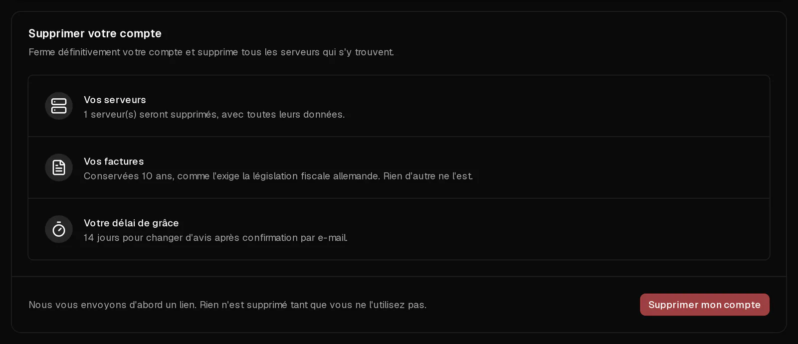

Vous pouvez fermer vous-même votre compte Virtbase dans le portail client. Sa suppression **détruit tous les serveurs du compte, avec toutes leurs données et leurs sauvegardes**. Pour vous protéger contre les erreurs, rien n'est supprimé tant que vous n'avez pas confirmé par e-mail, et vous disposez ensuite de 14 jours pour changer d'avis.

Si vous voulez seulement arrêter de payer pour un serveur, vous n'avez pas besoin de supprimer votre compte : [annulez plutôt l'abonnement de ce serveur](/fr/help/article/how-to-set-up-automatic-renewal#annuler-labonnement).

## Avant de commencer

- **Copiez tout ce que vous voulez conserver** depuis vos serveurs. Les sauvegardes sont supprimées avec eux.
- **Réglez toutes les factures en attente.** Un compte avec des factures impayées ne peut pas être supprimé.
- Facultatif : [téléchargez d'abord une copie de vos données](/fr/help/article/how-to-export-data).

## Supprimer votre compte

1. Dans le [portail client](https://app.virtbase.com/account/settings/privacy), ouvrez <Ui>Compte</Ui> › <Ui>Confidentialité</Ui>.
2. Sous <Ui>Supprimer votre compte</Ui>, vérifiez le récapitulatif : combien de serveurs seront détruits, et combien de temps vos factures sont conservées.
3. Cliquez sur <Ui>Supprimer mon compte</Ui> et tapez `DELETE`.
4. Cliquez sur <Ui>M'envoyer le lien</Ui>.
5. Sous <Ui>Confirmez votre identité</Ui>, confirmez avec votre mot de passe, une <Term id="passkey">clé d'accès</Term> ou un code envoyé par e-mail.
6. Ouvrez l'e-mail que nous vous envoyons et utilisez le lien pour confirmer. Il est valable 24 heures.

La page Confidentialité affiche désormais la date à laquelle tout sera supprimé.

## Ce qui se passe ensuite

| Quand | Ce qui se passe |
| --- | --- |
| Après votre confirmation par e-mail | La suppression de votre compte est programmée. Vos serveurs continuent de fonctionner. |
| 14 jours plus tard | Votre compte, tous vos serveurs, leurs sauvegardes et vos données personnelles sont définitivement supprimés. |

Nous ne conservons rien d'autre que vos **factures, pendant 10 ans**, car le droit fiscal allemand l'exige.

## Changer d'avis

Jusqu'à la date indiquée, ouvrez <Ui>Compte</Ui> › <Ui>Confidentialité</Ui> et cliquez sur <Ui>Conserver mon compte</Ui>. Tout reste comme avant.

Se connecter ne suffit pas à arrêter la suppression. Vous devez cliquer sur <Ui>Conserver mon compte</Ui>.

## Si cela n'a pas fonctionné

- <Msg>Réglez d'abord vos factures en attente.</Msg> Payez les factures impayées dans [Factures](https://app.virtbase.com/invoices), puis réessayez.
- <Msg>Une commande est encore en cours de traitement.</Msg> Attendez quelques minutes que la commande soit terminée.
- **L'e-mail n'arrive pas** : vérifiez votre dossier de courrier indésirable. Le lien est valable 24 heures ; passé ce délai, recommencez.

## Comptes inutilisés

Si un compte n'a eu ni serveur ni rien de facturable pendant 6 mois, nous programmons également sa suppression. Vous recevez un e-mail 30 jours avant, puis un rappel 7 jours avant. Il suffit de vous connecter pendant ce délai pour conserver votre compte.
