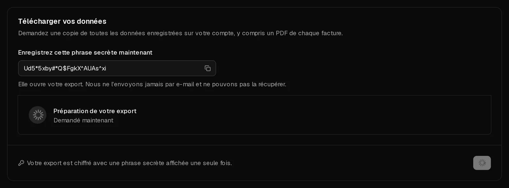

Vous pouvez télécharger à tout moment une copie de tout ce que Virtbase enregistre sur votre compte : votre profil, vos serveurs, vos commandes, vos paiements, vos dossiers d'abus et plus encore, ainsi qu'un PDF de chaque facture. L'export est un fichier PDF unique, chiffré avec une phrase secrète que vous seul voyez.

L'export contient les données de votre compte. Il ne contient pas les fichiers de vos serveurs. Pour les conserver, copiez-les depuis le serveur ou créez une [sauvegarde](/fr/help/article/how-to-backup-server).

## Demander un export

1. Ouvrez [Compte > Confidentialité](https://app.virtbase.com/account/settings/privacy).
2. Sous <Ui>Télécharger vos données</Ui>, cliquez sur <Ui>Demander un export</Ui>.
3. Sous <Ui>Confirmez votre identité</Ui>, confirmez avec votre mot de passe, une <Term id="passkey">clé d'accès</Term> ou un code envoyé par e-mail.
4. **Enregistrez cette phrase secrète maintenant.** Copiez-la dans votre gestionnaire de mots de passe. C'est elle qui ouvre votre export, et nous ne pouvons ni vous la réafficher ni vous l'envoyer.

La carte affiche <Ui>Préparation de votre export</Ui>. Lorsqu'il est prêt, vous recevez l'e-mail <Msg>Votre export de données est prêt</Msg>.

## Télécharger et ouvrir l'export

1. Ouvrez à nouveau <Ui>Compte</Ui> › <Ui>Confidentialité</Ui> et cliquez sur <Ui>Télécharger</Ui> sous <Ui>Votre export est prêt</Ui>.
2. Ouvrez le PDF dans un lecteur PDF et saisissez la phrase secrète.

Le PDF présente vos données sous une forme lisible et contient en pièces jointes l'ensemble des données sous forme de fichier JSON ainsi que vos factures. La plupart des lecteurs PDF affichent les pièces jointes dans un panneau latéral.

Le téléchargement est disponible pendant **7 jours**. Passé ce délai, la carte affiche <Ui>Votre export a expiré</Ui>, et vous pouvez en demander un nouveau.

## Limites

Vous pouvez demander un export par jour. Si vous réessayez, vous voyez <Msg>Vous avez déjà demandé un export aujourd'hui. Veuillez réessayer demain.</Msg>

## Si cela n'a pas fonctionné

- <Ui>Votre export n'a pas pu être créé</Ui> : demandez-en un nouveau le lendemain. S'il échoue à nouveau, [contactez le support](/fr/contact).
- **Vous avez perdu la phrase secrète** : l'export ne peut pas être ouvert sans elle. Demandez un nouvel export le lendemain et enregistrez la nouvelle phrase secrète.
- **Vous souhaitez demander vos données d'une autre manière,** par exemple au titre de l'article 15 du RGPD par e-mail : [contactez le support](/fr/contact) depuis l'adresse e-mail de votre compte.
